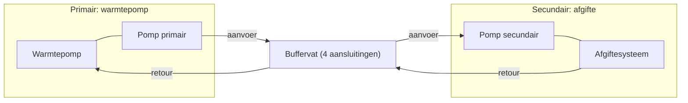
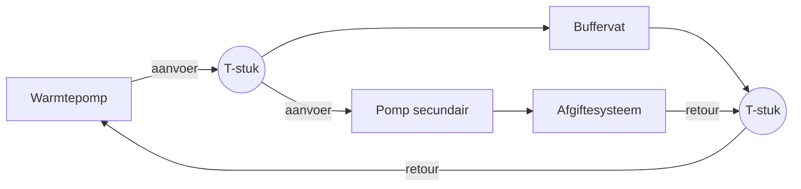

Een buffervat is een vat met cv-water tussen de warmtepomp en het afgiftesysteem.
Voor de meeste woningen is een buffervat niet nodig. Een buffervat kost geld, maakt de
installatie ingewikkelder en verlaagt vaak de COP. Deze pagina beschrijft wanneer een
buffervat wel helpt, hoe u het aansluit en waar u op moet letten.

**Zie ook:** [Hydrauliek](hydraulics.md) · [Pendelen](cycling.md) · [Ontdooien](defrost.md)

## Wanneer een buffervat helpt

Een buffervat is nuttig in deze situaties:

- **Meerdere zones die los van elkaar schakelen** (zoneregeling, elke ruimte is "master").
  Elke zone neemt warmte uit het vat. De warmtepomp ziet alleen de temperatuur van het vat.
  Bij naregeling met één hoofdruimte die altijd open staat, is geen buffervat nodig.
- **Meerdere warmtebronnen**, bijv. een houtgestookte ketel, een zonneboiler of een tweede
  warmtepomp zonder weersafhankelijke regeling. Kies dan een groot vat.
- **Te weinig systeeminhoud.** Dan volstaat een klein vat in serie in de retour.
  Zie [Aansluiten](#aansluiten).
- **Ontdooien.** Een vat in de retour levert warmte voor het ontdooien.
  Zie [Ontdooien](#ontdooien).
- **Scheiding tussen installateurs.** Panasonic noemt het vat een vaste grens tussen de
  installateur van de warmtepomp en die van het afgiftesysteem.

Geen buffervat nodig:

- Eén zone, een gesloten verdeler zonder eigen pomp, en groepen die altijd open staan.
- Vloerverwarming die altijd open staat. De vloer zelf is dan de buffer, ook voor het ontdooien.

Een buffervat lost pendelen meestal niet op. Zorg in plaats daarvan dat het afgiftesysteem
het minimale vermogen van de warmtepomp altijd kwijt kan. Zie [Stooklijn](heating-curve.md).

**Meningen verschillen.**

Bijna alle ervaren gebruikers raden een buffervat af, behalve bij zoneregeling of
meerdere bronnen. Een gebruiker met een parallel buffervat vindt dat een buffervat altijd
parallel hoort, met een tweede pomp, en dat het energie bespaart.

### Bronnen

- [ErikVers, 2023-11-29](https://gathering.tweakers.net/forum/list_message/77337252#77337252): parallel vat alleen bij zoneregeling; naregeling vs. zoneregeling
- [CurlyMo, 2021-12-15](https://gathering.tweakers.net/forum/list_message/69853920#69853920): zones nemen warmte uit het vat; warmtepomp ziet alleen het vat
- [FransvWoerkom, 2023-12-13](https://gathering.tweakers.net/forum/list_message/77497924#77497924): vat vooral voor meer zones en meer bronnen; hydraulische scheiding
- [Ep Woody, 2021-12-15](https://gathering.tweakers.net/forum/list_message/69854372#69854372): meer bronnen combineren, dan een groter vat
- [Thorsd, 2022-12-06](https://gathering.tweakers.net/forum/list_message/73706308#73706308): vat bij naregeling per ruimte en een tweede bron zonder WAR
- [FransvWoerkom, 2023-10-09](https://gathering.tweakers.net/forum/list_message/76782306#76782306): Panasonic-handleidingen: functies van een vat, grens tussen installateurs
- [FransvWoerkom, 2022-01-21](https://gathering.tweakers.net/forum/list_message/70310668#70310668): gesloten verdeler, vloer als buffer voor ontdooien
- [flippy, 2022-01-21](https://gathering.tweakers.net/forum/list_message/70310526#70310526): geen vat nodig, rechtstreeks op een gesloten verdeler
- [Thorsd, 2022-12-07](https://gathering.tweakers.net/forum/list_message/73724678#73724678): eerst zonder buffer proberen als de groepen altijd open staan
- [Andrehj, 2022-04-11](https://gathering.tweakers.net/forum/list_message/71217684#71217684): minimaal vermogen altijd kwijt kunnen in plaats van een buffer
- [reneeke1970, 2021-12-15](https://gathering.tweakers.net/forum/list_message/69854614#69854614): andere mening: altijd parallel, met tweede pomp

## Aansluiten

| Aansluiting | Hoe | Tweede pomp | Doel |
|---|---|---|---|
| In serie | Vat in de retour, één aansluiting onder en één boven | Nee | Meer systeeminhoud, ontdooien |
| Parallel, 4 aansluitingen | Warmtepomp aan één kant, afgifte aan de andere kant | Ja | Hydraulische scheiding (mengend) |
| Parallel, T-stukken | Vat met twee T-stukken tussen aanvoer en retour | Ja | Hydraulische scheiding, minder menging |

**In serie** stroomt al het water door het vat. Het vat werkt als extra systeeminhoud.
Volgens twee gebruikers verlaagt een vat in de retour de efficiëntie niet. Staat het vat binnen, dan
blijft het warmteverlies in de woning.

**Parallel** scheidt het vat de kring van de warmtepomp (primair) van de kring van het
afgiftesysteem (secundair). Elke kring heeft een eigen pomp. Een open verdeler of een
low-loss header werkt hetzelfde: het is een parallel vat met (bijna) geen inhoud.
Daarvoor zijn twee T-stukken op korte afstand genoeg.

Vat met 4 aansluitingen. Elke kring heeft een eigen pomp:

Met T-stukken haalt het afgiftesysteem het water direct uit de aanvoer van de warmtepomp.
De aanvoertemperatuur blijft daardoor beter behouden. Het nadeel: de warmtepomp kan
terugmoduleren op de retour, terwijl het afgiftesysteem veel warmte vraagt.

Aansluiting met twee T-stukken. Het afgiftesysteem trekt water uit de aanvoer:

### Bronnen

- [blb4, 2023-10-09](https://gathering.tweakers.net/forum/list_message/76786482#76786482): voor systeeminhoud beter in serie; parallel met extra pomp
- [Thorsd, 2022-12-07](https://gathering.tweakers.net/forum/list_message/73724678#73724678): alleen voor inhoud: vat in serie
- [MaartenXM, 2022-03-09](https://gathering.tweakers.net/forum/list_message/70878918#70878918): vat in de retour verlaagt de efficiëntie niet
- [Andrehj, 2022-03-09](https://gathering.tweakers.net/forum/list_message/70878950#70878950): alleen hydraulische scheiding verlaagt de efficiëntie; verlies binnen de schil
- [FransvWoerkom, 2022-12-06](https://gathering.tweakers.net/forum/list_message/73706528#73706528): hydraulische scheiding als parallel vat met nul inhoud tussen twee T-stukken
- [FransvWoerkom, 2022-04-12](https://gathering.tweakers.net/forum/list_message/71229518#71229518): ontkoppeling, ook met een stuk pijp
- [Thorsd, 2022-12-06](https://gathering.tweakers.net/forum/list_message/73704008#73704008): T-stukken vs. 4 aansluitingen; mengend vat
- [Thorsd, 2022-12-06](https://gathering.tweakers.net/forum/list_message/73706308#73706308): terugmoduleren bij T-stuk-aansluiting (grafiek)

## Grootte

Een klein vat slaat weinig warmte op. Reken met 1,16 Wh per liter per graad:

| Vat | Temperatuurdaling | Warmte | Looptijd |
|---|---|---|---|
| 50 L | 10 °C | 0,58 kWh | 7 min bij 5 kW opwekken, 17 min bij 2 kW afgifte |
| 60 L | 5 °C | 0,35 kWh | ongeveer 8 min bij 2,5 kW |

Een vat van 50 tot 100 liter verlengt een run dus met maar enkele minuten.
Pas bij ongeveer 500 liter merkt u invloed op het pendelen. Wilt u echt warmte bufferen,
dan gaat het om vaten van meer dan 1000 liter.

De minimale systeeminhoud hangt af van het **minimale** vermogen van de warmtepomp, niet van
het maximale. Gebruikers noemen 30 tot 50 liter. Haalt u dat niet, plaats dan een vat in
serie in de retour. Vergroot liever eerst de afgifte dan de inhoud.

### Bronnen

- [FransvWoerkom, 2022-04-12](https://gathering.tweakers.net/forum/list_message/71229518#71229518): 50 L, 10 °C = 0,58 kWh; pas bij 500 L invloed op pendelen
- [Ep Woody, 2021-12-15](https://gathering.tweakers.net/forum/list_message/69854372#69854372): 60 L, 5 °C = 350 Wh = 8,4 min bij 2500 W
- [FransvWoerkom, 2023-12-13](https://gathering.tweakers.net/forum/list_message/77497924#77497924): 50 L is goed voor 10 minuten warmte
- [Andrehj, 2022-04-11](https://gathering.tweakers.net/forum/list_message/71217684#71217684): echte buffer > 1000 L
- [Carboy54, 2022-12-08](https://gathering.tweakers.net/forum/list_message/73727462#73727462): minimale inhoud volgt uit minimaal vermogen, 40–50 L
- [ErikVers, 2024-12-05](https://gathering.tweakers.net/forum/list_message/80933276#80933276): 30–50 L; anders vat in serie in de retour; liever afgifte vergroten
- [FransvWoerkom, 2022-06-06](https://gathering.tweakers.net/forum/list_message/71747980#71747980): 50 L systeeminhoud, ook met open radiatoren of een klein vat in de retour

## Nadelen

- **Hogere aanvoertemperatuur, lagere COP.** Bij een parallel vat moet de warmtepomp
  warmer water maken dan het afgiftesysteem nodig heeft. De COP hangt vooral af van de
  aanvoertemperatuur van de warmtepomp. Bij een parallel vat schatten gebruikers ongeveer 5 °C
  overtemperatuur.
- **Menging.** In een vat met 4 aansluitingen mengt warm en koud water. De afgifte krijgt
  dan water dat kouder is dan de aanvoer van de warmtepomp.
- **Verhouding tussen de flows.** De flow in de primaire en secundaire kring bepaalt hoe het
  water door het vat stroomt:

    | Situatie | Gevolg |
    |---|---|
    | Secundaire flow > primaire flow | Retourwater stroomt van onder naar boven door het vat en mengt met de aanvoer. De afgifte krijgt koudere aanvoer. De warmtepomp moet warmer stoken. Slechtste geval. |
    | Primaire flow > secundaire flow | Warm water stroomt terug naar de warmtepomp. De retour wordt warm en de warmtepomp slaat af, terwijl de afgifte koud blijft. |
    | Gelijke flow | Optimale temperaturen, maar dan stroomt er niets door het vat. |

    Zorg dat de primaire flow altijd iets hoger is dan de secundaire flow.
- **Extra pomp en kosten.** Een parallel vat vraagt een tweede pomp met sturing. Een vat met
  leidingen, pomp en installatie kost ongeveer € 1000. Een secundaire pomp gebruikt ongeveer
  15 W bij 20 l/min.
- **Warmteverlies** van het vat zelf, als het buiten de geïsoleerde schil staat.
- **Lucht.** Lucht verzamelt zich bovenin het vat. Plaats een automatische ontluchter op het
  hoogste punt. Bij een liggend vat moet u daar extra op letten.

### Bronnen

- [Thorsd, 2022-12-06](https://gathering.tweakers.net/forum/list_message/73704008#73704008): COP volgt de aanvoertemperatuur; secundaire flow niet hoger dan primaire
- [Thorsd, 2023-10-09](https://gathering.tweakers.net/forum/list_message/76787504#76787504): drie flowsituaties A, B, C
- [FransvWoerkom, 2023-11-26](https://gathering.tweakers.net/forum/list_message/77304244#77304244): secundaire flow > primaire: stroming van onder naar boven
- [FransvWoerkom, 2022-12-06](https://gathering.tweakers.net/forum/list_message/73702080#73702080): primaire flow groter dan secundaire: gelijke aanvoertemperatuur voor en na het vat
- [Thorsd, 2022-12-06](https://gathering.tweakers.net/forum/list_message/73706308#73706308): secundaire flow hoger trekt het vat leeg; pomp 15 W bij 20 l/min
- [djoenez, 2022-02-02](https://gathering.tweakers.net/forum/list_message/70454366#70454366): warmtepomp pompt 2× zo snel; kortsluiting over het vat, warme retour
- [FransvWoerkom, 2023-03-10](https://gathering.tweakers.net/forum/list_message/74713018#74713018): aanvoer warmtepomp hoger dan nodig, lagere COP
- [FransvWoerkom, 2021-10-08](https://gathering.tweakers.net/forum/list_message/68985800#68985800): hogere aanvoer ook zonder warmtevraag
- [FransvWoerkom, 2022-09-18](https://gathering.tweakers.net/forum/list_message/72821906#72821906): € 1000 investering; 5° overtemperatuur
- [FransvWoerkom, 2023-10-09](https://gathering.tweakers.net/forum/list_message/76782306#76782306): Engelse studie: vat en secundaire pomp verlagen de COP
- [Aurelium, 2023-10-09](https://gathering.tweakers.net/forum/list_message/76785756#76785756): warmteverlies hangt af van de plaats van het vat
- [FransvWoerkom, 2025-12-14](https://gathering.tweakers.net/forum/list_message/84183968#84183968): automatische ontluchter op het vat
- [PASware, 2024-01-13](https://gathering.tweakers.net/forum/list_message/77793918#77793918): liggend vat: rekening houden met lucht

## Ontdooien

Zie ook [Ontdooien](defrost.md).

Bij het ontdooien draait de warmtepomp om. Hij haalt warmte uit het cv-water om de
verdamper te ontdooien. Een vat in serie in de retour geeft extra warm water. De warmtepomp
kan dan langer ontdooien zonder de elektrische backup heater. Een vloer die altijd open staat,
werkt ook als buffer.

Een bypass tussen aanvoer en vat, die opent bij hoge flow, houdt het vat in de kring tijdens
het ontdooien. De energie komt dan vooral uit het vat.

Een vat voorkomt niet dat er kort koud water in de aanvoer komt. Het afgekoelde retourwater
gaat bij het ontdooien de aanvoer in. Leidingen en koppelingen kunnen daar tegen.

Een parallel vat met een secundaire pomp kan tijdens het ontdooien een storing geven.
Zie [Panasonic: storingen, `H65`](../panasonic/troubleshooting.md#ontdooien-h65-h75).

### Bronnen

- [FransvWoerkom, 2023-12-13](https://gathering.tweakers.net/forum/list_message/77497924#77497924): vat in de retour helpt bij ontdooien, voorkomt backup heater
- [FransvWoerkom, 2023-03-10](https://gathering.tweakers.net/forum/list_message/74713018#74713018): vat in serie met de retour voor langer ontdooien
- [blb4, 2023-01-28](https://gathering.tweakers.net/forum/list_message/74290750#74290750): 50 L in de retour met bypass; energie komt uit het vat (schema)
- [FransvWoerkom, 2022-01-21](https://gathering.tweakers.net/forum/list_message/70310668#70310668): vloer als buffer voor ontdooien
- [FransvWoerkom, 2022-11-13](https://gathering.tweakers.net/forum/list_message/73448620#73448620): koud retourwater in de aanvoer; vat helpt niet; koppelingen kunnen het hebben
