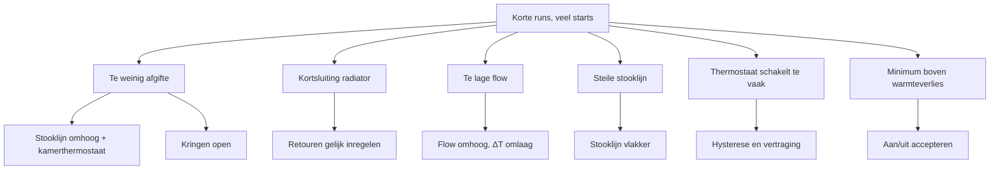

Pendelen betekent: de compressor maakt veel korte runs met korte pauzes. De warmtepomp
start, bereikt snel zijn doeltemperatuur, stopt en start kort daarna weer. Dit gebeurt
vooral in het voor- en naseizoen, als het huis weinig warmte nodig heeft.

Voor de stop- en startregels per merk, zie [Panasonic: instellingen](../panasonic/settings.md).
Voor het instellen van een stooklijn, zie [Stooklijn](heating-curve.md).

**Zie ook:** [Stooklijn](heating-curve.md) · [Hydrauliek](hydraulics.md) · [Buffervat](buffer-tank.md) · [Ontdooien](defrost.md) · [Vermogen kiezen](sizing.md)

## Waarom pendelen nadelig is

- **Slijtage.** Elke start belast de compressor. Hoeveel dat de levensduur kost, is niet
  zeker (zie hieronder).
- **Verbruik.** Een start kost energie. Lange runs op laag vermogen zijn zuiniger dan veel
  korte runs.
- **Comfort.** Bij vloerverwarming voelt u op sokken wanneer de warmtepomp draait en
  wanneer niet. Lange runs geven een gelijkmatig warme vloer.

De COP hangt vooral af van de buitentemperatuur en de aanvoertemperatuur, niet van het
vermogen. Een zachte start of een iets langere run verandert de COP van een run weinig.

**Meningen verschillen.**

- **Pendelen is weinig erg.** Een compressor kan volgens een gebruiker minstens
  150.000 starts aan. Met 24 starts per dag gaat hij dan nog 15 jaar mee. Een periode
  van pendelen maakt op de hele levensduur weinig uit.
- **Die rekensom is te optimistisch.** Niemand pendelt 24 uur per dag, het hele jaar.
- **Zoek een balans.** Wie alleen op minder starts stuurt, verliest misschien
  efficiëntie of comfort. Een compressor die 16 in plaats van 15 jaar meegaat, maar al
  die jaren slecht draait, is geen winst.

### Bronnen

- [sjimmie, 2023-01-17](https://gathering.tweakers.net/forum/list_message/74159452#74159452): 150.000 starts; 24 starts per dag ≈ 15 jaar
- [sjimmie, 2023-01-17](https://gathering.tweakers.net/forum/list_message/74160304#74160304): maximaal pendelen het hele jaar is niet realistisch
- [Tiesert, 2023-10-21](https://gathering.tweakers.net/forum/list_message/76911662#76911662): pendelen maakt op de levensduur weinig uit
- [Pejdref, 2024-02-13](https://gathering.tweakers.net/forum/list_message/78130264#78130264): balans tussen starts, efficiëntie en comfort
- [Ep Woody, 2022-09-26](https://gathering.tweakers.net/forum/list_message/72914242#72914242): een start kost stroom; liever lange runs
- [dof, 2023-11-04](https://gathering.tweakers.net/forum/list_message/77069222#77069222): aanslaan kost iets meer energie
- [Separator, 2023-11-01](https://gathering.tweakers.net/forum/list_message/77029516#77029516): runs voelbaar op de vloer
- [FransvWoerkom, 2022-12-26](https://gathering.tweakers.net/forum/list_message/73928524#73928524): COP hangt af van buitentemperatuur en aanvoertemperatuur
- [Thorsd, 2024-03-24](https://gathering.tweakers.net/forum/list_message/78536678#78536678): zachte start verandert de COP weinig

## Pendelen meten

1. **Starts en draaiuren.** De bediening of de cloud van de warmtepomp telt de starts en de
   draaiuren van de compressor. Deel de starts door de uren.
2. **Runlengte.** Kijk in een grafiek van compressorfrequentie of vermogen hoe lang een run
   duurt en hoe lang de pauze erna is.
3. **Ontdooien telt mee.** Elke ontdooicyclus kan een extra start geven. Trek die af
   voordat u conclusies trekt.

Richtwaarden uit de praktijk:

| Waarneming | Oordeel |
|---|---|
| Ongeveer 1 start per 3 draaiuren (met kamerthermostaat) | rustig |
| 2900 starts op 6300 draaiuren, deels door ontdooien | rustig |
| Run om de 1,5 uur | nauwelijks pendelen |
| 2380 starts op 917 draaiuren (ruim 10 per dag) | hoog |
| Runs van 30 tot 45 minuten of korter | pendelen |
| Meer dan 3 starts per uur | volgens de branche te veel |

### Bronnen

- [wheli, 2023-11-08](https://gathering.tweakers.net/forum/list_message/77108384#77108384): starts per draaiuur uit bediening of cloud; branche hanteert 3 per uur
- [Krilo_89, 2023-04-21](https://gathering.tweakers.net/forum/list_message/75126424#75126424): met thermostaat ongeveer 1 start per 3 uur
- [Binifada, 2024-12-16](https://gathering.tweakers.net/forum/list_message/81044522#81044522): 2900 starts op 6300 uur; minstens 10 % door ontdooien
- [dirkdeman, 2021-11-23](https://gathering.tweakers.net/forum/list_message/69550788#69550788): 2380 starts op 236 dagen is pendelen
- [Ep Woody, 2021-11-23](https://gathering.tweakers.net/forum/list_message/69550958#69550958): relatief hoog, maar niet buitensporig
- [dof, 2023-10-23](https://gathering.tweakers.net/forum/list_message/76930650#76930650): om de 1,5 uur is niet echt pendelen
- [ErikVers, 2023-11-01](https://gathering.tweakers.net/forum/list_message/77029654#77029654): pendelen pas bij runs binnen 30–45 minuten

## Oorzaken

- **Minimaal vermogen hoger dan het warmteverlies.** Dit is de hoofdoorzaak. Elke
  warmtepomp heeft een minimaal vermogen. Is het warmteverlies van het huis kleiner, dan
  kan hij alleen nog aan en uit gaan. Dit gebeurt in het voor- en naseizoen altijd, hoe
  laag het minimum ook is. Het minimale vermogen hangt ook af van de buitentemperatuur. Voorbeeld: bij ongeveer 12 °C buiten en 30 °C
  aanvoer ligt het minimum boven 3 kW (COP ongeveer 6,25). Een ander voorbeeld uit een
  grafiek: bij 9 tot 14 °C buiten neemt het minimum ongeveer 400 W op en levert het
  ongeveer 2,8 kW warmte.
- **Te weinig afgifte.** Het afgiftesysteem kan het minimale vermogen niet kwijt. Het water
  wordt dan snel warm en de warmtepomp stopt. Oorzaken: dichte groepen, thermostaatkranen
  of zonekleppen die dichtgaan, of een te lage aanvoertemperatuur.
- **Kortsluiting in het afgiftesysteem.** Eén radiator met veel flow werkt als bypass.
  Het retourwater komt dan te warm terug en de warmtepomp stopt.
- **Te lage flow of een trage pomp bij de start.** Het water warmt dan in de warmtepomp
  snel op en schiet voorbij de doeltemperatuur. Wie zowel een vaste flow als een vaste ΔT
  instelt, legt ook het vermogen vast (vermogen ≈ 70 × ΔT × flow). Past dat vermogen niet
  bij de vraag, dan pendelt de warmtepomp of blijft het huis koud.
- **Kleine systeeminhoud.** Weinig water in het systeem geeft weinig buffer. De
  watertemperatuur loopt dan snel op en zakt snel weer.
- **Steile stooklijn.** Bij elke graad stijging van de buitentemperatuur daalt de
  doeltemperatuur sterk. Is het water dan al warmer dan het nieuwe doel, dan stopt de
  warmtepomp.
- **Een thermostaat die te vaak schakelt.** Sommige zone- en kamerthermostaten schakelen
  minstens één keer per uur. Een thermostaat met een slechte hysterese laat de kamer ver
  afkoelen. Daarna moet de warmtepomp hard werken en volgt pendelen.

Snelle test voor een kortsluiting: sluit de aftakking naar de radiatoren direct nadat de
compressor stopt. Duurt de pauze dan veel langer, dan zijn de radiatoren de oorzaak.

### Bronnen

- [Pejdref, 2024-02-13](https://gathering.tweakers.net/forum/list_message/78130264#78130264): pendelen niet te voorkomen bij verlies onder het minimale vermogen
- [blb4, 2025-12-23](https://gathering.tweakers.net/forum/list_message/84242874#84242874): voor- en naseizoen altijd minimum boven warmteverlies
- [FransvWoerkom, 2025-06-11](https://gathering.tweakers.net/forum/list_message/82661470#82661470): minimale vermogen hangt af van buitentemperatuur; systeemvolume
- [FransvWoerkom, 2021-08-16](https://gathering.tweakers.net/forum/list_message/68401774#68401774): pendelen als thermostaatkranen dichtgaan
- [ConQuestador, 2023-12-12](https://gathering.tweakers.net/forum/list_message/77479698#77479698): radiator als bypass; warmte niet snel genoeg kwijt
- [John lamers, 2023-11-05](https://gathering.tweakers.net/forum/list_message/77069380#77069380): test met afsluiter radiatoraftakking
- [Thorsd, 2022-11-17](https://gathering.tweakers.net/forum/list_message/73497954#73497954): te lage flow, warmte niet kwijt
- [ercolano, 2024-03-02](https://gathering.tweakers.net/forum/list_message/78318160#78318160): trage pomp bij start; steile stooklijn
- [FransvWoerkom, 2022-12-05](https://gathering.tweakers.net/forum/list_message/73697772#73697772): vaste ΔT én vaste flow geeft pendelen
- [ErikVers, 2022-11-28](https://gathering.tweakers.net/forum/list_message/73618890#73618890): minimale afgifte en systeeminhoud nodig
- [Thorsd, 2024-12-03](https://gathering.tweakers.net/forum/list_message/80919534#80919534): zonethermostaat schakelt minstens 1× per uur
- [Tiesert, 2022-11-30](https://gathering.tweakers.net/forum/list_message/73645758#73645758): slechte hysterese, kamer koelt te ver af

## Oplossingen en afwegingen

- **Eerst de afgifte kennen.** Zet de warmtepomp een dag of langer op een vaste
  aanvoertemperatuur en kom er niet aan. Pendelt hij ook bij een hogere aanvoertemperatuur,
  dan is de afgifte te klein.
- **Stooklijn omhoog of vlakker, met een kamerthermostaat.** Een hogere aanvoertemperatuur
  geeft meer afgifte en langere runs. De kamerthermostaat stopt de warmtepomp als het huis
  warm genoeg is. De pauze komt dan door de thermostaat, niet door het water. De COP daalt
  iets, maar bij milde temperaturen is het verbruik toch laag. Zie
  [Stooklijn: bijstellen](heating-curve.md#bijstellen) voor de "\_"-vorm.
- **Kringen open.** Laat zo veel mogelijk groepen en radiatoren open. Regel de
  retourtemperaturen van vloer en radiatoren ongeveer gelijk. Knijp de radiator die te warm
  terugkomt.
- **Flow omhoog, ΔT omlaag.** Een hogere flow geeft een kleinere ΔT en een hogere
  gemiddelde watertemperatuur. De afgifte stijgt bij dezelfde aanvoertemperatuur. Een
  lagere flow geeft juist minder afgifte. Laat de warmtepomp vrij in flow of in ΔT; leg
  niet allebei vast.
- **Thermostaat met hysterese en vertraging.** Een kleine hysterese geeft comfort. Een
  schakelvertraging voorkomt dat een stuiterende thermostaat de warmtepomp elke minuut
  schakelt. Bij een trage betonvloer en genoeg afgifte werkt zelfs een zeer kleine
  hysterese goed. Een voorbeeld uit een grafiek: hysterese 0,01 °C, aanvoer 25 °C, retour ongeveer
  21,75 °C en 0 tot 4 °C buiten geven één run per 24 uur. Een thermostaat die te vaak schakelt, kunt u een afvalvertraging geven.
- **Draaien in blokken.** Stook in de warmste uren van de dag of gebruik een kleine
  nachtverlaging. De run in de ochtend wordt dan langer. Is de warmtevraag erg klein, dan
  blijft de warmtepomp daarna toch pendelen.
- **Aan/uit accepteren.** Ligt het minimale vermogen boven de warmtevraag, dan moduleert de
  warmtepomp in tijd, net als een cv-ketel. Een thermostaat die af en toe uitschakelt, is
  dan de normale regeling.
- **Buffervat.** Een klein buffervat helpt weinig. 50 liter met 10 °C verschil bevat
  ongeveer 0,58 kWh; een warmtepomp van 5 kW vult dat in 7 minuten. Pas bij veel grotere
  vaten merkt u effect. Zie [Buffervat](buffer-tank.md).

**Meningen verschillen.**

- **Hogere stooklijn plus thermostaat.** Liever een iets hogere aanvoertemperatuur en
  lange runs die een thermostaat begrenst, dan veel korte runs.
- **Niet lager dan de afgifte toelaat.** Stel de stooklijn niet lager in dan nodig om
  het minimale vermogen kwijt te raken. Dan pendelt er niets en is de COP maximaal.
  Wordt het te warm, gebruik dan bloktijden of een thermostaat; zet de flow niet lager.

### Bronnen

- [dof, 2023-11-04](https://gathering.tweakers.net/forum/list_message/77069222#77069222): test met vaste aanvoertemperatuur; minimum ongeveer 400 W verbruik (grafiek)
- [Thorsd, 2024-03-24](https://gathering.tweakers.net/forum/list_message/78536678#78536678): aanvoertemperatuur omhoog, externe thermostaat; minimum boven 3 kW bij 12 °C buiten (grafiek)
- [ErikVers, 2023-11-01](https://gathering.tweakers.net/forum/list_message/77029654#77029654): stilstand alleen door de thermostaat
- [Thorsd, 2023-10-24](https://gathering.tweakers.net/forum/list_message/76944950#76944950): COP iets lager, effect op het jaar klein
- [Ep Woody, 2022-09-26](https://gathering.tweakers.net/forum/list_message/72914242#72914242): hogere aanvoertemperatuur en lange runs met thermostaat
- [ErikVers, 2025-12-23](https://gathering.tweakers.net/forum/list_message/84243866#84243866): stooklijn niet onder de afgifte; bloktijden of thermostaat
- [Appelpie3000, 2023-11-05](https://gathering.tweakers.net/forum/list_message/77073000#77073000): retourtemperaturen gelijk inregelen
- [Thorsd, 2023-11-04](https://gathering.tweakers.net/forum/list_message/77067650#77067650): hogere pompsnelheid, lagere ΔT, meer afgifte
- [dunklefaser, 2023-11-05](https://gathering.tweakers.net/forum/list_message/77070488#77070488): debiet verhogen voor meer afgifte
- [FransvWoerkom, 2022-12-05](https://gathering.tweakers.net/forum/list_message/73697772#73697772): flow vrij of ΔT vrij
- [sjimmie, 2021-09-15](https://gathering.tweakers.net/forum/list_message/68733440#68733440): hysterese en schakelvertraging
- [padoempats, 2023-05-09](https://gathering.tweakers.net/forum/list_message/75288852#75288852): zeer kleine hysterese met betonvloer; één run per 24 uur (grafiek)
- [Thorsd, 2024-12-03](https://gathering.tweakers.net/forum/list_message/80919534#80919534): afvalvertraging op de thermostaat
- [Daffy1982, 2023-12-15](https://gathering.tweakers.net/forum/list_message/77514278#77514278): nachtverlaging voor betere afgifte overdag
- [RaymondD, 2023-12-19](https://gathering.tweakers.net/forum/list_message/77553352#77553352): na de ochtendrun blijft hij pendelen
- [FransvWoerkom, 2022-12-26](https://gathering.tweakers.net/forum/list_message/73928524#73928524): pendelen is pulsduurmodulatie
- [blb4, 2025-12-23](https://gathering.tweakers.net/forum/list_message/84242874#84242874): ramen open of af en toe uitschakelen
- [FransvWoerkom, 2022-04-12](https://gathering.tweakers.net/forum/list_message/71229518#71229518): rekenvoorbeeld buffervat 50 liter
