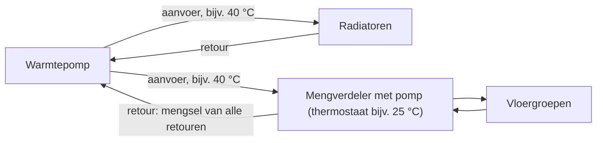
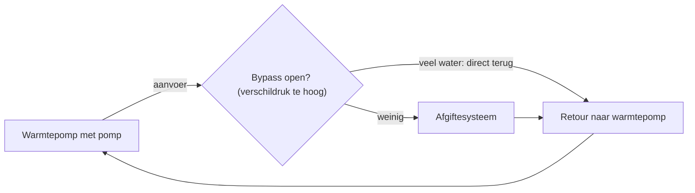

Hydrauliek gaat over het water tussen de warmtepomp en het afgiftesysteem: hoeveel water
stroomt er, hoe warm gaat het heen en terug, en waar loopt het langs. Een warmtepomp werkt
het best als het water vrij kan stromen en de warmte zonder omwegen in het huis komt.

Voor de aanvoertemperatuur zelf, zie [Stooklijn](heating-curve.md). Voor flowstoringen
(`H62`, `H20`) bij Panasonic, zie [Storingen en foutcodes](../panasonic/troubleshooting.md).

**Zie ook:** [Buffervat](buffer-tank.md) · [Pendelen](cycling.md) · [Ontdooien](defrost.md) · [Koelen: leidingen isoleren](cooling.md#leidingen-isoleren) · [Vermogen kiezen](sizing.md)

## Flow, ΔT en vermogen

Het vermogen dat het water meeneemt, volgt uit de flow en het verschil tussen aanvoer en
retour (ΔT):

> vermogen (W) = flow (l/min) × ΔT × 69,7

Het getal 69,7 komt van de soortelijke warmte van water (4184 J/kg·K) en de omrekening van
liters per minuut naar m³ per seconde. Voorbeeld: 10 l/min met ΔT 5 is ongeveer 3,5 kW.
Hoe u dit in de praktijk meet en hoe nauwkeurig dat is, staat bij
[Stooklijn: controleren in de praktijk](heating-curve.md#controleren-in-de-praktijk).

Bij hetzelfde vermogen geeft meer flow een kleinere ΔT. Een radiator of vloer geeft warmte af
op de gemiddelde watertemperatuur. Met een kleine ΔT is het gemiddelde hoger bij dezelfde
aanvoertemperatuur. Daardoor kan de aanvoertemperatuur omlaag, en dat verhoogt de COP.
Voorbeeld: 25 °C aanvoer met ΔT 4 bij 5 l/min geeft evenveel warmte als 24 °C aanvoer met
ΔT 2 bij 10 l/min. Een meting op een vloer laat hetzelfde zien: bij 2,6 kW en een gelijke
aanvoertemperatuur gaat de ΔT van 5 naar 3 °C als de flow stijgt van 9,4 naar 15,5 l/min.

Meer flow kost wel pompvermogen. Zo vindt u het optimum voor uw systeem:

1. Meet het opgenomen vermogen van de circulatiepomp bij een paar pompstanden (kWh-meter).
2. Noteer per stand de flow.
3. Reken per stand de ΔT uit bij het vermogen van de warmtepomp, en hoeveel warmer de aanvoer
   moet zijn dan bij de hoogste flow.
4. Tel het extra compressorvermogen voor die hogere aanvoer op bij het pompvermogen.
   De stand met het laagste totaal is het optimum.

Het optimum verschuift met de belasting: bij laag vermogen ligt het bij een lagere flow dan
bij vol vermogen.

**Meningen verschillen.**

- **Kleine ΔT, hoge flow.** De winst van een lagere aanvoertemperatuur is groter dan de
  extra stroom voor de pomp. Zet de pomp hoger zolang de leidingen niet ruisen.
- **Grotere ΔT.** Een kleine ΔT vraagt veel van de pomp, en de warmtepomp krijgt warm water
  terug. Een ΔT van ongeveer 20 % van de aanvoertemperatuur is een oude vuistregel;
  dat is ongeveer 6 °C bij vloerverwarming en 7 °C bij radiatoren.

### Bronnen

- [FransvWoerkom, 2022-12-06](https://gathering.tweakers.net/forum/list_message/73702080#73702080): formule vermogen = flow × ΔT × 69,73
- [twain4me, 2023-03-13](https://gathering.tweakers.net/forum/list_message/74751460#74751460): topicstart, *Optimale pompsnelheid*: gemiddelde watertemperatuur, methode, optimum per belasting
- [John lamers, 2023-02-22](https://gathering.tweakers.net/forum/list_message/74550264#74550264): meer flow, kleinere ΔT bij gelijk vermogen (grafiek)
- [Noutie, 2023-11-18](https://gathering.tweakers.net/forum/list_message/77219110#77219110): kleine ΔT, lagere aanvoer, winst groter dan pompstroom
- [BarryH, 2023-11-19](https://gathering.tweakers.net/forum/list_message/77222670#77222670): kleine ΔT geeft hogere gemiddelde temperatuur en betere COP
- [ErikVers, 2023-11-18](https://gathering.tweakers.net/forum/list_message/77216006#77216006): ΔT 20 % van de aanvoer; 6 °C vloer, 7 °C radiatoren

## Leidingen tussen warmtepomp en huis

Een warmtepomp pompt veel meer water rond dan een cv-ketel, vooral tijdens ontdooien en
warmwaterbereiding. Kies de leidingen daarop.

| Leiding | Binnendiameter |
|---|---|
| Meerlagenbuis 32 × 3 mm | 26 mm |
| Dunwandig staal 28 × 1,2 mm | 25,6 mm |
| Hep2O 28 mm | 22–23 mm |

- **32 mm meerlagenbuis en 28 mm staal zijn praktisch gelijk.** 25/26 × 3 mm en 32 × 3 mm
  meerlagenbuis zijn de meest gebruikte maten.
- **Vuistregel snelheid:** maximaal 1 m/s binnen in huis, onder meer voor geluid.
  Bij 28 mm staal is dat ongeveer 30 l/min.
- **Let op 5/4" en DN32.** 5/4" (1¼") is een draadmaat. DN32 betekent 32 mm *binnen*diameter.
  Dat is geen 32 mm meerlagenbuis.
- **Koppelingen.** Klemkoppelingen van meerlagenbuis kunnen inwendig veel nauwer zijn dan de
  buis. Staal heeft die vernauwing niet. Persbochten hebben minder weerstand dan knieën.
  Kunststof is gladder dan staal.
- **Kleppen met een kleinere doorlaat** zijn zelden een probleem. Een korte vernauwing kost
  ongeveer zoveel als een bocht of een meter leiding. Een klep met Kv 16 m³/h geeft ongeveer
  0,1 bar drukval bij 27 l/min.
- **Hep2O** past op de buitendiameter van oude stalen leidingen (22, 28 mm) en de koppelingen
  kunnen weer los. Groter dan 28 mm bestaat niet.
- **Losneembaar.** Zet wartels of flenskoppelingen bij de warmtepomp, pomp en boiler.
- **RVS-flexslang** bij de warmtepomp vermindert trillingen via de leidingen.
- 32 mm meerlagenbuis op rol is stug en moeilijk alleen te verwerken.

**Meningen verschillen.**

- **Zo dik mogelijk.** Neem altijd de grootste maat als u leidingen aanlegt.
- **Niet overdrijven.** Ook met 28 mm naar de verdelers en 22 mm naar de zolder haalt een
  12 kW-warmtepomp 35 l/min. Een compromis is 26 mm meerlagenbuis met zoveel mogelijk
  zelfgebogen bochten.

### Bronnen

- [twain4me, 2023-03-13](https://gathering.tweakers.net/forum/list_message/74751460#74751460): topicstart, *Leidingen* en *Koppelingen*: maten, Hep2O, wartels, RVS-flex
- [Bra-Jo, 2022-09-07](https://gathering.tweakers.net/forum/list_message/72682748#72682748): binnendiameters 28 mm staal en 32 mm meerlagenbuis
- [Fr33z, 2022-09-07](https://gathering.tweakers.net/forum/list_message/72684004#72684004): vuistregel 1 m/s, 30 l/min bij 28 mm
- [FransvWoerkom, 2022-09-07](https://gathering.tweakers.net/forum/list_message/72684380#72684380): weerstand staal vs. kunststof verwaarloosbaar
- [Carboy54, 2022-09-08](https://gathering.tweakers.net/forum/list_message/72704472#72704472): klemkoppelingen inwendig nauwer; 32 mm op rol
- [Diedo70, 2022-11-09](https://gathering.tweakers.net/forum/list_message/73403836#73403836): Hep2O 28 mm, binnendiameter 22–23 mm
- [The Lord, 2021-03-02](https://gathering.tweakers.net/forum/list_message/66364228#66364228): 5/4" en DN32
- [Thorsd, 2023-08-25](https://gathering.tweakers.net/forum/list_message/76320902#76320902): geen vernauwing bij staal; persbochten; hoge flow bij ontdooien en SWW
- [FransvWoerkom, 2023-08-25](https://gathering.tweakers.net/forum/list_message/76322740#76322740): 35 l/min met 28/22 mm; verhalen overdreven; 26 mm als compromis
- [ConQuestador, 2023-08-25](https://gathering.tweakers.net/forum/list_message/76320600#76320600): altijd de grootste maat
- [FransvWoerkom, 2022-02-09](https://gathering.tweakers.net/forum/list_message/70532554#70532554): korte vernauwing ≈ bocht of meter leiding
- [FransvWoerkom, 2023-10-23](https://gathering.tweakers.net/forum/list_message/76937130#76937130): Kv 16 geeft 0,1 bar bij 27 l/min

## Verdelers en mengverdelers

De namen zijn verwarrend. Op het forum betekent *open verdeler* meestal een
vloerverwarmingsverdeler **met** pomp en menging. Een *gesloten verdeler* heeft **geen** pomp;
de circulatiepomp van de warmtepomp duwt het water direct door de groepen. Soms bedoelt
iemand met *open verdeler* een hydraulische scheiding (zoals een buffervat). Vraag na wat
er bedoeld is.

- **Gesloten verdeler (zonder pomp) is de voorkeur.** Er wordt geen koud retourwater
  bijgemengd, dus de vloer geeft meer af bij dezelfde aanvoertemperatuur. De tweede pomp
  kost geen stroom meer. Ombouwen: verwijder de pomp, de thermostaatkop en het voetventiel,
  en zet de bypass van de verdeler volledig dicht.
- **Mengverdeler met pomp** mengt retourwater bij. De retour naar de warmtepomp is dan
  een mengsel van alle retouren en blijft laag. Dit werkt naast radiatoren die warmer water
  nodig hebben: zet de aanvoer hoger (bijv. 40 °C) en de thermostaat van de verdeler lager
  (bijv. 25 °C). Nadeel: u moet de thermostaat van de verdeler met de hand bijstellen.
- **Twee zones.** Een gemotoriseerde driewegmengklep met pomp, gestuurd door de warmtepomp,
  geeft de vloer een eigen stooklijn. De radiatoren krijgen de hogere temperatuur.
  Zonder warmtevraag van de radiatoren zakt de aanvoer naar vloerniveau.
- **Hydraulische scheiding** (buffervat of klassieke open verdeler) maakt flow en ΔT van de
  warmtepomp los van het afgiftesysteem. Bij hoge flow mengt daar warm water bij de retour.
  Zie [Buffervat](buffer-tank.md).
- Vloerverwarming hoeft normaal niet warmer dan 28 °C *vloer*temperatuur. Het water mag iets
  warmer zijn.
- Een RTL-ventiel meet de watertemperatuur (meestal retour, ongeveer 30 °C), niet de
  ruimtetemperatuur. Het werkt goed met een warmtepomp als de flow door de vloer voldoende is.

Waterpad bij een mengverdeler naast radiatoren (voorbeeld uit de tekst hierboven):

### Bronnen

- [flippy, 2022-03-09](https://gathering.tweakers.net/forum/list_message/70878802#70878802): open = met pomp, gesloten = zonder pomp; liever pomp eruit dan buffervat
- [ErikVers, 2022-04-02](https://gathering.tweakers.net/forum/list_message/71129138#71129138): gesloten verdeler; verwarrende naam; 28 °C vloertemperatuur
- [ErikVers, 2023-10-24](https://gathering.tweakers.net/forum/list_message/76946696#76946696): zonder bijmengen meer afgifte en beter rendement
- [thehog, 2021-10-11](https://gathering.tweakers.net/forum/list_message/69012044#69012044): verdeler ombouwen naar gesloten verdeler
- [flippy, 2022-02-09](https://gathering.tweakers.net/forum/list_message/70536038#70536038): bypass dicht, thermostaat en voetventiel weg
- [FransvWoerkom, 2021-12-24](https://gathering.tweakers.net/forum/list_message/69974116#69974116): hydraulische scheiding; retour bij verdeler met pomp
- [FransvWoerkom, 2025-10-01](https://gathering.tweakers.net/forum/list_message/83572898#83572898): mengverdeler naast radiatoren, 40 °C en 25 °C; daarna mengklep
- [FransvWoerkom, 2021-10-11](https://gathering.tweakers.net/forum/list_message/69021840#69021840): mengklep met pomp als tweede zone
- [thehog, 2023-01-30](https://gathering.tweakers.net/forum/list_message/74309528#74309528): RTL-ventiel

## Thermostaatkranen, zoneregeling en inregelen

Een warmtepomp wil lang en rustig draaien. Elke kraan die dichtgaat, verkleint de flow en de
afgifte. Het simpelste systeem heeft daarom geen regeling per kamer: alle groepen open en de
temperatuur geregeld met de aanvoertemperatuur.

- **Laat minstens één groep altijd volledig open**, zowel bij de radiatoren als bij de vloer.
  Dit is de hoofdruimte (meestal de woonkamer) met de kamerthermostaat.
- **Knijpen in plaats van regelen.** Is een kamer te warm? Knijp de flow naar die kamer iets.
  Dat heet ook naregeling (master/slave): de hoofdruimte stuurt, de rest volgt.
- **Echte zoneregeling** (master/master, elke kamer los open en dicht) vraagt een parallel
  buffervat met een extra pomp. Dat kost veel en is meestal niet nodig.
- Thermostaatkranen of naregeling per kamer zonder buffervat: de pomp moet zijn flow altijd
  kwijt kunnen.

**Waterzijdig inregelen** verdeelt de flow zo dat elke groep of radiator de warmte krijgt die
hij nodig heeft. Zonder inregelen gaat het meeste water door de kortste weg. Die radiator wordt
heet, de rest blijft lauw, en u zet de aanvoer hoger dan nodig.

1. Zorg eerst dat alle radiatoren en groepen goed warm worden.
2. Zet de groep met de grootste warmtevraag helemaal open.
3. Knijp groepen en radiatoren die te warm worden, tot elke ruimte de gewenste temperatuur
   heeft.
4. Een andere methode: stel elke groep in op ongeveer dezelfde ΔT (bijv. 4 °C) tussen aanvoer
   en retour, gemeten met een (goedkope) warmtebeeldcamera.
5. Bij meerdere verdelers: regel ook de verdelers onderling in. Op een gesloten verdeler doet
   u dit met de flowmeters.

Hoe beter ingeregeld, hoe lager de aanvoertemperatuur kan. Met veel groepen van gelijke lengte
is het effect klein. Zon op een deel van de vloer verandert de balans weer.

**Teveel geknepen.**

Groepen die te ver zijn dichtgedraaid tijdens het inregelen, kunnen een flowstoring geven.

### Bronnen

- [FransvWoerkom, 2022-08-04](https://gathering.tweakers.net/forum/list_message/72333660#72333660): minstens één groep open; regelen met aanvoertemperatuur
- [ErikVers, 2022-08-02](https://gathering.tweakers.net/forum/list_message/72319820#72319820): te warme ruimte knijpen; los per ruimte vraagt groot buffervat
- [ErikVers, 2023-11-29](https://gathering.tweakers.net/forum/list_message/77337252#77337252): naregeling (master/slave) vs. zoneregeling (master/master)
- [lampy25, 2021-06-21](https://gathering.tweakers.net/forum/list_message/67782672#67782672): geen thermostaatkranen per kamer zonder buffervat
- [twain4me, 2023-03-13](https://gathering.tweakers.net/forum/list_message/74751460#74751460): topicstart: eerst alles warm, dan waterzijdig inregelen
- [Pejdref, 2024-01-16](https://gathering.tweakers.net/forum/list_message/77827358#77827358): kortsluiting door één radiator; lagere aanvoer; effect bij veel groepen
- [FransvWoerkom, 2024-01-16](https://gathering.tweakers.net/forum/list_message/77825294#77825294): grootste vraag open, rest terugregelen
- [Tranquility, 2023-11-27](https://gathering.tweakers.net/forum/list_message/77320958#77320958): inregelen op ΔT 4 °C met warmtebeeldcamera
- [flippy, 2022-01-24](https://gathering.tweakers.net/forum/list_message/70345432#70345432): verdelers onderling inregelen; flowmeters op gesloten verdeler
- [mdi2022, 2023-10-18](https://gathering.tweakers.net/forum/list_message/76877988#76877988): flowstoring door te ver geknepen groepen

## Bypass en overstort

Een bypass (overstortventiel) verbindt aanvoer en retour. Bij een cv-ketel beschermt hij de
pomp als alle kranen dicht zijn. Bij een warmtepomp is hij meestal een probleem.

- **De pomp van een warmtepomp is sterk.** Hij maakt meer dan 1 bar drukverschil. Een oude
  bypass die opent bij 0,5 bar staat dan gewoon open.
- **Gevolg:** warm water gaat direct terug naar de warmtepomp. De flow is hoog, maar het
  afgiftesysteem krijgt weinig. De warmtepomp raakt zijn warmte niet kwijt en gaat pendelen.
  Meer flow lost dit niet op; die gaat ook door de bypass.
- **Advies:** verwijder een bypass als er geen goede reden voor is. Een reden is: alle
  kringen of een driewegklep kunnen volledig dichtgaan. Is de bypass instelbaar, stel hem
  dan zwaarder af.
- **Valse bypass.** Een oude cv-ketel die in het circuit blijft, kan als bypass werken.
  Plaats dan een terugslagklep.
- **Bypass bij ontdooien.** Sommigen gebruiken een drukgevoelige bypass bij een seriebuffer.
  Tijdens het ontdooien gaat de pomp hard en opent de bypass. Dat vermindert ruisende
  leidingen. Controleer zo'n bypass wel: hij mag in normaal bedrijf niet openstaan.
  Voorbeeld uit een installatieschema: een drukverschilregelaar tussen aanvoer en de
  ingang van een buffervat van 50 l in de retour. Normaal is de flow 10–16 l/min.
- Een zoneregeling die de pomp laat draaien terwijl alle zones dicht zijn, pompt het water
  alleen door de bypass rond. Dat kost energie en geeft geluid.

Waterpad met een open bypass:

### Bronnen

- [FransvWoerkom, 2021-02-14](https://gathering.tweakers.net/forum/list_message/66148338#66148338): verwijderen als er geen goede reden is
- [pgeene, 2021-02-14](https://gathering.tweakers.net/forum/list_message/66148586#66148586): enige reden: alles dicht of dichte driewegklep; zwaarder afstellen
- [FransvWoerkom, 2021-02-15](https://gathering.tweakers.net/forum/list_message/66158650#66158650): bypass opent bij 0,5 bar, pomp maakt 1,4 bar
- [FransvWoerkom, 2022-08-08](https://gathering.tweakers.net/forum/list_message/72367360#72367360): open bypass, warmte niet kwijt
- [sjimmie, 2023-11-08](https://gathering.tweakers.net/forum/list_message/77107636#77107636): bypass: water te snel terug; hoge flow helpt niet
- [twain4me, 2023-03-13](https://gathering.tweakers.net/forum/list_message/74751460#74751460): topicstart, *Valkuilen*: cv-ketel als bypass, terugslagklep
- [blb4, 2023-01-28](https://gathering.tweakers.net/forum/list_message/74290750#74290750): bypass opent bij ontdooien; minder ruis; drukverschilregelaar, buffervat 50 l (schema)
- [ErikVers, 2024-12-05](https://gathering.tweakers.net/forum/list_message/80933276#80933276): drukgevoelige bypass; risico op valse bypass
- [CyberHanz, 2022-12-18](https://gathering.tweakers.net/forum/list_message/73850182#73850182): zones dicht, water door bypass rondgepompt

## Water: filter, lucht, druk en spoelen

### Filters en magnetiet

Magnetiet is zwart, magnetisch ijzeroxide uit stalen leidingen en radiatoren. Het kan de
circulatiepomp laten vastlopen.

- **Op een bestaand cv-systeem komt veel vuil los.** De hoge flow van de warmtepomp spoelt
  vuil los dat jarenlang in de radiatoren lag. Controleer het filter al na een week. Maak het
  daarna regelmatig schoon tot er weinig meer in komt.
- **Een extra magneetfilter** in de retour is nuttig bij een oud systeem met metaal.
  Het ingebouwde filter van een warmtepomp is daarvoor vaak te klein.
- Zet kogelkranen voor en na het filter, zodat u het kunt schoonmaken zonder af te tappen.
- Rood-bruin aanslag in kunststof leidingen is gewone roest. Dat is niet magnetisch en schaadt
  de pomp niet.
- Haal stalen onderdelen die u niet meer nodig hebt weg en spoel het systeem met leidingwater.

**Meningen verschillen.**

Over de microbellenontluchter zijn de meningen verdeeld. Sommigen vinden hem nuttig tegen
roestvorming. Anderen vinden hem zinloos bij kunststof en koper en lage temperaturen.

### Lucht

- Lucht moet er echt uit. Kleine bellen zoeken elkaar op. Als lucht ontsnapt of het water
  opwarmt, ontstaan nieuwe bellen.
- Vul water bij tijdens het ontluchten, want de druk zakt als de lucht ontsnapt.
- Een ontluchter op een filter haalt alleen lucht weg die daar langskomt. Lucht in de hoogste
  radiator moet u daar ontluchten, vaak meer dan één keer.
- Draait de pomp en zakt de druk sterk? Dan staat er mogelijk nog een luchtkolom in een
  verticale leiding.

### Druk

- 10 m hoogteverschil is 1 bar drukverschil. Een manometer op zolder toont dus minder dan een
  manometer bij de warmtepomp.
- Controleer of het expansievat groot genoeg is. Reken de waterinhoud uit: 16 mm
  vloerverwarmingsbuis (binnendiameter 12 mm) bevat 0,113 l per meter. Bij 10 cm hart-op-hart
  ligt er ongeveer 10 m buis per m². Van 15 naar 35 °C zet het water ongeveer 0,42 % uit.

### Vullen en spoelen

Vul nieuwe vloerverwarming groep voor groep met leidingwater onder druk. Spoel elke groep
krachtig door tot er geen lucht meer in zit. Laat de druk erop staan en controleer op lekken
voordat de dekvloer gestort wordt.

### Bronnen

- [ASW1, 2023-10-30](https://gathering.tweakers.net/forum/list_message/77013072#77013072): filter vol magnetiet na een week; vuil losgewoeld door hoge flow
- [sjimmie, 2023-10-30](https://gathering.tweakers.net/forum/list_message/77013902#77013902): eerste jaar veel vuil; filters regelmatig legen
- [Carboy54, 2023-01-31](https://gathering.tweakers.net/forum/list_message/74319368#74319368): extra magneetfilter; ingebouwd filter te bescheiden
- [Jojan265, 2022-10-09](https://gathering.tweakers.net/forum/list_message/73070490#73070490): kogelkranen rond het filter
- [FransvWoerkom, 2023-11-15](https://gathering.tweakers.net/forum/list_message/77176290#77176290): magnetiet vs. gewone roest
- [FransvWoerkom, 2023-07-22](https://gathering.tweakers.net/forum/list_message/76005234#76005234): stalen delen weg, doorspoelen met leidingwater
- [Gary199, 2023-01-30](https://gathering.tweakers.net/forum/list_message/74309524#74309524): microbellenontluchter tegen roestvorming
- [Tranquility, 2023-02-02](https://gathering.tweakers.net/forum/list_message/74336030#74336030): microbellenontluchter weinig zin bij kunststof en koper
- [FransvWoerkom, 2022-08-08](https://gathering.tweakers.net/forum/list_message/72367360#72367360): bellen zoeken elkaar op; bijvullen tijdens ontluchten
- [Thorsd, 2023-08-28](https://gathering.tweakers.net/forum/list_message/76351734#76351734): ontluchter op filter werkt alleen ter plaatse
- [FransvWoerkom, 2023-10-30](https://gathering.tweakers.net/forum/list_message/77011506#77011506): drukdaling bij draaiende pomp; luchtkolom
- [blb4, 2023-10-24](https://gathering.tweakers.net/forum/list_message/76946478#76946478): 10 m hoogte = 1 bar
- [FransvWoerkom, 2022-12-02](https://gathering.tweakers.net/forum/list_message/73662164#73662164): waterinhoud 16 mm buis; uitzetting 0,42 %
- [marcop23, 2023-08-28](https://gathering.tweakers.net/forum/list_message/76351202#76351202): 16 mm buis, binnendiameter 12 mm; 10 cm hart-op-hart
- [FransvWoerkom, 2021-03-05](https://gathering.tweakers.net/forum/list_message/66412984#66412984): groepen een voor een vullen en doorspoelen; druktest
