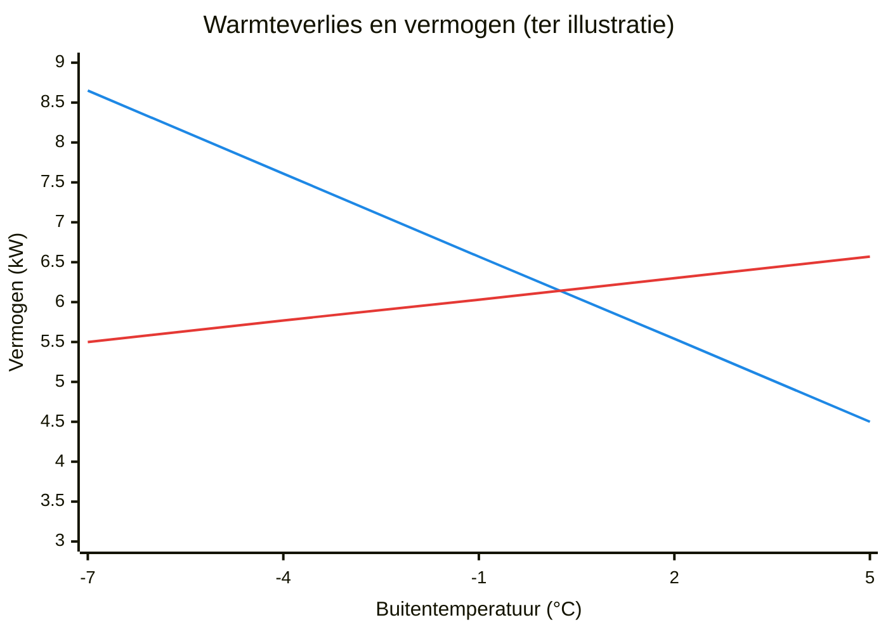

# Vermogen kiezen

Het vermogen van een warmtepomp moet passen bij het warmteverlies van de woning op de
koudste dagen. Het minimale vermogen moet passen bij de mildere dagen. Het afgiftesysteem
moet dat vermogen kwijt kunnen bij een lage watertemperatuur.

**Zie ook:** [Stooklijn](heating-curve.md) · [Pendelen](cycling.md) · [Ontdooien](defrost.md) · [Hydrauliek](hydraulics.md)

## Eerst de afgifte

Of een woning geschikt is, hangt vooral af van het afgiftesysteem, niet van het
gasverbruik. Een huis dat 2000 m³ gas verbruikt, kan een warmtepomp krijgen als het nu al
warm wordt met water van 35 °C.

Test dit in de winter met de huidige cv-ketel:

1. Zet de aanvoertemperatuur van de ketel op 40 °C of lager.
2. Kijk of het huis op koude dagen warm wordt en warm blijft.
3. Kijk hoe lang de ketel brandt. Brandt hij op de koudste momenten de helft van de tijd,
   dan is er ruimte over.

Is de afgifte te klein, vergroot dan eerst de afgifte. Bijvoorbeeld: radiatoren vervangen
door grotere (type 33), of ventilatoren op radiatoren zetten.

### Bronnen

- [twain4me, 2023-03-13](https://gathering.tweakers.net/forum/list_message/74751460#74751460): topicstart, *Is mijn woning geschikt*
- [FransvWoerkom, 2021-12-22](https://gathering.tweakers.net/forum/list_message/69952210#69952210): eerst nagaan of het huis warm bleef met de ketel op 40 °C
- [nikon., 2022-05-09](https://gathering.tweakers.net/forum/list_message/71468336#71468336): ketel maanden op 40 °C, huis blijft warm
- [ASW1, 2023-10-22](https://gathering.tweakers.net/forum/list_message/76926018#76926018): ketel op 40 °C, op de koudste momenten 50 % van de tijd aan
- [denneappel, 2023-09-21](https://gathering.tweakers.net/forum/list_message/76590520#76590520): radiatoren vervangen door T33 en ventilatoren

## Het warmteverlies bepalen

Er zijn drie manieren. Gebruik er minstens twee en vergelijk de uitkomsten.

| Methode | Wat u nodig hebt | Voordeel |
|---|---|---|
| Warmteverliesberekening | Bouwgegevens, isolatie, ventilatie | Persoonlijk stookgedrag telt niet mee |
| Vollasturen | Gasverbruik van 12 maanden | Snel |
| Graaddagen | Gasverbruik en graaddagen per periode | Geeft verlies per graad, ook bruikbaar voor de stooklijn |

### Warmteverliesberekening

Dit is de beste methode. Een lagere temperatuur op de slaapkamer of afwezigheid in een
koude periode vertekent de uitkomst niet. Ook kunt u rekening houden met later gebruik,
bijv. een slaapkamer die een kantoor wordt.

- Bij nieuwe woningen is de berekening verplicht. De gemeente heeft hem vaak.
- Zelf rekenen kan met [Ubakus](https://www.ubakus.com/) (uitgebreid) of
  [bouw-energie.be](https://bouw-energie.be/) (vereenvoudigd).
- Snelle indicatie: gebruiksoppervlak × norm per m². De norm hangt af van bouwjaar,
  ventilatie en woningtype. Voorbeeld: woning uit 1981–1989 met WTW, 70 W/m², 138 m²
  → 9,7 kW bij −10 °C. 25 W/m² geldt alleen voor een goed geïsoleerde nieuwbouwwoning.

Het bouwjaar is een ruwe maat. De datum van de vergunning bepaalt de bouweisen, niet de
bouwdatum. Na-isolatie verandert het verlies ook sterk.

### Vollasturen (methode Koevlaas)

> vermogen (kW) = gasverbruik per jaar (m³) ÷ 1650 × 8 kWh

Voorbeeld: 2000 m³ ÷ 1650 × 8 = 9,7 kW.

- Trek eerst het gas voor tapwater en koken af. Schat dat uit het verbruik in de zomer:
  maandverbruik in juni × 12.
- De factor 8 kWh per m³ is voorzichtig. Bij een lage retourtemperatuur haalt een
  HR-ketel meer warmte uit een m³ gas. Gebruikers rekenen met 8,8 tot 9,7 kWh.
  Een gebruiker raadt juist 9 aan, voor extra marge.
- 1650 uur is geen vaste buitentemperatuur. Het getal geeft de verhouding tussen het
  gemiddelde en het maximale vermogen in een stookseizoen.

### Graaddagen

1. Zoek op [mindergas.nl](https://mindergas.nl/) de graaddagen bij het dichtstbijzijnde
   weerstation. Neem een koude periode (december tot maart) of een heel jaar.
2. Deel het gasverbruik in die periode door het aantal graaddagen: m³ per graaddag.
3. m³ per graaddag ÷ 24 × kWh per m³ = kW verlies per graad.
4. Verlies per graad × (18 °C − ontwerptemperatuur) = vermogen.

Voorbeeld: 1334 m³ over 1556,57 graaddagen = 0,857 m³ per graaddag.
0,857 ÷ 24 × 9,7 = 0,346 kW per graad. Bij −10 °C: 0,346 × 28 = 9,7 kW.

De stookgrens van 18 °C is ongeveer de gemiddelde temperatuur van de hele woning.
Een periode van afwezigheid kunt u uit de berekening laten.

### Koudste dag

Een snelle controle: neem het gasverbruik op de koudste dag van het jaar, zonder tapwater.
m³ × 9 kWh ÷ 24 uur = gemiddeld vermogen op die dag. Voorbeeld: 17 m³ → 6,4 kW.
Nog beter: begrens het vermogen van de cv-ketel een winter lang op het beoogde vermogen en
meet met een warmtemeter.

### Bronnen

- [twain4me, 2023-03-13](https://gathering.tweakers.net/forum/list_message/74751460#74751460): topicstart, *Welk vermogen warmtepomp heb ik nodig*, methode 1 en 2
- [Andrehj, 2021-03-04](https://gathering.tweakers.net/forum/list_message/66395088#66395088): 25 W/m² alleen voor goed geïsoleerde nieuwbouw
- [Fantastic_fox, 2021-05-31](https://gathering.tweakers.net/forum/list_message/67522312#67522312): gas voor tapwater en koken uit zomerverbruik aftrekken
- [dunklefaser, 2023-05-06](https://gathering.tweakers.net/forum/list_message/75256954#75256954): 8,8 of 9,3 kWh per m³ bij lage retour
- [Gary199, 2023-02-19](https://gathering.tweakers.net/forum/list_message/74515304#74515304): factor 9 in plaats van 8 voor marge
- [FransvWoerkom, 2023-12-09](https://gathering.tweakers.net/forum/list_message/77450164#77450164): 1650 uur is een verhouding, geen buitentemperatuur
- [fadsjeik, 2021-10-11](https://gathering.tweakers.net/forum/list_message/69021390#69021390): gasverbruik op de koudste dag
- [Speedsmile, 2021-10-11](https://gathering.tweakers.net/forum/list_message/69022530#69022530): ketel een winter op 6,3 kW begrensd, met warmtemeter

## Vermogen bij lage buitentemperatuur

Het typenummer (5, 7, 9 kW) is niet het vermogen op de koudste dag. Bij lage
buitentemperaturen levert een warmtepomp minder. Vergelijk het warmteverlies daarom met
de tabel in de service manual, bij −7 of −10 °C en de watertemperatuur die u nodig hebt.

Voorbeeld uit datasheets, bij −7 °C buiten en 35 °C aanvoer: een model van 7 kW levert
5,5 kW (ene serie) of 6,8 kW (andere serie). Een model van 9 kW levert 6,4 of 7,5 kW. Bij
+2 °C levert het 7 kW-model 6,3 kW (ene serie).

Ter illustratie: de grafiek zet het warmteverlies uit het graaddagenvoorbeeld (0,346 kW
per graad, 18 °C stookgrens) naast het vermogen van een model van 7 kW. Het vermogen is tussen
−7 en +2 °C geïnterpoleerd en daarboven rechtdoor getrokken. Bij ongeveer 0 °C wordt het vermogen te klein. Daaronder
springt het element bij.

- **Blauw:** warmteverlies van de woning (0,346 kW × (18 °C − buitentemperatuur)).
- **Rood:** vermogen van de warmtepomp bij 35 °C aanvoer.
- Waar blauw boven rood ligt, mist de warmtepomp vermogen. Het element vult dat aan.

Ook ontdooien kost vermogen. Rond het vriespunt, bij vochtig weer, ontdooit de
warmtepomp vaak. Het effectieve vermogen kan dan ongeveer 20 % lager zijn. Bij strenge
vorst ontdooit hij minder vaak. Zie [Ontdooien](defrost.md).

Een meting op de koudste dag van een winter toont het effect. Het geleverde vermogen
schommelt tussen ongeveer 7 en 9 kW. Bij elke ontdooibeurt zakt het naar 4 à 4,5 kW. Het
element springt dan kort bij, met 1 à 2 kW.

Een klein tekort op de koudste uren is meestal geen probleem:

- Een huis met veel massa (beton, steen) buffert warmte. Is het 10 uur lang −7 °C en
  mist u 1 kW, dan verliest het huis 10 kWh. Dat merkt u nauwelijks.
- Mensen en apparaten geven ook warmte.
- Een elektrisch element (backup heater) komt boven op het vermogen van de compressor.

Houd ook rekening met de uren die overblijven. Een warmtepomp die tapwater maakt of
's nachts uit staat, moet het verlies van 24 uur in minder uren goedmaken. Voorbeeld: 2 uur
tapwater en 7 uur nachtverlaging laten 15 uur over.

### Bronnen

- [poing, 2022-08-11](https://gathering.tweakers.net/forum/list_message/72398256#72398256): vermogen bij −7 °C lager dan het typenummer; datasheetwaarden (screenshot)
- [jurjen_g, 2022-08-11](https://gathering.tweakers.net/forum/list_message/72398490#72398490): tekort van 1 kW gedurende 10 uur; massa buffert; datasheetwaarden (screenshot)
- [JanAllElectric, 2022-01-09](https://gathering.tweakers.net/forum/list_message/70148864#70148864): vermogen zakt in rond het vriespunt, in de praktijk te weinig
- [Thorsd, 2023-12-01](https://gathering.tweakers.net/forum/list_message/77367830#77367830): ontdooien kost ongeveer 20 % vermogen; minder bij strenge vorst
- [Speedsmile, 2021-10-11](https://gathering.tweakers.net/forum/list_message/69022530#69022530): element komt boven op het compressorvermogen; vermogen en element tijdens ontdooien (grafiek)
- [blb4, 2023-12-19](https://gathering.tweakers.net/forum/list_message/77553994#77553994): tapwater en nachtverlaging verkorten de beschikbare uren

## Het minimale vermogen

Het minimale vermogen lijkt bij de keuze onbelangrijk. Het bepaalt wel het comfort en een
deel van het verbruik. Is het warmteverlies kleiner dan het minimale vermogen, dan kan de
warmtepomp niet meer continu draaien. Hij gaat dan aan en uit (zie [Pendelen](cycling.md)).
Elk huis heeft zo'n omslagpunt, hoe klein de warmtepomp ook is.

Het omslagpunt rekent u uit met het verlies per graad uit de graaddagenmethode:

> omslagpunt = 18 °C − (minimaal vermogen ÷ verlies per graad)

Voorbeeld: 150 W per graad en minimaal 2500 W → 18 − 16,7 = 1,3 °C. Boven 1,3 °C buiten
schakelt de warmtepomp aan en uit. Een kamerthermostaat vangt dat op.

Het minimale vermogen telt ook voor de afgifte. Het afgiftesysteem moet dat vermogen
kwijt kunnen. Met radiatoren is daar een hogere watertemperatuur voor nodig. Een lager
minimaal vermogen laat dus een lagere stooklijn toe. Bij radiatoren is het effect groter
dan bij vloerverwarming.

De datasheets noemen het minimale vermogen meestal niet. Het hangt af van de
buitentemperatuur, de watertemperatuur en de warmtevraag. In de praktijk, met een
stooklijn, ligt het hoger dan het technische minimum.

### Bronnen

- [twain4me, 2023-03-13](https://gathering.tweakers.net/forum/list_message/74751460#74751460): topicstart, *Het minimale vermogen van een warmtepomp*
- [blb4, 2023-12-19](https://gathering.tweakers.net/forum/list_message/77553994#77553994): elk huis heeft een omslagpunt
- [Pejdref, 2024-02-13](https://gathering.tweakers.net/forum/list_message/78130264#78130264): pendelen niet te voorkomen onder het minimale vermogen

## Te groot of te klein

Een warmtepomp kiest u op twee grenzen tegelijk: genoeg vermogen op de koudste dag, en
een minimaal vermogen dat laag genoeg is voor het voor- en naseizoen. Heeft een groter
model hetzelfde minimale vermogen als een kleiner model, dan kost het grotere model vooral
geld. Een groter model kan wel meer geluid maken bij vol vermogen.

!!! note "Meningen verschillen"
    - **Liever iets te groot.** Een warmtepomp die het op de koudste dagen maar net haalt,
      geeft risico op een koud huis. Ontdooien pleit ook
      voor een ruimer model.
    - **Iets te klein is te overzien.** De koudste dagen zijn er maar een paar per jaar.
      Het element of een extra kachel vangt die op. Een groter model kost meer.
    - **Bewust kleiner kiezen, voor beter moduleren, kan tegenvallen.** Een gebruiker koos
      een kleiner model dan de vollasturen aangaven. Rond het vriespunt bleef er te weinig
      vermogen over.

Twijfelt u, kijk dan eerst of u te warm stookt. Een gebruiker dacht dat zijn warmtepomp te
klein was. Het bleek 24 °C binnen te zijn.

### Bronnen

- [_Piwi_, 2021-10-11](https://gathering.tweakers.net/forum/list_message/69015586#69015586): liever iets over- dan ondergedimensioneerd; ontdooien
- [fadsjeik, 2021-10-11](https://gathering.tweakers.net/forum/list_message/69021390#69021390): weinig koude dagen; kachel bijzetten; meerprijs
- [JanAllElectric, 2022-01-09](https://gathering.tweakers.net/forum/list_message/70148864#70148864): bewust kleiner gekozen, te weinig rond het vriespunt
- [dof, 2023-10-11](https://gathering.tweakers.net/forum/list_message/76805404#76805404): groter model met gelijk minimum heeft alleen de meerprijs als nadeel
- [Thorsd, 2023-10-11](https://gathering.tweakers.net/forum/list_message/76807040#76807040): groter model, hoger maximaal geluidsvermogen
- [Beekforel, 2023-12-03](https://gathering.tweakers.net/forum/list_message/77382494#77382494): vermeend tekort, binnen bleek 24 °C

## Hybride

Overweegt u een hybride opstelling uit angst voor een koud huis? Reken dan eerst het
warmteverlies uit. De uitkomst laat zien of die angst terecht is. Een warmtepomp die met
element 24 uur per dag draait, levert veel warmte.

- **Zelf testen.** Zet de CV-ketel een winter op maximaal 45 °C aanvoer en een vaste
  kamertemperatuur. Blijft het huis rond 0 °C buiten warm? Dan kan het waarschijnlijk
  all-electric.
- **Ervaring.** Een gebruiker had een jaar een hybride warmtepomp van 4 kW. De ketel stookte
  bijna nooit. Daarna ging hij over op een warmtepomp van 5 kW zonder gas.
- **Kosten.** De gasaansluiting blijft geld kosten. Een gebruiker noemde in 2021 ongeveer
  € 200 per jaar.

!!! note "Meningen verschillen"
    Een gebruiker vindt hybride een optie als het huis bij strenge vorst krap is: het wordt
    zelden −10 °C en maar een paar dagen per jaar vriest het. Een ander vindt hybride geen
    goede keuze, omdat het gas er toch af moet. Hij wijst erop dat een koude periode ook
    een week kan duren. Kies dan liever een grotere warmtepomp.

### Bronnen

- [ErikVers, 2022-04-02](https://gathering.tweakers.net/forum/list_message/71129138#71129138): eerst warmteverlies of Koevlaas, dan pas hybride overwegen
- [Thorsd, 2024-02-20](https://gathering.tweakers.net/forum/list_message/78199420#78199420): test met 45 °C aanvoer; hybride overwegen, zelden −10 °C
- [rvdgaag, 2024-12-04](https://gathering.tweakers.net/forum/list_message/80922362#80922362): hybride van 4 kW zonder gas, daarna 5 kW all-electric
- [CurlyMo, 2021-10-28](https://gathering.tweakers.net/forum/list_message/69220222#69220222): hybride kost € 200 per jaar
- [blb4, 2026-01-07](https://gathering.tweakers.net/forum/list_message/84359060#84359060): hybride geen goede keuze; koude periodes duren langer; groter model
