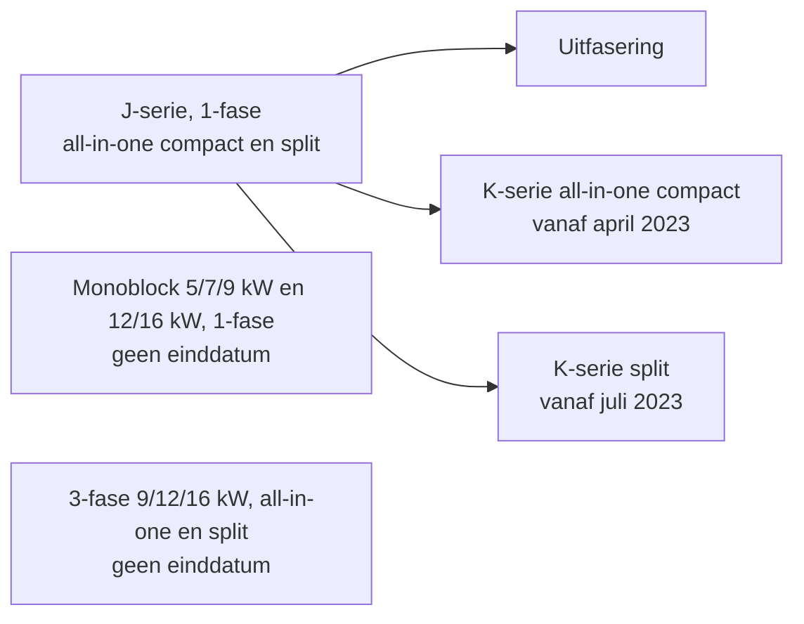

Panasonic Aquarea is een reeks lucht-waterwarmtepompen. Op het forum gaat het vooral over de
series H, J, K, L en M. Deze pagina vergelijkt de series, de uitvoeringen en de koudemiddelen.
Ook leest u hier hoe u een typenummer leest.

**Zie ook:** [Pendelen](../general/cycling.md) · [Ontdooien](../general/defrost.md)

## Uitvoeringen

| Uitvoering | Wat loopt er tussen buiten en binnen | Binnenunit |
|---|---|---|
| Monoblock | Water | Geen; alleen een bediening |
| Split (bi-bloc) | Koudemiddel | Hydromodule met pomp, backup heater en print |
| All-in-one | Koudemiddel (K) of water (L) | Hydromodule met ingebouwde boiler en expansievat |
| Hydrosplit (L-serie) | Water | Hydromodule (bi-bloc) of all-in-one |

- **Monoblock.** Het hele koelcircuit zit in de buitenunit. U sluit twee waterleidingen, voeding
  en een datakabel aan. Daarom installeren veel tweakers een monoblock zelf.
- **Split.** Voor de koudemiddelleidingen is een F-gassencertificaat nodig. Een split is daarom
  niet geschikt voor een doe-het-zelver.
- **Hydrosplit (L-serie).** De warmtewisselaar zit in de buitenunit. Het propaan blijft buiten.
  Tussen binnen en buiten lopen twee waterleidingen. Een F-gassencertificaat is niet nodig.
  Anders dan bij de oudere monoblocks zitten de backup heater, de circulatiepomp en de hoofdprint
  in de binnenunit, net als bij een split. Ook het expansievat, de waterdruksensor, het
  magnetische filter en de driewegklep zitten binnen. Het handleidingschema toont één
  warmtewisselaar, in de buitenunit.

### Bronnen

- [twain4me, 2023-03-13](https://gathering.tweakers.net/forum/list_message/74751460#74751460): topicstart; monoblock: twee waterleidingen, stroom, datakabel
- [Ethirty, 2023-11-19](https://gathering.tweakers.net/forum/list_message/77225690#77225690): alleen monoblock is water; all-in-one is bi-bloc met boiler en expansievat
- [ErikVers, 2023-11-19](https://gathering.tweakers.net/forum/list_message/77225982#77225982): J klassieke monoblock, K split met F-gassen, L hydrosplit
- [Carboy54, 2023-02-08](https://gathering.tweakers.net/forum/list_message/74398118#74398118): L-serie: hydraulische verbinding, geen F-gassencertificaat nodig
- [FransvWoerkom, 2025-06-14](https://gathering.tweakers.net/forum/list_message/82685784#82685784): L: warmtewisselaar buiten; backup heater, pomp en print binnen; watercircuit met driewegklep en expansievat (schema)
- [Beninho, 2023-11-20](https://gathering.tweakers.net/forum/list_message/77239144#77239144): L: twee leidingen tussen binnen en buiten; onderdelen binnenunit (schema)

## Een typenummer lezen

Elk deel van het typenummer doet ertoe. Voorbeelden:

| Typenummer | Betekenis |
|---|---|
| `WH-MDC05J3E5` | Monoblock (`MDC`), 5 kW, J-serie, 1-fase |
| `WH-MXC09J3E8` | T-CAP monoblock (`MXC`), 9 kW, J-serie, 3-fase |
| `WH-MXC12J9E8` | T-CAP monoblock, 12 kW, J-serie, 3-fase, backup heater van 9 kW |
| `WH-UD09JE5` | Buitenunit van een split, 9 kW, J-serie |
| `WH-UDZ07KE5` | Buitenunit van een split, 7 kW, K-serie |
| `WH-SDC0305J3E5` | Binnenunit (hydromodule) van een split, J-serie |
| `WH-ADC0309K3E5` | Binnenunit all-in-one (hydromodule met boiler), K-serie |
| `WH-WDG09LE5` | Buitenunit, 9 kW, L-serie |
| `WH-WXG16ME8` | T-CAP, 16 kW, M-serie, 3-fase |

- De letter na het vermogen geeft de serie: `H`, `J`, `K`, `L` of `M`.
- `E5` is 1-fase, `E8` is 3-fase. 3-fase bestaat alleen als T-CAP. Er is ook een 1-fase T-CAP
  (`WH-MXC09J3E5`).
- Het cijfer voor de `E` hoort bij de backup heater: `J9E8` heeft een backup heater van 9 kW.
- Eén binnenunit (bijv. `ADC0309J…`) hoort bij buitenunits van verschillend vermogen.

### Bronnen

- [SJB, 2021-12-02](https://gathering.tweakers.net/forum/list_message/69673398#69673398): `WH-MDC05H3E5` is een monoblock van 5 kW
- [WackoH, 2020-12-31](https://gathering.tweakers.net/forum/list_message/65468688#65468688): `MDC09J3E5` 1-fase, `MXC09H3E8` 3-fase
- [rbrt, 2021-08-09](https://gathering.tweakers.net/forum/list_message/68326452#68326452): 3-fase alleen als T-CAP
- [rbrt, 2021-08-20](https://gathering.tweakers.net/forum/list_message/68453576#68453576): `MXC09J3E8` 3-fase en `MXC09J3E5` 1-fase
- [rbrt, 2022-07-29](https://gathering.tweakers.net/forum/list_message/72277500#72277500): `WH-MXC09J3E8` is een 3-fase T-CAP van 9 kW
- [LinuZZ, 2024-02-04](https://gathering.tweakers.net/forum/list_message/78030158#78030158): `WH-MXC12J9E8` met backup heater van 9 kW
- [FransvWoerkom, 2024-01-22](https://gathering.tweakers.net/forum/list_message/77890562#77890562): `WH-SDC…` is de binnenunit, buitenunit begint met `WH-UD`
- [kjoosten, 2023-11-27](https://gathering.tweakers.net/forum/list_message/77313282#77313282): buitenunit `WH-UDZ07KE5`
- [simpelmuis, 2023-02-21](https://gathering.tweakers.net/forum/list_message/74538454#74538454): `WH-ADC0309J3E5C` is hydromodule met tank
- [FransvWoerkom, 2022-02-24](https://gathering.tweakers.net/forum/list_message/70711958#70711958): binnenunits `ADC0309J` gelijk voor 5 en 7 kW
- [The Real Gunnar, 2023-09-13](https://gathering.tweakers.net/forum/list_message/76509616#76509616): L-serie: buitenunit `WH-WDG09LE5`, binnenunit `WH-ADC0509L3E5`
- [Beer070, 2025-11-03](https://gathering.tweakers.net/forum/list_message/83843118#83843118): `WH-WXG16ME8` is een T-CAP van 16 kW

## De series

| Serie | Koudemiddel | Uitvoeringen | Kenmerken |
|---|---|---|---|
| H | R410A | Monoblock, split | 5 kW moduleert het verst terug; niet meer leverbaar |
| J | R32 | Monoblock, split, all-in-one | 5, 7 en 9 kW: dezelfde compressor |
| K | R32 | Split, all-in-one | Opvolger van de J-split; apart 3 kW-model met kleinere compressor |
| L | R290 | Hydrosplit, all-in-one | Meer vermogen bij −7 °C dan K; geen F-gassen |
| M | — | Alleen T-CAP, 9 tot 30 kW | Monoblock los of met binnenunit |

Vermogen bij −7 °C buiten en 35 °C water, volgens de datasheets:

| Vermogen | H | J | K | L |
|---|---|---|---|---|
| 5 kW | 4,70 kW | 5,00 kW | 5,00 kW | 4,60 kW |
| 7 kW | 5,50 kW | 6,80 kW | 5,75 kW | 5,80 kW |
| 9 kW | 6,40 kW | 7,50 kW | 6,25 kW | 7,00 kW |

Alleen de 9 kW J-serie haalt meer dan 7 kW bij −7 °C. De 5, 7 en 9 kW van de K-serie liggen
dicht bij elkaar.

**T-CAP** is een variant met een grotere compressor. Een T-CAP houdt zijn nominale vermogen
ook bij −7 °C vast: de `WH-MXC09H3E8` levert 9 kW, de `WH-MDC09J3E5` 7,5 kW.

Productie en verkoop (stand op de datum van de bron):

- Begin 2023 vervangt de K-serie de J-splits. De J-monoblocks blijven toen nog leverbaar.
- In maart 2023 melden distributeurs dat Panasonic de J-serie uitfaseert. De L-serie is de opvolger.
- In november 2025 mag de K-serie (R32) nog ongeveer één jaar worden verkocht.

De roadmap van Panasonic (FY22–FY23, gedeeld in februari 2023) toont de overgang van J naar K voor 1-fase modellen van
3, 5, 7 en 9 kW. Voor 3-fase modellen en monoblocks staat geen einddatum op de roadmap.

### Bronnen

- [Rimco, 2025-11-25](https://gathering.tweakers.net/forum/list_message/84028136#84028136): tabel per serie: vermogen bij +7 en −7 °C, compressor, koudemiddel
- [ASW1, 2025-11-25](https://gathering.tweakers.net/forum/list_message/84028228#84028228): K-modellen liggen dicht bij elkaar
- [martijn v o, 2022-10-16](https://gathering.tweakers.net/forum/list_message/73147516#73147516): K is R32, L is R290
- [ErikVers, 2025-11-23](https://gathering.tweakers.net/forum/list_message/84014574#84014574): K (R32) nog één jaar verkocht; L meer vermogen bij −7 °C
- [Carboy54, 2023-02-08](https://gathering.tweakers.net/forum/list_message/74398118#74398118): splits vervangen door K-serie; J-monoblocks blijven; K-start april en juli 2023 (schema)
- [Carboy54, 2023-03-10](https://gathering.tweakers.net/forum/list_message/74718690#74718690): J-serie uitgefaseerd, L-serie opvolger
- [Johan-1986, 2024-02-24](https://gathering.tweakers.net/forum/list_message/78241124#78241124): M-serie alleen als T-CAP
- [dof, 2025-06-29](https://gathering.tweakers.net/forum/list_message/82802906#82802906): M-serie van 9 tot 30 kW; J 5/7/9 vrijwel identiek
- [WackoH, 2020-12-31](https://gathering.tweakers.net/forum/list_message/65468688#65468688): T-CAP 9 kW ook bij −7 °C, 1-fase 9 kW dan 7,5 kW
- [FransvWoerkom, 2023-11-20](https://gathering.tweakers.net/forum/list_message/77240078#77240078): splits uit de H- en J-serie
- [HarmoniousVibe, 2022-02-24](https://gathering.tweakers.net/forum/list_message/70708830#70708830): J-split met geïntegreerde boiler (`KIT-ADC05JE5`)
- [kjoosten, 2023-11-27](https://gathering.tweakers.net/forum/list_message/77313282#77313282): K-split met all-in-one binnenunit `WH-ADC0309K3E5`
- [FransvWoerkom, 2026-02-24](https://gathering.tweakers.net/forum/list_message/84711840#84711840): M-monoblock ook zonder binnenunit (stand-alone)
- [FransvWoerkom, 2026-03-15](https://gathering.tweakers.net/forum/list_message/84858159#84858159): verschillen tussen M-binnenunits in de introductie van Panasonic

## R32 en R290

R290 is propaan. De L-serie gebruikt R290, de J- en K-serie R32 en de H-serie R410A.

- R290-modellen zijn volgens Panasonic Europa 15–20 % duurder dan R32-modellen.
- De meeste R290-warmtepompen halen 60 °C of meer. Zie [Legionella](../general/legionella.md).

**Let op: Propaan (R290) in de L-serie.**

De L-serie heeft geen dubbele warmtewisselaar. Lekt de warmtewisselaar, dan kan propaan via
het cv-water de woning in. Daarom verbiedt de handleiding automatische ontluchters en
ontgassers (bijv. Vacustream) in het systeem. Ontlucht met de handmatige ontluchter.

### Bronnen

- [Rimco, 2025-11-25](https://gathering.tweakers.net/forum/list_message/84028136#84028136): koudemiddel per serie
- [Carboy54, 2023-02-08](https://gathering.tweakers.net/forum/list_message/74398118#74398118): R290-modellen 15–20 % duurder (interview Panasonic EU)
- [flippy, 2024-04-21](https://gathering.tweakers.net/forum/list_message/78779676#78779676): de meeste propaanwarmtepompen halen 60+ °C
- [Beninho, 2023-11-20](https://gathering.tweakers.net/forum/list_message/77239144#77239144): geen dubbele wisselaar; propaan kan de woning in; geen ontgasser
- [Beninho, 2023-12-12](https://gathering.tweakers.net/forum/list_message/77485412#77485412): handleiding L: geen automatische ontluchters vanwege R290

## Minimaal vermogen

De datasheets noemen geen minimaal vermogen. Het minimum hangt af van buitentemperatuur,
watertemperatuur en installatie. Bij kou stijgt de minimale compressorfrequentie. Waarden uit
de praktijk:

| Model | Minimaal vermogen (thermisch) |
|---|---|
| H, 5 kW (`WH-MDC05H3E5`) | 1400 W |
| H, 7 kW en J, 5/7/9 kW | 2500 W |
| K, 9 kW | ca. 500–550 W elektrisch op het laagste toerental |
| L, 7 kW | ca. 1800 W |
| L, 5 kW | ca. 1 kW lager dan de 7 kW |
| T-CAP, J-serie | 35 Hz minimum bij ≤ 4–5 °C buiten; tot ca. 7 kW |

- **J-serie.** De 5, 7 en 9 kW hebben dezelfde compressor. Het verschil zit in de software. Een
  7 of 9 kW moduleert dus even ver terug als een 5 kW.
- **K-serie.** De 3 kW heeft een kleinere compressor, net als vroeger de 5 kW H-serie.
- **T-CAP.** De J-serie T-CAP draait bij een buitentemperatuur van 4–5 °C of lager minimaal op
  35 Hz. Hij levert dan meer warmte dan veel huizen kwijt kunnen, en gaat pendelen. Een T-CAP
  past bij een groot huis met veel vloerverwarming en vraagt meer systeeminhoud. De H-serie
  T-CAP had dit gedrag minder.

**Meningen verschillen.**

De topicstart noemt 2500 W voor de J-serie. Een andere gebruiker rekent bij 12 °C buiten en
30 °C aanvoer met ruim 3 kW. Voor de K-serie zijn geen metingen van het thermisch minimum.
Eén gebruiker gaat uit van dezelfde waarden als de L-serie.

Hoe u de stooklijn op het minimum afstemt: [Panasonic: instellingen](settings.md) en
[Pendelen](../general/cycling.md).

### Bronnen

- [twain4me, 2023-03-13](https://gathering.tweakers.net/forum/list_message/74751460#74751460): topicstart, tabel minimaal vermogen H en J
- [Rimco, 2025-11-25](https://gathering.tweakers.net/forum/list_message/84028136#84028136): J alleen softwarebeperking; K 3 kW kleinere compressor; T-CAP 35 Hz
- [ErikVers, 2025-11-25](https://gathering.tweakers.net/forum/list_message/84030338#84030338): 5L moduleert ca. 1 kW verder terug dan 7L
- [FransvWoerkom, 2022-02-24](https://gathering.tweakers.net/forum/list_message/70711958#70711958): J-monoblocks mechanisch vrijwel gelijk
- [Appelpie3000, 2023-11-05](https://gathering.tweakers.net/forum/list_message/77073000#77073000): 5 en 7 kW moduleren even ver terug
- [Thorsd, 2024-03-24](https://gathering.tweakers.net/forum/list_message/78536678#78536678): J-serie minimum ruim 3 kW bij Tb 12 en Ta 30
- [P.K., 2023-12-15](https://gathering.tweakers.net/forum/list_message/77511286#77511286): 9 kW K-serie 500–550 W op laagste stand
- [Joris273, 2025-06-14](https://gathering.tweakers.net/forum/list_message/82679414#82679414): 7 kW L-serie minimum ca. 1800 W
- [ErikVers, 2026-05-27](https://gathering.tweakers.net/forum/list_message/85358240#85358240): K-serie: ga uit van de waarden van de L-serie
- [FransvWoerkom, 2026-05-26](https://gathering.tweakers.net/forum/list_message/85351594#85351594): minimum hangt af van buitentemperatuur, aanvoer en installatie
- [Tiesert, 2023-01-19](https://gathering.tweakers.net/forum/list_message/74185086#74185086): J-T-CAP minimaal 35 Hz bij ≤ 5 °C, veel pendelen
- [doek55, 2023-01-21](https://gathering.tweakers.net/forum/list_message/74211308#74211308): 9 kW T-CAP: bij ≤ 4 °C is 35 Hz het minimum
- [Kuraya, 2023-01-25](https://gathering.tweakers.net/forum/list_message/74252240#74252240): J-T-CAP tot 7 kW minimum; H-T-CAP anders
- [ConQuestador, 2023-08-18](https://gathering.tweakers.net/forum/list_message/76259120#76259120): T-CAP hoog minimum; pendelen zonder groot huis met veel vloerverwarming
- [ErikVers, 2023-11-29](https://gathering.tweakers.net/forum/list_message/77337252#77337252): T-CAP vraagt meer systeeminhoud

## Geluid en ontdooien

- **Geluid J-serie.** Op een laag toerental kan de R32-compressor tikken. De H-serie (R410A)
  heeft daar minder last van.
- **Geluid K- en J-serie.** Bij matige temperaturen hoort u de buitenunit nauwelijks. Rond 0 °C,
  met veel ontdooicycli, maakt hij duidelijk meer geluid.
- **Ontdooien H en J.** De beslissing om te ontdooien is bij beide series gelijk. Bij een
  retourtemperatuur onder 27 °C ontdooit de warmtepomp op de compressor.
- **Ontdooien T-CAP.** Een T-CAP ontdooit op de compressor, niet met de backup heater.
  Zie [Storingen](troubleshooting.md).
- **Ontdooien K en L.** Met de instelling *DHW-defrost* haalt de warmtepomp de energie voor het
  ontdooien uit de boiler.

Algemene uitleg: [Ontdooien](../general/defrost.md).

### Bronnen

- [flippy, 2023-06-25](https://gathering.tweakers.net/forum/list_message/75754464#75754464): tikkende R32-compressor bij laag toerental; H-serie minder
- [P.K., 2023-12-15](https://gathering.tweakers.net/forum/list_message/77511286#77511286): K-serie stil bij matige kou, goed hoorbaar rond 0 °C
- [gerard053, 2023-12-15](https://gathering.tweakers.net/forum/list_message/77513192#77513192): 5 kW J: meer geluid bij elk uur een defrost
- [FransvWoerkom, 2024-01-30](https://gathering.tweakers.net/forum/list_message/77974502#77974502): defrostbeslissing H en J gelijk; onder 27 °C op de compressor
- [FransvWoerkom, 2022-03-10](https://gathering.tweakers.net/forum/list_message/70886252#70886252): T-CAP ontdooit op de compressor
- [mbrunek, 2024-11-04](https://gathering.tweakers.net/forum/list_message/80608076#80608076): K-serie: DHW Defrost via de boiler
- [Stellar, 2025-12-23](https://gathering.tweakers.net/forum/list_message/84248806#84248806): L-serie: DHW-defrost

## Bekende problemen per serie

- **M-serie, monoblock zonder binnenunit.** Zonder binnenunit en backup heater beschermt de
  warmtepomp zich anders tegen bevriezing. Hij stookt het cv-water op tot 25–40 °C, ook in
  voorjaar en najaar. Oudere monoblocks laten bij vorst eerst de circulatiepomp draaien.
  Advies op het forum: koop een kleine binnenunit met backup heater, of kies de L-serie.
- **L-serie, ontluchten.** De all-in-one is lastig te ontluchten. Lucht blijft achter het vuilfilter
  bij de pomp hangen. Automatische ontluchters mogen niet (zie hierboven).
- **J-serie T-CAP.** Hoog minimum bij 4–5 °C of lager, zie [Minimaal vermogen](#minimaal-vermogen).

**Meningen verschillen.**

Volgens een andere gebruiker is het vorstgedrag van de M-serie goed gedocumenteerd en ligt een
probleem bijna altijd aan de instellingen. Andere gebruikers vinden de losse M-monoblock
minder geschikt voor het Nederlandse klimaat.

### Bronnen

- [FransvWoerkom, 2026-02-22](https://gathering.tweakers.net/forum/list_message/84701658#84701658): losse M-monoblock stookt tot 25–40 °C tegen bevriezing
- [ErikVers, 2026-02-21](https://gathering.tweakers.net/forum/list_message/84692498#84692498): vorstgedrag M zonder backup gedocumenteerd; meestal verkeerde instellingen
- [FransvWoerkom, 2026-02-24](https://gathering.tweakers.net/forum/list_message/84711840#84711840): oudere monoblocks laten eerst de pomp lopen; M standalone geen complete monoblock
- [FransvWoerkom, 2026-03-21](https://gathering.tweakers.net/forum/list_message/84898268#84898268): binnenunit met backup heater kopen of L-serie kiezen
- [Roschambo, 2023-11-30](https://gathering.tweakers.net/forum/list_message/77347828#77347828): `WH-ADC0509L3E5` lastig te ontluchten
- [Beninho, 2023-12-12](https://gathering.tweakers.net/forum/list_message/77485412#77485412): lucht in L-serie blijft hangen bij de pomp

## Pagina's over Panasonic

- [Instellingen](settings.md): stooklijn, stop- en startregels, kamerthermostaat
- [Storingen en foutcodes](troubleshooting.md): `H62`, `H75`, `H90` en andere codes
- Hardware: [plaatsing en installatie](hardware/installation.md) ·
  [bekabeling](hardware/wiring.md) · [backup heater](hardware/backup-heater.md) ·
  [sensoren](hardware/sensors.md)
- Besturing: [Comfort en Service Cloud](control/cloud.md) · [HeishaMon](control/heishamon.md) ·
  [Home Assistant](control/home-assistant.md)
