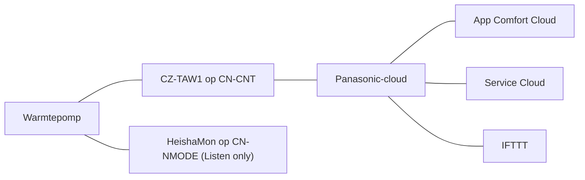

# Comfort Cloud en Service Cloud

Met de netwerkadapter CZ-TAW1 verbindt u een Panasonic Aquarea met de servers van Panasonic.
Daarna kunt u de warmtepomp op afstand bedienen en uitlezen. Er zijn twee omgevingen:

| Omgeving | Voor wie | Wat u kunt |
|---|---|---|
| Comfort Cloud (app, vroeger *Smart Cloud*) | Gebruiker | Aan/uit, koelen/verwarmen, shift van de stooklijn, SWW-temperatuur, weektimer, verbruik |
| Service Cloud | Installateur | Alle instellingen, status, grafieken en logging |

**Zie ook:** [Instellingen](../settings.md) · [Storingen](../troubleshooting.md) · [Stooklijn](../../general/heating-curve.md) · [HeishaMon](heishamon.md) · [Home Assistant](home-assistant.md)

## De adapter CZ-TAW1

- De CZ-TAW1 gaat op de `CN-CNT`-aansluiting van de hoofdprint. Hebt u de optionele print
  (CZ-NS4P)? Dan gaat de adapter volgens de handleiding op die print.
- **L-serie:** op de optionele print ziet u in de Service Cloud geen verbruik en opwekking
  voor verwarmen. Sluit de adapter dan aan op `CNT-CN2` (rood/roze) van de hoofdprint.
  De H- en J-serie hebben dit probleem niet.
- Twee kopers melden dat de L-serie standaard wifi heeft. Dit is niet bevestigd.
- De adapter werkt via een netwerkkabel of wifi. Wifi stelt u in met WPS. Zet WPS eerst aan
  op de router. Zonder WPS: zet een bestand `settings.txt` op een USB-stick met twee regels,
  `SSID=<netwerknaam>` en `KEY=<wachtwoord>`, en steek de stick in de adapter.
- De adapter werkt alleen op 2,4 GHz (802.11 b/g/n). Hij heeft één Ethernet-poort en één USB-poort.
  Volgens de handleiding laadt de adapter de wifi-gegevens van de USB-stick als u de WPS-knop
  10 s ingedrukt houdt. De link-led gaat dan branden.
- Monteer de bijgeleverde ferrietkern om de kabel naar de hoofdprint.
- Valt de verbinding vaak weg met de adapter in de behuizing van de warmtepomp? Hang de
  adapter buiten de behuizing. Dit helpt niet altijd.
- **Reset:** branden alle drie de leds, houd dan de middelste knop meer dan 10 s ingedrukt
  tot de leds uitgaan. Wacht tot de adapter terugkomt. Dat kan even duren.
- De elektronica met de CZ-TAW1 neemt ongeveer 10 W op (12 kW H-serie).

### Bronnen

- [twain4me, 2023-03-13](https://gathering.tweakers.net/forum/list_message/74751460#74751460): topicstart, CZ-TAW1 en de twee accounts
- [Tiesert, 2023-01-12](https://gathering.tweakers.net/forum/list_message/74108428#74108428): CZ-TAW1 op `CN-CNT` van de optionele print, via LAN
- [Grim20, 2025-01-28](https://gathering.tweakers.net/forum/list_message/81470422#81470422): L-serie, adapter op `CNT-CN2`
- [wortelsky, 2024-12-18](https://gathering.tweakers.net/forum/list_message/81067110#81067110): wifi-module standaard bij de L-serie
- [Beninho, 2023-10-31](https://gathering.tweakers.net/forum/list_message/77023626#77023626): WLAN standaard bij de L-serie; CZ-TAW1 nog nodig?
- [FransvWoerkom, 2022-12-18](https://gathering.tweakers.net/forum/list_message/73847008#73847008): EMC-kern, reset, WPS op de router
- [t.oswald, 2022-12-18](https://gathering.tweakers.net/forum/list_message/73847248#73847248): wifi instellen met `settings.txt` (handleiding)
- [rykers, 2023-02-11](https://gathering.tweakers.net/forum/list_message/74436912#74436912): verbinding beter buiten de behuizing
- [schrobbelbob, 2023-02-11](https://gathering.tweakers.net/forum/list_message/74437862#74437862): dagelijks verbinding kwijt, ook buiten de behuizing
- [t.oswald, 2021-11-30](https://gathering.tweakers.net/forum/list_message/69654368#69654368): reset en opnieuw installeren
- [FransvWoerkom, 2025-06-28](https://gathering.tweakers.net/forum/list_message/82790804#82790804): ongeveer 10 W voor de elektronica met CZ-TAW1

## Accounts aanmaken

1. Maak bij de installatie van de CZ-TAW1 een gebruikersaccount aan en registreer de
   adapter. U hebt het apparaat-ID en het wachtwoord van de sticker op de adapter nodig.
2. Maak in de Service Cloud een installateursaccount aan.
3. Wacht na het activeren ongeveer een uur. Pas dan werkt het account.
4. Log in op de Service Cloud met de **gebruikersnaam**, niet met het e-mailadres.
5. Stuur vanuit de gebruikersomgeving een verzoek aan het installateursaccount. Geef bij
   *Gebruiksvoorwaarden* **volledige toegang**. Zonder volledige toegang ziet u in de
   Service Cloud geen statistieken en geen datalog.

Tips:

- Gebruik geen speciale tekens in wachtwoorden (bijv. `$`). Gebruik voor beide accounts een
  ander wachtwoord.
- Aan één warmtepomp kunt u maar één installateursaccount koppelen. Heeft uw installateur al
  toegang? Dan moet hij eerst worden verwijderd voordat u uzelf toevoegt.
- De Service Cloud is formeel alleen voor installateurs. Veel gebruikers maken toch een eigen
  installateursaccount aan.
- Lukt het opnieuw registreren niet na een storing? Verwijder het apparaat in de
  gebruikersomgeving, registreer het opnieuw onder een nieuwe naam en meld het daarna weer aan
  bij de Service Cloud.

!!! note "Meningen verschillen"
    Sommige gebruikers moesten voor de twee accounts verschillende e-mailadressen gebruiken.
    Anderen konden hetzelfde adres gebruiken.

### Bronnen

- [--Erik--, 2022-12-08](https://gathering.tweakers.net/forum/list_message/73728962#73728962): inloggen met gebruikersnaam
- [t.oswald, 2022-12-08](https://gathering.tweakers.net/forum/list_message/73729846#73729846): enkele uren tussen activeren en werken
- [t.oswald, 2022-11-12](https://gathering.tweakers.net/forum/list_message/73436790#73436790): een uur wachten, daarna verzoek uit de Smart Cloud
- [Nachtwaker055, 2022-11-12](https://gathering.tweakers.net/forum/list_message/73441978#73441978): registratie met apparaat-ID en wachtwoord van de adapter
- [superjoost, 2023-11-15](https://gathering.tweakers.net/forum/list_message/77176536#77176536): toegang geven via *Gebruiksvoorwaarden*
- [Maurice1066, 2023-11-16](https://gathering.tweakers.net/forum/list_message/77197950#77197950): alleen cijfers en letters, inloggen met gebruiker
- [Tiesert, 2022-10-11](https://gathering.tweakers.net/forum/list_message/73096240#73096240): grafieken pas na *Full Access*
- [Tiesert, 2023-03-03](https://gathering.tweakers.net/forum/list_message/74644852#74644852): zonder alle rechten geen statistieken
- [sjimmie, 2022-11-12](https://gathering.tweakers.net/forum/list_message/73436054#73436054): `$` werkte niet
- [t.oswald, 2022-12-19](https://gathering.tweakers.net/forum/list_message/73855634#73855634): verschillende wachtwoorden zonder speciale tekens
- [t.oswald, 2023-01-11](https://gathering.tweakers.net/forum/list_message/74097016#74097016): maar één installateur
- [Tranquility, 2023-11-19](https://gathering.tweakers.net/forum/list_message/77224004#77224004): installateur verwijderd en zichzelf toegevoegd
- [Tiesert, 2023-01-11](https://gathering.tweakers.net/forum/list_message/74096598#74096598): Service Cloud formeel voor installateurs
- [sjimmie, 2021-03-09](https://gathering.tweakers.net/forum/list_message/66451696#66451696): ander e-mailadres voor de Service Cloud
- [Ep Woody, 2021-03-09](https://gathering.tweakers.net/forum/list_message/66453384#66453384): hetzelfde e-mailadres werkte

## Comfort Cloud (gebruiker)

- Sinds 8 mei 2025 is de webversie van de Smart Cloud weg. De gebruikersomgeving werkt alleen
  nog via de app Panasonic Comfort Cloud. De Service Cloud blijft bestaan.
- In de app zet u de warmtepomp aan of uit, past u de shift van de stooklijn en de
  SWW-temperatuur aan en ziet u grafieken van het (geschatte) verbruik.
- De app heeft een eigen weektimer. Die werkt alleen als het internet en de servers van
  Panasonic werken op het moment van schakelen. Zie [Weektimers](#weektimers).
- Via IFTTT kunt u de cloud koppelen aan andere apparaten. Voorbeelden: de shift aanpassen op
  de kamertemperatuur van een slimme thermostaat, of meer punten in de stooklijn maken met de
  shift (−5 tot +5). De IFTTT-actie voor de cloud heet *Change Heat Mode settings*. U bent dan afhankelijk van internet, de Panasonic-cloud en IFTTT.
- Een Home Assistant-integratie voor de Smart Cloud gooit de gewone gebruikerssessie eruit,
  omdat maar één login tegelijk actief kan zijn. Bij één gebruiker stopte de integratie toen de
  website op 8 mei 2025 verdween.

### Bronnen

- [hemertje, 2025-04-25](https://gathering.tweakers.net/forum/list_message/82271632#82271632): bericht van Panasonic over het einde van de Smart Cloud-website
- [FransvWoerkom, 2025-04-26](https://gathering.tweakers.net/forum/list_message/82279868#82279868): Smart Cloud vervangen door de Comfort Cloud-app
- [FransvWoerkom, 2026-04-14](https://gathering.tweakers.net/forum/list_message/85068942#85068942): app-timer afhankelijk van internet en servers; Comfort Cloud heette eerst Smart Cloud
- [Ethirty, 2024-12-28](https://gathering.tweakers.net/forum/list_message/81146686#81146686): shift, SWW-temperatuur en verbruiksgrafieken in de app
- [t.oswald, 2021-10-15](https://gathering.tweakers.net/forum/list_message/69061576#69061576): IFTTT met Tado, SmartLife en Smart Cloud (screenshot)
- [ErikVers, 2024-12-28](https://gathering.tweakers.net/forum/list_message/81144968#81144968): extra stooklijnpunten met shift via IFTTT
- [Tiesert, 2023-01-06](https://gathering.tweakers.net/forum/list_message/74043386#74043386): afhankelijk van internet, cloud en IFTTT
- [Deismyna, 2023-11-03](https://gathering.tweakers.net/forum/list_message/77056184#77056184): Home Assistant-integratie, maar één login actief
- [SpikeHome, 2025-05-08](https://gathering.tweakers.net/forum/list_message/82365624#82365624): integratie werkt niet meer na het einde van de website

## Service Cloud (installateur)

- U ziet en wijzigt alle instellingen van de warmtepomp. Instellingen gaan naar de warmtepomp
  alsof u ze op de controller invoert.
- De Service Cloud heeft de tabbladen *Status*, *Instellingen* en *Statistieken*. Boven de
  statistieken staat uw toegangsrecht, bijvoorbeeld *Volledige toegang*. Grafieken kunt u
  als CSV downloaden.
- Het tabblad *Status* toont actuele waarden, zoals de stand van de driewegklep en of de
  warmtepomp in *Power Off* of *Thermo Off* staat.
- **Logging:** de warmtepomp logt meer dan 50 meetwaarden en setpoints elke 5 minuten. De
  Service Cloud bewaart ze 7 dagen. Per grafiek kiest u 10 waarden.
- **Datalog:** voor korte verschijnselen logt u met een resolutie van 30 s. Gebruik dit ook om
  een grafiek langer dan 7 dagen te bewaren.
- Korte stops tussen twee meetpunten ziet u in de gewone logging niet.
- De Service Cloud toont opgenomen en afgegeven vermogen, maar geen stroomverbruik per uur,
  dag, maand of jaar. Dat ziet alleen de gebruiker.

### Bronnen

- [twain4me, 2023-03-13](https://gathering.tweakers.net/forum/list_message/74751460#74751460): installateursaccount ziet en wijzigt alles
- [FransvWoerkom, 2025-02-21](https://gathering.tweakers.net/forum/list_message/81717476#81717476): instellingen alsof ze van de controller komen
- [FransvWoerkom, 2025-07-10](https://gathering.tweakers.net/forum/list_message/82890964#82890964): stand driewegklep op het statusscherm
- [FransvWoerkom, 2025-11-17](https://gathering.tweakers.net/forum/list_message/83958946#83958946): *Power Off* of *Thermo Off* op het statusscherm
- [FransvWoerkom, 2026-01-28](https://gathering.tweakers.net/forum/list_message/84517528#84517528): logging 5 min, 7 dagen, 10 waarden per grafiek; datalog 30 s
- [TomN87, 2026-08-18](https://gathering.tweakers.net/forum/list_message/85952120#85952120): meetpunt elke 5 minuten, korte stops niet zichtbaar; tabbladen en CSV (screenshot)
- [FransvWoerkom, 2025-04-26](https://gathering.tweakers.net/forum/list_message/82279868#82279868): geen stroomverbruik per periode in de Service Cloud

## Verbruik en COP in de cloud

De warmtepomp meet alleen het verbruik van de compressor. De circulatiepomp, de ventilator en
de elektronica meet hij niet. De backup heater en een tankheater berekent hij met een vast
vermogen (bijv. 3 kW). Het verbruik wordt ook naar beneden afgerond. Daarom wijken de cijfers
in de cloud en op de controller af van een kWh-meter. De COP die de controller daaruit
berekent, klopt dus ook niet.

!!! note "Meningen verschillen"
    Volgens sommige gebruikers geeft de Comfort Cloud meer verbruik dan de controller
    (meer dan 1 kWh per dag, of ongeveer 10 %). Eén gebruiker vindt dat dichter bij zijn
    kWh-meter. Een ander zegt dat de cloud te hoog meet.

### Bronnen

- [FransvWoerkom, 2023-10-18](https://gathering.tweakers.net/forum/list_message/76883936#76883936): alleen compressor gemeten, afronding naar beneden
- [FransvWoerkom, 2023-03-02](https://gathering.tweakers.net/forum/list_message/74628852#74628852): heaters berekend, niet gemeten
- [t.oswald, 2023-03-01](https://gathering.tweakers.net/forum/list_message/74624486#74624486): Service Cloud tegenover slimme meter
- [t.oswald, 2023-10-19](https://gathering.tweakers.net/forum/list_message/76886570#76886570): COP op de controller zinloos
- [nokiaan958GB, 2023-10-18](https://gathering.tweakers.net/forum/list_message/76883826#76883826): Smart Cloud geeft altijd te hoog aan
- [Speedy-Andre, 2026-02-11](https://gathering.tweakers.net/forum/list_message/84621152#84621152): Comfort Cloud ongeveer 10 % hoger, dichter bij kWh-meter

## Bekende problemen

### Vertraging en storingen

- Grafieken lopen soms achter, van enkele minuten tot ongeveer drie kwartier.
- De Service Cloud is soms enkele uren niet bereikbaar. Bij onderhoud stuurt Panasonic vooraf
  een bericht.
- Geen grafieken meer na een serverupdate? Leeg de cache van de browser.
- Geen grafieken, wel actuele status? Controleer of de installateur volledige toegang heeft
  (zie [Accounts aanmaken](#accounts-aanmaken)). Reset anders de adapter.
- Status werkt, maar statistieken tonen geen compressorfrequentie of stroom? Een herstart
  van de warmtepomp hielp bij één gebruiker.
- Tijd in de grafieken een uur verkeerd? Controleer de tijd op de controller en de tijdzone
  in de systeeminstellingen van de gebruikersomgeving.

### Weektimers

De controller en de cloud hebben elk een eigen weektimer. Ze sluiten elkaar uit: de laatst
ingestelde timer zet de andere op *niet gebruiken*. De timer op de controller werkt altijd
als de warmtepomp spanning heeft. De cloudtimer werkt alleen als internet en de servers van
Panasonic werken. Sommige wijzigingen wissen de cloudtimer. Bij een gebruiker zette een
wijziging van de stooklijn de SWW-timer in de Comfort Cloud uit. Gevolg: geen warm water.

Na het instellen moet u een timer ook activeren. Op de controller ziet u dan het timersymbool
met een doorgetrokken streepje eronder.

!!! note "Meningen verschillen"
    De meeste ervaren gebruikers raden aan de weektimer alleen op de controller in te stellen
    en alles van de cloudtimer te verwijderen. Een andere gebruiker raadt juist de timer in de
    Comfort Cloud-app aan.

### Instellingen wijzigen

Eén gebruiker meldt dat de warmtepomp uitgaat als u via de Service Cloud de stooklijn wijzigt.
U kunt hem daarna in de Service Cloud weer aanzetten.

### Bronnen

- [Tiesert, 2022-10-21](https://gathering.tweakers.net/forum/list_message/73201100#73201100): grafieken lopen tot drie kwartier achter
- [Tiesert, 2022-10-21](https://gathering.tweakers.net/forum/list_message/73207292#73207292): wisselende vertraging, ontbrekende data
- [Tiesert, 2022-11-19](https://gathering.tweakers.net/forum/list_message/73520214#73520214): vertraging bij het laden van statistieken
- [t.oswald, 2022-11-19](https://gathering.tweakers.net/forum/list_message/73520084#73520084): na serverupdate browsercache legen
- [bazzzzzz, 2023-03-29](https://gathering.tweakers.net/forum/list_message/74905176#74905176): Service Cloud tijdelijk weg, statistieken zonder compressorfrequentie
- [hemertje, 2025-04-25](https://gathering.tweakers.net/forum/list_message/82271632#82271632): aangekondigd onderhoud
- [t.oswald, 2022-06-09](https://gathering.tweakers.net/forum/list_message/71781648#71781648): adapter resetten, toestemming controleren
- [wessy, 2022-09-24](https://gathering.tweakers.net/forum/list_message/72898056#72898056): grafieken een uur verkeerd
- [FransvWoerkom, 2022-09-24](https://gathering.tweakers.net/forum/list_message/72899954#72899954): tijd op de controller controleren
- [t.oswald, 2022-09-25](https://gathering.tweakers.net/forum/list_message/72904576#72904576): tijdzone in de systeeminstellingen
- [FransvWoerkom, 2025-02-21](https://gathering.tweakers.net/forum/list_message/81717476#81717476): andere timers, laatst ingestelde wint
- [FransvWoerkom, 2025-11-08](https://gathering.tweakers.net/forum/list_message/83891620#83891620): weektimers sluiten elkaar uit
- [FransvWoerkom, 2026-04-14](https://gathering.tweakers.net/forum/list_message/85068942#85068942): controllertimer werkt altijd, app alleen met internet
- [Ethirty, 2026-04-14](https://gathering.tweakers.net/forum/list_message/85067852#85067852): cloudtimer gewist na wijzigen van instellingen
- [Ethirty, 2026-04-24](https://gathering.tweakers.net/forum/list_message/85134162#85134162): stooklijn gewijzigd, SWW-timer uit
- [zwollie, 2025-11-08](https://gathering.tweakers.net/forum/list_message/83885382#83885382): M-serie volgt het weekprogramma uit de cloud niet
- [ErikVers, 2025-11-08](https://gathering.tweakers.net/forum/list_message/83887066#83887066): alleen op de controller instellen en activeren
- [ErikVers, 2026-01-28](https://gathering.tweakers.net/forum/list_message/84515824#84515824): timers alleen op de controller
- [jeroegro, 2026-04-14](https://gathering.tweakers.net/forum/list_message/85067436#85067436): kies de timer in de Comfort Cloud-app
- [FransvWoerkom, 2025-07-10](https://gathering.tweakers.net/forum/list_message/82890964#82890964): streepje onder het timersymbool
- [SpikeHome, 2024-12-28](https://gathering.tweakers.net/forum/list_message/81145772#81145772): stooklijn wijzigen via Service Cloud, alles gaat uit
- [FransvWoerkom, 2024-12-28](https://gathering.tweakers.net/forum/list_message/81150448#81150448): in de Service Cloud weer aanzetten

## CZ-TAW1 samen met HeishaMon

HeishaMon is een open-source alternatief dat lokaal werkt
([HeishaMon docs](https://github.com/Egyras/HeishaMon)). Beide tegelijk kan, met beperkingen:

| Situatie | Wat werkt |
|---|---|
| Kleine HeishaMon-print | CZ-TAW1 blijft op `CN-CNT`. HeishaMon op `CN-NMODE` in *Listen only*: alleen uitlezen. |
| Grote HeishaMon-print | CZ-TAW1 op de proxypoort van HeishaMon. Beide kunnen lezen en sturen. |
| HeishaMon actief (sturen) op een kleine print | Haal de CZ-TAW1 helemaal weg. |

Voor *Listen only* naast de CZ-TAW1 hebt u HeishaMon-firmware 3.1 of nieuwer nodig. Oudere
firmware laat de verbinding van de CZ-TAW1 steeds wegvallen, ook in *Listen only*.

Schema van de routes bij een kleine HeishaMon-print (*Listen only*). De cloudroute loopt via de
CZ-TAW1. HeishaMon werkt lokaal.

### Bronnen

- [Tiesert, 2023-03-02](https://gathering.tweakers.net/forum/list_message/74639192#74639192): firmware 3.1, *Listen only*, `CN-NMODE`, actief alleen zonder CZ-TAW1
- [Tiesert, 2023-01-12](https://gathering.tweakers.net/forum/list_message/74108428#74108428): CZ-TAW1 valt weg met HeishaMon op `CN-NMODE`
- [Induslogic, 2025-09-27](https://gathering.tweakers.net/forum/list_message/83533708#83533708): grote print met proxypoort, kleine print alleen *Listen only*
- [blb4, 2023-11-04](https://gathering.tweakers.net/forum/list_message/77067080#77067080): naast CZ-TAW1 alleen uitlezen
