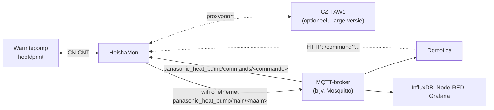

HeishaMon is een open-source module voor Panasonic Aquarea. De module leest de data van de
warmtepomp uit en kan de belangrijkste instellingen wijzigen. Zij vervangt of vult de
Panasonic-netwerkadapter CZ-TAW1 aan. De module stuurt zelf niets: u stuurt, met domotica of
met rules op de module zelf.

Documentatie, firmware en de volledige lijst met topics: [HeishaMon op GitHub](https://github.com/Egyras/HeishaMon).
Op Tweakers heeft HeishaMon een eigen topic.

**Zie ook:** [Panasonic: instellingen](../settings.md) · [Stooklijn](../../general/heating-curve.md) ·
[Pendelen](../../general/cycling.md) · [Home Assistant](home-assistant.md) · [Sensoren](../hardware/sensors.md) · [Bekabeling](../hardware/wiring.md)

Zo loopt de data. De CZ-TAW1 hangt op de proxypoort van de Large-versie (zie [Hardware](#hardware)).



### Bronnen

- [twain4me, 2023-03-13](https://gathering.tweakers.net/forum/list_message/74751460#74751460): topicstart, hoofdstuk *Heishamon*
- [thehog, 2022-08-15](https://gathering.tweakers.net/forum/list_message/72434202#72434202): HeishaMon stuurt zelf niets aan
- [thehog, 2021-11-29](https://gathering.tweakers.net/forum/list_message/69638584#69638584): apart HeishaMon-topic

## Hardware

- **Kant-en-klaar printje.** Te koop via de Tindie-winkel van thehog, een van de ontwikkelaars.
  Er zijn versies met wifi en met ethernet.
- **Large-versie.** Heeft een proxypoort voor de Panasonic-netwerkadapter. Zo werken HeishaMon en
  de cloud tegelijk; ook instellingen wijzigen via de cloud werkt dan.
- **Zelf bouwen.** De firmware is open source. Een gebruiker stelt een zelf gecompileerde
  HeishaMon op een ESP32 met ethernet voor.
- **Extra aansluitingen.** S0-ingangen voor twee kWh-meters (`S0_0`, `S0_1` en GND) en een
  schroefconnector voor 1-wire-sensoren (GND, data, 3,3 V). Op de foto van de v3-print heten de
  S0-klemmen `S0_1`, `S0_2` en GND; de print heeft ook een programmeerheader (3V, TX, RX, GND). Het bordje vanaf v3.3 heeft drie vrije GPIO's.
  Er is ook een versie voor een OpenTherm-thermostaat (in 2023 nog in bèta). De logica
  daarvoor maakt u zelf, bijv. met rules.

**Plaats en bereik**

- De behuizing van de warmtepomp schermt wifi af. Bij slecht bereik: zet de module in een
  waterdicht kastje buiten tegen de unit, of gebruik ethernet.
- De kabel naar de warmtepomp gebruikt een serieel protocol met een maximale lengte. Een
  gebruiker noemt 5 m zonder extra maatregelen. Voor lange afstanden bestaat een
  TTL-RS485-oplossing (zie de upstream-documentatie).

### Bronnen

- [twain4me, 2023-03-13](https://gathering.tweakers.net/forum/list_message/74751460#74751460): topicstart: Tindie, S0, Dallas-sensoren; klemmen v3-print (foto)
- [FransvWoerkom, 2026-01-01](https://gathering.tweakers.net/forum/list_message/84303098#84303098): Large-versie met proxypoort
- [Tiesert, 2026-04-06](https://gathering.tweakers.net/forum/list_message/85008894#85008894): cloudadapter op de proxy, instellingen wijzigen werkt
- [blb4, 2025-01-12](https://gathering.tweakers.net/forum/list_message/81293842#81293842): ethernet-versie, maximale kabellengte, OpenTherm via rules
- [sjimmie, 2021-01-27](https://gathering.tweakers.net/forum/list_message/65871178#65871178): zelf compileren op ESP32-ethernet-kit
- [thehog, 2021-01-14](https://gathering.tweakers.net/forum/list_message/65691762#65691762): drie vrije GPIO's vanaf v3.3
- [.Frank, 2022-01-09](https://gathering.tweakers.net/forum/list_message/70149256#70149256): OT-versie van het printje
- [blb4, 2023-09-20](https://gathering.tweakers.net/forum/list_message/76587156#76587156): OpenTherm nog in bèta
- [Fasthook, 2021-01-24](https://gathering.tweakers.net/forum/list_message/65835410#65835410): behuizing schermt af; kastje buiten
- [Pejdref, 2023-12-14](https://gathering.tweakers.net/forum/list_message/77500632#77500632): 5 m zonder versterking
- [thehog, 2021-10-01](https://gathering.tweakers.net/forum/list_message/68911190#68911190): TTL-RS485 voor lange afstanden

## Aansluiten: `CN-CNT` en `CN-NMODE`

HeishaMon gaat op de `CN-CNT`-aansluiting van de hoofdprint. Daar zit anders de CZ-TAW1.
De print heeft ook `CN-NMODE`, een 4-pins JST PH-connector. Die is elektrisch verbonden met
`CN-CNT`; alleen de 12 V ontbreekt, en die gebruikt HeishaMon niet.

- Sinds december 2022 levert thehog alleen nog `CN-NMODE`-kabels. Daarmee kiest u zelf:
  normaal of *listen only*, altijd op dezelfde connector.
- De binnenunit van de M-serie (WH-ADC…) heeft `CN-CNT2` voor de netwerkadapter en `CN-CNT`
  voor het uitbreidingsboard.

**Let op: Netspanning op de print.**

Op de hoofdprint staan hoge spanningen (bijv. 320 V op `CN-PUMP1`; handleiding H20: 280–373 V DC (handleiding, foto)). Schakel de spanning uit
voordat u een kabel aansluit. De handleiding noemt voor de pomp-aansluiting 280–373 V DC (pin 1 en 4)
en noemt die `CN-PUMP2`; op de print van een J-serie heet hij `CN-PUMP1`.

### Bronnen

- [thehog, 2021-11-03](https://gathering.tweakers.net/forum/list_message/69289546#69289546): `CN-CNT`; `CN-NMODE` is 4-pins JST PH
- [thehog, 2023-02-20](https://gathering.tweakers.net/forum/list_message/74523396#74523396): alleen nog `CN-NMODE`-kabels, normaal of listen only
- [thehog, 2023-02-20](https://gathering.tweakers.net/forum/list_message/74523546#74523546): `CN-NMODE` elektrisch verbonden; geen 12 V
- [FransvWoerkom, 2026-01-01](https://gathering.tweakers.net/forum/list_message/84303098#84303098): M-serie: `CN-CNT2` en `CN-CNT`
- [bazzzzzz, 2024-05-12](https://gathering.tweakers.net/forum/list_message/78965128#78965128): 320 V op `CN-PUMP1`; handleiding H20: 280–373 V DC (handleiding, foto)

## Alleen lezen of ook sturen

| Modus | Aansluiting | CZ-TAW1 | Sturen |
|---|---|---|---|
| *Listen only* (read-only) | `CN-NMODE` | blijft aangesloten | nee |
| Normaal (lezen en schrijven) | `CN-CNT` of `CN-NMODE` | moet eraf | ja |
| Large met proxy | `CN-CNT` | op de proxypoort | ja |

- Naast de CZ-TAW1 hebt u minstens firmware 3.1 nodig. Oudere versies brachten de CZ-TAW1 in
  storing, ook met *listen only* aan.
- *Listen only* zet u op afstand uit. Begin dus gerust read-only naast de CZ-TAW1, bijv. zolang
  de installateur via de cloud meekijkt.

### Bronnen

- [Tiesert, 2023-03-02](https://gathering.tweakers.net/forum/list_message/74639192#74639192): firmware 3.1, `CN-NMODE`, CZ-TAW1 eraf bij sturen
- [Tiesert, 2023-01-12](https://gathering.tweakers.net/forum/list_message/74108428#74108428): CZ-TAW1 valt weg met oudere HeishaMon
- [sjimmie, 2022-06-24](https://gathering.tweakers.net/forum/list_message/71938540#71938540): read-only op afstand uitzetten
- [sjimmie, 2021-03-09](https://gathering.tweakers.net/forum/list_message/66453790#66453790): CZ-TAW1 terug voor de leverancier, HeishaMon alleen read-only

## Instellen: wifi en MQTT

1. **Wifi.** Na een factory reset start HeishaMon een eigen hotspot. Ga naar `192.168.4.1` en
   stel in de webinterface het wifi-netwerk in. Ziet u de hotspot niet meer? Zet de groep
   van de warmtepomp even uit en weer aan.
2. **MQTT-broker.** HeishaMon publiceert zijn data via MQTT. U hebt een broker nodig,
   bijv. Mosquitto op een Raspberry Pi. Veel gebruikers zetten er InfluxDB, Node-RED en
   Grafana naast voor historie en grafieken.
3. **Zonder broker sturen.** HeishaMon accepteert ook HTTP-commando's (zie hieronder).

Na een firmware-update: controleer uw automatiseringen. Bij v1.0 kreeg de module een factory
reset en veranderden de topics. Slechte wifi gaf in oude versies veel MQTT-reconnects.

**Meningen verschillen.**

- **Niets voor beginners.** Wie de antwoorden niet zelf in het topic kan vinden, kan beter
  de standaard netwerkmodule en de app van Panasonic nemen.
- **Uitlezen valt mee.** Een beginner kreeg broker, database en dashboard werkend. Sturen
  vond hij lastiger.

### Bronnen

- [CurlyMo, 2021-05-05](https://gathering.tweakers.net/forum/list_message/67182712#67182712): hotspot, `192.168.4.1`, wifi in de webinterface
- [CurlyMo, 2021-01-11](https://gathering.tweakers.net/forum/list_message/65639928#65639928): groep uit- en aanzetten
- [Tiesert, 2023-10-19](https://gathering.tweakers.net/forum/list_message/76884972#76884972): broker, InfluxDB, Node-RED, Grafana; sturen via HTTP
- [ConQuestador, 2023-10-18](https://gathering.tweakers.net/forum/list_message/76878256#76878256): niets voor beginners
- [thehog, 2020-12-22](https://gathering.tweakers.net/forum/list_message/65357070#65357070): v1.0: factory reset en nieuwe topics
- [thehog, 2021-01-19](https://gathering.tweakers.net/forum/list_message/65751196#65751196): reconnect-bug bij slechte wifi opgelost in v1.0

## MQTT-topics en commando's

Waarden staan onder `panasonic_heat_pump/main/<naam>`, bijv. `Heatpump_State`. Commando's
stuurt u naar `panasonic_heat_pump/commands/<commando>`. Via HTTP:
`http://<ip-adres>/command?SetHeatpump=1`. Meerdere commando's combineert u met `&`.

| Commando | Werking |
|---|---|
| `SetHeatpump` | `1` aan, `0` uit. Zonder externe thermostaat stopt alleen `0` de waterpomp na de run; dan stopt ook SWW |
| `SetZ1HeatRequestTemperature` | Met stooklijn: de shift (−5 tot +5). Met directe temperatuur: het doel in °C |
| `SetOperationMode` | `0` verwarmen, `1` koelen, `3` SWW, `4` verwarmen + SWW |
| `SetForceDHW` | Start een SWW-run |
| `SetDHWTemp` | Doeltemperatuur SWW (40–75 °C) |
| `SetForceSterilization` | Start de legionellarun |
| `SetQuietMode` | Stille modus, bijv. `3` |
| `SetPump` | Waterpomp `1` aan, `0` uit |
| `SetMaxPumpDuty` | Maximale pompsnelheid, bijv. `124` |
| `SetCurves` | De hele stooklijn als JSON |

Let op:

- Met een externe thermostaat werkt de shift niet. Een gebruiker verschuift dan de hele
  stooklijn met `SetCurves`.
- Zet u de warmtepomp aan met `SetHeatpump=1`, dan begint hij in *verwarmen + SWW* met SWW.
  Een gebruiker zet daarom bij het uitzetten ook `SetOperationMode=0`.
- De blokkering op `CN4` gaat voor `SetHeatpump`.
- `Main_Target_Temp` (TOP7) is alleen-lezen: de warmtepomp berekent die zelf. De shift leest u
  in `Z1_Heat_Request_Temp` (TOP27).

Voorbeeld `SetCurves` (een bijna vlakke stooklijn, 26–28 °C):

```
SetCurves={"zone1":{"heat":{"target":{"high":28,"low":26},"outside":{"high":-7,"low":-15}}}}
```

### Bronnen

- [Binifada, 2022-09-08](https://gathering.tweakers.net/forum/list_message/72701102#72701102): topicstructuur `main/` en `commands/`
- [nike, 2023-06-01](https://gathering.tweakers.net/forum/list_message/75501966#75501966): `SetPump` via HTTP
- [Tiesert, 2023-03-15](https://gathering.tweakers.net/forum/list_message/74772552#74772552): commando's combineren met `&`
- [blb4, 2023-01-06](https://gathering.tweakers.net/forum/list_message/74044288#74044288): pomp blijft draaien; `SetHeatpump=0` stopt ook SWW
- [sjimmie, 2023-01-06](https://gathering.tweakers.net/forum/list_message/74044392#74044392): met externe thermostaat stopt de pomp ook
- [blb4, 2023-12-16](https://gathering.tweakers.net/forum/list_message/77524282#77524282): na `SetHeatpump=1` eerst SWW
- [blb4, 2023-12-17](https://gathering.tweakers.net/forum/list_message/77531568#77531568): `SetOperationMode = 0` bij uitzetten
- [dirkdeman, 2021-08-29](https://gathering.tweakers.net/forum/list_message/68537688#68537688): SET5: shift of directe temperatuur
- [sjimmie, 2021-01-26](https://gathering.tweakers.net/forum/list_message/65864178#65864178): geen shift met externe thermostaat; hele stooklijn verschuiven
- [dirkdeman, 2022-02-06](https://gathering.tweakers.net/forum/list_message/70499322#70499322): `SetOperationMode`, `SetForceDHW`, SWW 40–75 °C
- [thehog, 2022-09-13](https://gathering.tweakers.net/forum/list_message/72756406#72756406): `SetForceSterilization`, `SetDHWTemp`
- [The-Source, 2023-07-30](https://gathering.tweakers.net/forum/list_message/76078902#76078902): log met `SetQuietMode`, `SetPump`
- [thehog, 2022-09-10](https://gathering.tweakers.net/forum/list_message/72728308#72728308): `CN4` gaat voor `SetHeatpump`
- [stevenP, 2025-06-30](https://gathering.tweakers.net/forum/list_message/82809112#82809112): TOP7 is alleen-lezen
- [FransvWoerkom, 2024-10-20](https://gathering.tweakers.net/forum/list_message/80450472#80450472): TOP27 en de topiclijst
- [padoempats, 2022-12-20](https://gathering.tweakers.net/forum/list_message/73874950#73874950): `SetCurves`-voorbeeld

## 1-wire-temperatuursensoren

Op de schroefconnector sluit u DS18B20-sensoren (1-wire, "Dallas") aan. Hun waarden komen in
de MQTT-data. Zo meet u op extra plaatsen: aanvoer, retour, boiler, lucht.

- Nieuwere bordjes voeden de sensoren met 5 V in plaats van 3,3 V. Dat geeft meer kabellengte.
- Het uitlezen duurt ruim 700 ms.
- Originele Maxim-sensoren waren stabieler dan Chinese klonen.
- Voor ΔT telt vooral dat twee sensoren gelijk meten. Kalibreer ze samen, bijv. in een bak water.
- Voor goed contact: zet de sensor met koelpasta in een dompelbuis.

### Bronnen

- [thehog, 2021-09-17](https://gathering.tweakers.net/forum/list_message/68754020#68754020): sensoren voor extra metingen, waarden in MQTT
- [thehog, 2021-05-02](https://gathering.tweakers.net/forum/list_message/67144624#67144624): 5 V in plaats van 3,3 V
- [thehog, 2021-01-19](https://gathering.tweakers.net/forum/list_message/65751196#65751196): ruim 700 ms vertraging
- [CurlyMo, 2021-01-11](https://gathering.tweakers.net/forum/list_message/65635596#65635596): Maxim stabieler dan Chinese sensoren
- [Erwin94, 2022-08-20](https://gathering.tweakers.net/forum/list_message/72487676#72487676): twee sensoren samen kalibreren
- [Erwin94, 2023-01-22](https://gathering.tweakers.net/forum/list_message/74222506#74222506): dompelbuis met koelpasta

## Rules

Met rules draait uw logica op de HeishaMon zelf. U hebt dan geen domoticaserver nodig.
CurlyMo schreef de rules-library samen met thehog. De taal lijkt op de rules van ESPEasy.

| Element | Betekenis |
|---|---|
| `on <event> then … end` | Blok dat start bij een gebeurtenis of een aanroep |
| `on System#Boot then` | Draait bij het opstarten |
| `on @Compressor_Freq then` | Draait als die waarde van de warmtepomp verandert |
| `on timer=5 then` / `setTimer(5, 60)` | Timer 5, na 60 seconden |
| `@Outside_Temp` | Waarde van de warmtepomp lezen |
| `@SetHeatpump = 1;` | Commando naar de warmtepomp sturen |
| `#naam` / `$naam` | Globale / lokale variabele |
| `%hour`, `%month` | Uur en maand |
| `if … then … else … end` | Voorwaarde |

Voorbeeld: de maximale pompsnelheid volgt de compressorfrequentie. Zet de pomp in het
installatiemenu op *max duty*, niet op ΔT. De waarden vond de schrijver met proberen.

```
on System#Boot then
  #flowHigh = 140;
  #flowMid = 124;
  #flowLow = 92;
  #flowHighBoundary = 40;
  changePumpSpeed();
end

on @Compressor_Freq then
  changePumpSpeed();
end

on changePumpSpeed then
  if @Defrosting_State == 0 then
    if @Compressor_Freq > #flowHighBoundary then
      #flowHighBoundary = 30;
      $target = #flowHigh;
    else
      #flowHighBoundary = 40;
      if @Compressor_Freq > 0 then
        $target = #flowMid;
      else
        $target = #flowLow;
      end
    end
    if @Max_Pump_Duty != $target then
      @SetMaxPumpDuty = $target;
    end
  end
end
```

Tips:

- Stuur een commando alleen als de waarde verandert (zoals `@Max_Pump_Duty != $target`).
- Een gebruiker vroeg of elk `SetZ1HeatRequestTemperature`-commando naar het EEPROM van de
  warmtepomp schrijft. Het topic geeft geen duidelijk antwoord. CurlyMo beperkt het aantal
  commando's alleen voor de pomp; bij de doeltemperatuur zou de compressor anders ontsnappen.
- Versie 3.9 had een fout in de functies `ceil` en `floor` (gemeld in 2025).

### Bronnen

- [CurlyMo, 2021-04-30](https://gathering.tweakers.net/forum/list_message/67130744#67130744): rules-library, zoals ESPEasy
- [CurlyMo, 2021-09-12](https://gathering.tweakers.net/forum/list_message/68698828#68698828): volledige ruleset; syntaxis
- [dlrozendaal, 2024-10-16](https://gathering.tweakers.net/forum/list_message/80415276#80415276): rule voor de pompsnelheid
- [Robbiedobbie, 2022-09-19](https://gathering.tweakers.net/forum/list_message/72835126#72835126): vraag over EEPROM-schrijfacties
- [CurlyMo, 2022-09-19](https://gathering.tweakers.net/forum/list_message/72836584#72836584): beperking alleen bij de pomp
- [blb4, 2025-11-05](https://gathering.tweakers.net/forum/list_message/83861278#83861278): fout in Ceil & Floor in v3.9

## Voorbeelden

- **Sturen op minimaal vermogen.** De rules van CurlyMo zetten het doel steeds net onder de
  aanvoertemperatuur. De strategie staat op [Panasonic: instellingen](../settings.md#sturen-op-minimaal-vermogen-heishamon).
- **Stooklijn verschuiven.** Rules verhogen of verlagen de shift op basis van de
  kamertemperatuur. Een gebruiker kreeg zo wel meer pendelen bij mild weer. Een ander gebruikt
  de shift juist om ongewenst uitschakelen te voorkomen. Zie ook
  [Valse stops door de buitentemperatuur](../settings.md#valse-stops-door-de-buitentemperatuur).
- **Pompsnelheid naar buitentemperatuur.** De topicstart geeft een OpenHAB-script dat
  `Pump_Duty` aanpast. Met rules kan dit op de module (zie het voorbeeld hierboven).
- **SWW-run op commando.** `SetOperationMode=3`, dan `SetForceDHW`. Als `Force_DHW_State`
  weer `0` is: terug naar `0` (verwarmen).
- **Pomp periodiek laten draaien**, zodat hij niet vastloopt: `SetPump=1`, later `SetPump=0`.
- **OpenTherm-thermostaat.** Een Evohome met OpenTherm-module op HeishaMon stuurt de warmtepomp
  via rules.

### Bronnen

- [CurlyMo, 2021-09-12](https://gathering.tweakers.net/forum/list_message/68698828#68698828): ruleset voor minimaal vermogen en WAR
- [twain4me, 2023-03-13](https://gathering.tweakers.net/forum/list_message/74751460#74751460): topicstart, *Optimale pompsnelheid* en *Sturen op minimaal vermogen*
- [Beekforel, 2024-12-16](https://gathering.tweakers.net/forum/list_message/81040930#81040930): shift op kamertemperatuur, pendelen bij mild weer
- [blb4, 2024-03-02](https://gathering.tweakers.net/forum/list_message/78317946#78317946): shift tegen ongewenst uitschakelen
- [dirkdeman, 2022-02-06](https://gathering.tweakers.net/forum/list_message/70499322#70499322): SWW-run via `SetOperationMode` en `SetForceDHW`
- [nike, 2023-06-01](https://gathering.tweakers.net/forum/list_message/75501966#75501966): pomp periodiek laten draaien
- [blb4, 2025-02-16](https://gathering.tweakers.net/forum/list_message/81666986#81666986): Evohome met OpenTherm en rules
