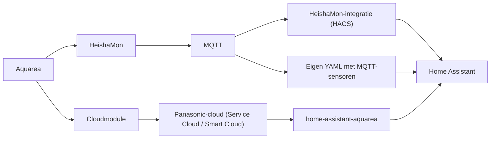

# Home Assistant

Met Home Assistant (HA) kunt u een Panasonic Aquarea uitlezen, grafieken maken en de
warmtepomp automatisch sturen. Deze pagina beschrijft de koppelingen en de automatiseringen
die gebruikers op het forum toepassen.

Stel eerst de warmtepomp zelf goed in. Begin daarna pas met domotica.
Zie [Panasonic: instellingen](../settings.md) en [Stooklijn](../../general/heating-curve.md).

**Zie ook:** [HeishaMon-documentatie](https://github.com/Egyras/HeishaMon) ·
[MQTT-topics](https://github.com/Egyras/HeishaMon/blob/master/MQTT-Topics.md) ·
[Pendelen](../../general/cycling.md) · [HeishaMon](heishamon.md) · [Cloud](cloud.md)

## Koppelen met Home Assistant

| Koppeling | Hoe | Voordelen | Nadelen |
|---|---|---|---|
| HeishaMon via MQTT | HeishaMon-integratie uit HACS, of eigen YAML met MQTT-sensoren | Lokaal, veel data, veel instellingen | Zelf bouwen; geen toegang van buitenaf zonder eigen oplossing |
| Panasonic-cloud | Integratie [home-assistant-aquarea](https://github.com/cjaliaga/home-assistant-aquarea) | Geen extra hardware | Afhankelijk van de cloud van Panasonic |

- **HeishaMon.** De HACS-integratie herkent de sensoren zonder extra werk. Met de optionele
  printplaat herkent hij ook twee zones. Een alternatief is de handmatige YAML uit de
  HeishaMon-repository. Oude YAML met `platform: mqtt` werkt niet meer sinds HA 2022.9:
  MQTT-entiteiten staan nu onder een eigen `mqtt:`-sleutel.
- **Cloud.** De cloudmodule blijft werken naast HA. Panasonic staat maar één ingelogd account
  tegelijk toe. Een gebruiker logt daarom met het serviceaccount in op de Service Cloud.
- **Cloud of lokaal.** In 2022 werkten de API-endpoints van de cloud een tijd niet en was er
  vaak onderhoud. Een gebruiker stapte daarom over op HeishaMon: lokaal, meer opties en
  stabieler.

### Bronnen

- [timovd, 2023-11-02](https://gathering.tweakers.net/forum/list_message/77039830#77039830): HACS-integratie of handmatige YAML
- [pgeene, 2023-05-12](https://gathering.tweakers.net/forum/list_message/75320464#75320464): HACS-integratie herkent twee zones met extra print
- [Binifada, 2022-09-08](https://gathering.tweakers.net/forum/list_message/72701102#72701102): YAML aangepast na update HA 2022.9
- [dof, 2022-09-08](https://gathering.tweakers.net/forum/list_message/72699720#72699720): MQTT-instellingen nu via de integratie
- [Cklaver, 2023-11-02](https://gathering.tweakers.net/forum/list_message/77041450#77041450): cloudintegratie, cloud werkt naast HA
- [ErikKo, 2023-11-02](https://gathering.tweakers.net/forum/list_message/77042302#77042302): één ingelogd account
- [Cklaver, 2023-11-02](https://gathering.tweakers.net/forum/list_message/77043060#77043060): inloggen met serviceaccount
- [Niltag, 2022-09-30](https://gathering.tweakers.net/forum/list_message/72968906#72968906): cloud-API stuk, HeishaMon lokaal
- [CurlyMo, 2023-04-24](https://gathering.tweakers.net/forum/list_message/75148702#75148702): eerst de warmtepomp instellen

## Dashboards en grafieken

Gebruikers maken grafieken op drie manieren:

- **In HA zelf**, met de HeishaMon-data via MQTT. Nuttige grafieken: aanvoer-, retour- en
  doeltemperatuur, compressorfrequentie en vermogen.
- **InfluxDB en Grafana.** HA of Telegraf schrijft de MQTT-data naar InfluxDB. Grafana toont de
  grafieken. Zo bewaart u lange reeksen met korte intervallen.
- **Node-RED.** Er is een kant-en-klaar Node-RED-dashboard voor HeishaMon. Node-RED kan ook
  binnen HA draaien.

De HACS-integratie geeft de sensoren namen als `Aquarea Compressor Frequency`,
`Aquarea Inlet Temperature`, `Aquarea Outlet Temperature`, `Aquarea Outdoor Ambient`,
`Aquarea Pump Flow` en `Aquarea Tank Actual Tank Temperature`. Een kWh-meter op de S0-ingang
verschijnt als eigen entiteit, bijv. `HeishaMon s0 2 Watt`. Een compleet dashboard bevat ook
de kamertemperatuur, de doeltemperatuur (*T-vraag*), een keuzelijst voor de bedrijfsstand
(`Aquarea Mode`), de vakantieschakelaar, het aantal ontdooiingen vandaag en de COP.
In zulke grafieken ziet u de compressor in blokken op ongeveer 20 Hz draaien.

Let op de resolutie. Sommige units sturen temperaturen in hele graden. Dat vertekent de
grafieken. De web-UI van HeishaMon toont in- en uitlaat soms in stappen van 0,25 °C. HA rondt die
waarde af op het aantal decimalen van de entiteit. Dat aantal kunt u verhogen naar 2.

### Bronnen

- [ErikKo, 2024-10-04](https://gathering.tweakers.net/forum/list_message/80306244#80306244): grafieken in HA via MQTT, doeltemperatuur
- [wheli, 2023-10-15](https://gathering.tweakers.net/forum/list_message/76844748#76844748): grafiek compressorfrequentie in HA (screenshot)
- [Beer070, 2025-12-30](https://gathering.tweakers.net/forum/list_message/84286086#84286086): HA, InfluxDB en Grafana; hele graden
- [Erwin94, 2023-01-22](https://gathering.tweakers.net/forum/list_message/74222506#74222506): InfluxDB met Telegraf en Grafana
- [Thorsd, 2024-01-21](https://gathering.tweakers.net/forum/list_message/77882942#77882942): kleine logintervallen met HeishaMon en HA
- [hemertje, 2025-02-21](https://gathering.tweakers.net/forum/list_message/81720206#81720206): Node-RED-dashboard voor HeishaMon
- [dirkdeman, 2021-08-29](https://gathering.tweakers.net/forum/list_message/68546946#68546946): Node-RED werkt onder HA of Domoticz
- [tieske_janssen, 2024-06-18](https://gathering.tweakers.net/forum/list_message/79317176#79317176): entiteit `HeishaMon s0 2 Watt`, tanktemperatuur (screenshot)
- [vandermark, 2025-10-08](https://gathering.tweakers.net/forum/list_message/83628328#83628328): compleet dashboard met `Aquarea Mode` (screenshot)
- [blb4, 2025-11-05](https://gathering.tweakers.net/forum/list_message/83859934#83859934): 0,25 °C in web-UI, decimalen in HA

## Energie en COP bijhouden

Het opgenomen vermogen dat de warmtepomp zelf meldt (`Heat_Power_Consumption`, TOP16) is
grof: stappen van 200 W. Het geleverde vermogen (`Heat_Power_Production`, TOP15) is redelijk
bruikbaar. Voor een realistische COP combineert u dat met een eigen kWh-meter, bijv. via de
S0-ingang van HeishaMon.

De COP schiet tijdens het ontdooien omhoog in plaats van omlaag. Panasonic neemt bij TOP15
waarschijnlijk de absolute waarde. Reken het geleverde vermogen daarom zelf uit:

> geleverd vermogen (W) ≈ 70 × `Pump_Flow` (TOP1, l/min) × (`Main_Outlet_Temp` TOP6 − `Main_Inlet_Temp` TOP5)

Het is aanvoer min retour. In de bron staat twee keer *Tinlet*; dat is een typefout.
Deze uitkomst wordt negatief tijdens het ontdooien. Deel door het gemeten verbruik voor de COP.

**Dag-COP.** Bewaar de energie (geproduceerd en verbruikt), niet de COP. Een gemiddelde
van COP-waarden over de tijd is misleidend. De dag-COP is geproduceerde energie gedeeld door
verbruikte energie. Voorbeeld: 12 uur 1 kW met COP 6 en 12 uur 10 kW met COP 2. Het
tijdgemiddelde is 4, de werkelijke dag-COP is 132 ÷ 62 ≈ 2,1.

!!! note "Meningen verschillen"
    Een gebruiker raadt de integratie
    [HADailySensor](https://github.com/jeroenterheerdt/HADailySensor) aan voor een dagelijkse
    SCOP. Een ander wijst erop dat die een tijdgemiddelde berekent.

### Bronnen

- [ErikVers, 2022-10-01](https://gathering.tweakers.net/forum/list_message/72975110#72975110): verbruik onbruikbaar, eigen kWh-meter en S0 (screenshot)
- [Amrod, 2026-01-07](https://gathering.tweakers.net/forum/list_message/84350618#84350618): L-serie, COP stijgt bij ontdooien
- [blb4, 2026-01-07](https://gathering.tweakers.net/forum/list_message/84351084#84351084): absolute waarde TOP15, formule, afronding TOP16
- [cerebrum, 2026-01-07](https://gathering.tweakers.net/forum/list_message/84351038#84351038): vermogen zelf berekenen met templates
- [rvdgaag, 2026-01-07](https://gathering.tweakers.net/forum/list_message/84351530#84351530): HADailySensor
- [cerebrum, 2026-01-07](https://gathering.tweakers.net/forum/list_message/84352940#84352940): tijdgemiddelde COP is misleidend

## Kamertemperatuur regelen vanuit HA

Veel gebruikers laten HA de thermostaat zijn. HA leest een kamersensor (bijv. Zigbee) en
stuurt de warmtepomp via HeishaMon. Twee aanpakken:

- **Aan/uit.** Zet de warmtepomp uit met de schakelaar van HeishaMon
  (`switch.panasonic_heat_pump_main_heatpump_state` in de HACS-integratie). Controleer eerst
  of er geen ontdooiing, legionella- of SWW-run bezig is. *Climate Zone 1* op *Off* zetten via
  HeishaMon werkt niet.
- **Bijsturen met shift.** Verhoog of verlaag de stooklijn op basis van de kamertemperatuur.
  Zie het volgende hoofdstuk.

Voorbeeld van een set automatiseringen (J-serie, fysieke thermostaat als invoer):

1. Kamer te koud en stijgt niet, terwijl de compressor draait of langer dan 2 uur uit is:
   shift +1 en zet de warmtepomp aan.
2. Kamer te warm en stijgt: shift −1. Onder 10 °C buiten of bij een korte run alleen als de
   compressor dan blijft draaien (frequentie > 25 Hz).
3. Compressor stopt: zet de warmtepomp uit, zodat hij niet uit zichzelf weer start.

Een fysieke thermostaat kan ook via `CN2` of `CN4` schakelen, met HA als regelaar van het
setpoint. Zie [Kamerthermostaat](../settings.md#kamerthermostaat) voor het verschil.
Een lange run op minimaal vermogen staat in
[Sturen op minimaal vermogen](../settings.md#sturen-op-minimaal-vermogen-heishamon).

### Bronnen

- [denneappel, 2023-10-28](https://gathering.tweakers.net/forum/list_message/76992830#76992830): automatiseringen shift +1, shift −1, uit bij compressorstop
- [Nnoitra, 2025-02-25](https://gathering.tweakers.net/forum/list_message/81751656#81751656): entiteit voor uitzetten, eerst ontdooien en SWW controleren
- [loyske, 2025-02-25](https://gathering.tweakers.net/forum/list_message/81751694#81751694): *Climate Zone 1 Off* niet geaccepteerd
- [dirkdeman, 2022-01-24](https://gathering.tweakers.net/forum/list_message/70348360#70348360): thermostaat met hysterese en nachtverlaging in Node-RED
- [ConQuestador, 2024-06-14](https://gathering.tweakers.net/forum/list_message/79272406#79272406): thermostaat op meerdere sensoren
- [sjimmie, 2022-01-24](https://gathering.tweakers.net/forum/list_message/70341584#70341584): ESP-thermostaat op externe aansluiting, HA past setpoint aan

## De stooklijn schuiven

Een shift verhoogt of verlaagt de hele stooklijn met −5 tot +5 °C. HA kan de shift aanpassen op
basis van de kamertemperatuur, de zon of de buitentemperatuur. Voorbeelden van gebruikers:

| Gebruiker | Regel |
|---|---|
| 7J | Boven 21 °C binnen: shift −1. Onder 20 °C: terug naar 0. |
| — | Boven 20,3 °C binnen: shift −5. Onder 19,5 °C: shift +2. |
| — | Onder 5 °C buiten de stooklijn verlagen. Bij 19,8 °C binnen shift −1; bij 20,3 °C alleen SWW. |

De topicstart beschrijft een *automagische stooklijncorrectie*: hoe groter het verschil tussen
kamer en setpoint, hoe groter de stap (bijv. stappen bij 0,1, 0,3 en 0,6 °C te warm). Dit vangt
zon, houtkachel of oven op. Het werkt alleen als de warmtepomp nog ruimte heeft om te
moduleren. Op minimaal vermogen kan hij niet minder leveren.

Een andere aanpak: zet de warmtepomp op een vaste watertemperatuur (*direct*) en reken de
stooklijn in HA uit. Een shift is dan een wijziging van de doeltemperatuur. Die gaat in stappen
van 1 °C, maar u kunt meer invoer gebruiken, bijv. zoninstraling.

Shift of thermostaat hoger? Een hogere shift verhoogt de aanvoertemperatuur (Ta) meteen. Een
hoger setpoint op een externe thermostaat doet niets met de Ta. De interne thermostaat van de
controller verhoogt de Ta zelf als het setpoint lang uitblijft.

!!! note "Meningen verschillen"
    - Een shift gaat soms niet laag genoeg om oververhitting te voorkomen. Advies: verlaag
      eerst de basisstooklijn.
    - Met een externe thermostaat is de shift op de controller van een J-serie niet beschikbaar.
      Een gebruiker past daarom via HA de hele stooklijn aan. Een gebruiker met een G-serie
      kan wel shiften.

### Bronnen

- [twain4me, 2023-03-13](https://gathering.tweakers.net/forum/list_message/74751460#74751460): topicstart, *Automagische stooklijncorrectie*
- [dirkdeman, 2021-08-29](https://gathering.tweakers.net/forum/list_message/68546946#68546946): shift −5 tot +5, zon compenseren
- [loyske, 2025-02-25](https://gathering.tweakers.net/forum/list_message/81750948#81750948): 7J, shift −1 boven 21 °C
- [RaymondD, 2024-03-16](https://gathering.tweakers.net/forum/list_message/78462442#78462442): shift −5 en +2
- [ErikVers, 2024-12-28](https://gathering.tweakers.net/forum/list_message/81145630#81145630): stooklijn verlagen, naar alleen SWW
- [Pejdref, 2024-10-19](https://gathering.tweakers.net/forum/list_message/80446382#80446382): directe temperatuur, stooklijn in HA, stappen van 1
- [FransvWoerkom, 2025-02-23](https://gathering.tweakers.net/forum/list_message/81739410#81739410): shift tegenover thermostaat, Pi Control
- [I-King, 2023-12-26](https://gathering.tweakers.net/forum/list_message/77609234#77609234): shift niet laag genoeg
- [flippy, 2023-12-26](https://gathering.tweakers.net/forum/list_message/77609386#77609386): eerst stooklijn lager
- [sjimmie, 2021-02-10](https://gathering.tweakers.net/forum/list_message/66089148#66089148): J-serie, geen shift met externe thermostaat
- [Wolly, 2021-02-10](https://gathering.tweakers.net/forum/list_message/66091190#66091190): G-serie, shift werkt wel

## Nachtverlaging op de weersverwachting

Een gebruiker met een 5J laat HA elke avond om 22:00 de nachtverlaging kiezen. Invoer is de
verwachte minimum- en maximumtemperatuur van morgen (KNMI-integratie). Een zachte dag geeft
een grote verlaging: de warmtepomp blijft tot 9:00 uit. Een koude dag geeft een kleine
verlaging: het huis blijft warmer en de warmtepomp hoeft 's ochtends minder hard te werken.
Een *scheduler*-integratie zet het setpoint van de woonkamer.

Een verfijning: maak het setpoint een formule in plaats van twee standen, bijv.
15 + (12 − gemiddelde buitentemperatuur) × factor.

!!! note "Meningen verschillen"
    Niet iedereen is voor nachtverlaging. Wat u 's nachts mist, moet de warmtepomp 's ochtends
    inhalen. Sommigen houden hem liever lang op laag vermogen.

### Bronnen

- [vandermark, 2025-10-08](https://gathering.tweakers.net/forum/list_message/83628328#83628328): 5J, HA-thermostaat met nachtverlaging (screenshot)
- [vandermark, 2025-10-29](https://gathering.tweakers.net/forum/list_message/83802312#83802312): KNMI-sensor, 22:00, scheduler
- [The_Woesh, 2025-10-29](https://gathering.tweakers.net/forum/list_message/83803148#83803148): formule, geen fan van nachtverlaging

## Sturen op stroomprijs of zonnestroom

Met een dynamisch contract of zonnepanelen kan HA warmte verschuiven naar goedkope of groene
uren. Het huis en het tapwatervat dienen dan als buffer. Voorbeelden:

- **Kamer voorladen.** Zet het setpoint enkele uren vóór een dure periode hoger
  (bijv. 20 → 21,5 °C) en daarna terug. Een shift van de stooklijn werkt ook en reageert sneller.
- **Tapwater overdag.** Stel de SWW-doeltemperatuur per tijdvak in. Voorbeeld: 42 °C op dure
  uren en 47 °C tussen 11:30 en 15:00. Met een hysterese van 5 °C start de warmtepomp dan
  bijna altijd overdag, bij zonnestroom of lage prijs.
- **Aan bij zonnestroom.** Zet de warmtepomp aan als er 's ochtends genoeg zonopwek is.
- **Prijs × COP.** Combineer de verwachte COP (uit de buitentemperatuur, bijv. van een 7 kW
  J-serie) met de uurprijs (NordPool-integratie). Kies de uren met de laagste
  verwachte COP × kWh-prijs. 's Nachts is de prijs vaak lager, maar de COP ook.

De optionele printplaat heeft een SG-Ready-ingang. Die kent uit, normaal en twee standen met
extra capaciteit, die de setpoints van SWW en verwarming verschuiven. Volgens een gebruiker
kan HeishaMon hetzelfde.

### Bronnen

- [hemertje, 2025-02-21](https://gathering.tweakers.net/forum/list_message/81720206#81720206): plan voor dynamisch sturen, setpoint vooraf hoger
- [hemertje, 2025-02-22](https://gathering.tweakers.net/forum/list_message/81727934#81727934): "duurzaam sturen"
- [Thorsd, 2025-02-22](https://gathering.tweakers.net/forum/list_message/81728288#81728288): shift in plaats van kamertemperatuur, lagere COP 's nachts
- [blb4, 2025-02-22](https://gathering.tweakers.net/forum/list_message/81728284#81728284): kosten- tegenover duurzaam sturen, oplossingen in HA
- [wheli, 2023-09-01](https://gathering.tweakers.net/forum/list_message/76392518#76392518): SWW-doeltemperatuur per tijdvak
- [Beekforel, 2024-10-21](https://gathering.tweakers.net/forum/list_message/80465706#80465706): aan bij zonopwek via HA
- [Pejdref, 2024-10-19](https://gathering.tweakers.net/forum/list_message/80446382#80446382): verwachte COP × uurprijs
- [Thorsd, 2024-10-22](https://gathering.tweakers.net/forum/list_message/80470084#80470084): SG-Ready eenvoudig, kan ook via HeishaMon
- [FransvWoerkom, 2024-08-02](https://gathering.tweakers.net/forum/list_message/79734408#79734408): SG-Ready op optionele print

## Vakantie

De warmtepomp heeft een vakantiestand (*holiday mode*) met timer. Via HeishaMon:

- Aan/uit: `panasonic_heat_pump/commands/SetHolidayMode` (`1`/`0`).
- Status: `Holiday_Mode_State` (TOP19).
- Verlaging: `Room_Holiday_Shift_Temp` (TOP45) en `DHW_Holiday_Shift_Temp` (TOP25), in K.

Een gebruiker met een 9J zag de vakantiestand uit de Service Cloud en Smart Cloud niet
opgeslagen worden. HeishaMon heeft geen cloud. Wilt u de warmtepomp op afstand aanzetten, dan
moet u zelf toegang van buitenaf regelen (bijv. via HA).

!!! note "Meningen verschillen"
    - Uit, en via HA een dag of 8 uur vóór thuiskomst weer aan.
    - Thermostaat lager, bijv. 17 °C. Uit met vloerverwarming werkt minder goed.
    - Gewoon 24/7 dezelfde temperatuur houden.
    - Bij een lage instelling zag een gebruiker met alleen vloerverwarming de backup heater
      bijschakelen en pendelen.

Na de vakantie doen sommigen een legionellarun, bijv. geforceerd via HeishaMon.
Zie [Legionella](../../general/legionella.md).

### Bronnen

- [FransvWoerkom, 2023-02-28](https://gathering.tweakers.net/forum/list_message/74606766#74606766): holiday mode met timer, uit en vloerverwarming
- [Binifada, 2022-09-08](https://gathering.tweakers.net/forum/list_message/72701102#72701102): MQTT-topics `SetHolidayMode`, `Holiday_Mode_State`
- [tieske_janssen, 2024-06-18](https://gathering.tweakers.net/forum/list_message/79317176#79317176): TOP19, TOP25, TOP45 (screenshot)
- [nokiaan958GB, 2023-12-07](https://gathering.tweakers.net/forum/list_message/77438030#77438030): 9J, vakantiestand via cloud niet opgeslagen
- [thehog, 2022-03-12](https://gathering.tweakers.net/forum/list_message/70911282#70911282): HeishaMon heeft geen cloud
- [dof, 2023-02-27](https://gathering.tweakers.net/forum/list_message/74606660#74606660): uit, via HA op afstand weer aan
- [blb4, 2023-02-27](https://gathering.tweakers.net/forum/list_message/74606684#74606684): uit, 8 uur voor thuiskomst aan
- [sjimmie, 2023-12-19](https://gathering.tweakers.net/forum/list_message/77545078#77545078): thermostaat op 17 °C
- [CurlyMo, 2023-12-19](https://gathering.tweakers.net/forum/list_message/77544980#77544980): 24/7 constante temperatuur
- [KaDoos, 2023-02-28](https://gathering.tweakers.net/forum/list_message/74608580#74608580): backup heater bij lage instelling
- [dirkdeman, 2022-02-07](https://gathering.tweakers.net/forum/list_message/70511612#70511612): legionellarun na vakantie
- [cerebrum, 2026-08-24](https://gathering.tweakers.net/forum/list_message/85992130#85992130): geforceerde sterilisatie via HeishaMon

## Als Home Assistant uitvalt

Laat de verwarming niet volledig van HA afhangen. Houd de controller van Panasonic als
terugvaloptie. Valt HA uit, dan zet u met een knop op de controller de verwarming of SWW weer
aan. Met een eigen thermostaat (bijv. op een ESP) blijft de regeling ook zonder HA werken.

### Bronnen

- [dirkdeman, 2022-01-10](https://gathering.tweakers.net/forum/list_message/70164922#70164922): alles moet blijven werken zonder HA
- [Krilo_89, 2022-08-15](https://gathering.tweakers.net/forum/list_message/72433920#72433920): controller als terugval
- [RaymondD, 2024-03-16](https://gathering.tweakers.net/forum/list_message/78462442#78462442): verwarming niet afhankelijk van HA
- [sjimmie, 2022-01-24](https://gathering.tweakers.net/forum/list_message/70341584#70341584): ESP-thermostaat regelt autonoom
