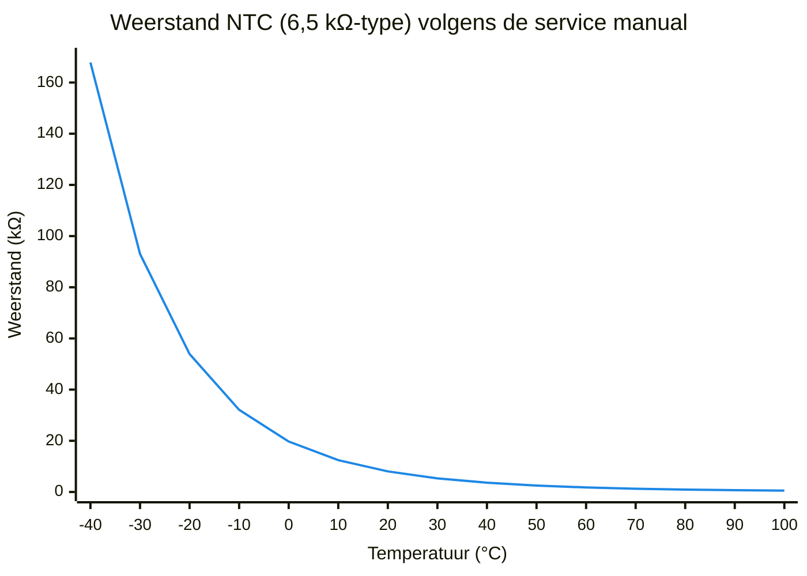

De Panasonic Aquarea meet temperaturen met NTC-thermistors: buiten, aanvoer en retour,
de SWW-tank, en optioneel buffervat, zones en kamer. Deze pagina beschrijft de plaats,
de nauwkeurigheid en de correctie van die sensoren.

Foutcodes van sensoren (`H43`, `H67`, `H15`, `F36`) staan op
[Storingen en foutcodes](../troubleshooting.md#sensoren-h43-h67-h15-f36-f37-f48).

**Zie ook:** [Stooklijn](../../general/heating-curve.md) · [Pendelen](../../general/cycling.md) ·
[Ontdooien](../../general/defrost.md) · [Instellingen](../settings.md) · [Bekabeling](wiring.md) · [HeishaMon](../control/heishamon.md)

**Let op: Spanning uit.**

Sensoren zitten op de printplaat van de warmtepomp. Daar staat ook netspanning op.
Schakel de spanning uit voordat u een sensor losmaakt of een weerstand aansluit.
Een sensor losmaken onder spanning geeft bovendien een foutcode.

## Buitensensor

De standaard buitensensor zit achterop de warmtepomp, in de aangezogen lucht. Bij de
meeste opstellingen is dat goed genoeg.

De warmtepomp gebruikt de buitentemperatuur voor de [stooklijn](../../general/heating-curve.md),
voor de grenzen van de compressor en voor de beslissing om te
[ontdooien](../../general/defrost.md). Een verkeerde meting heeft dus meer gevolgen dan
alleen een verkeerde aanvoertemperatuur.

**Zon.** Schijnt de zon op de achterkant, dan meet de sensor veel te hoog. Gemeld zijn
24 °C bij 13 °C buiten en 23 °C op een plat dak op het zuiden. Oplossingen:

1. Maak schaduw, als het om een klein beetje zon gaat.
2. Hang een losse buitensensor (`PAW-A2W-TSOD`) op een betere plek. Voorbeelden: onder de
   warmtepomp met tie-wraps, onder een zonnepaneel, of op een onverwarmde muur op het noorden.
3. Sluit de losse sensor aan op `CN5`. Activeer hem onder *Installateursinstellingen →
   Systeeminst. → Alternatieve buitensensor*. De sensor achterop is dan niet meer actief.

Een losse sensor meet ook niet de koude lucht die rond de warmtepomp blijft hangen.
Compatibele sensoren voor de H- en J-serie zijn goedkoper dan het origineel (circa € 34).
Ook een buffersensor kan dienen: de karakteristiek is gelijk (zie [NTC-waarden](#ntc-waarden)).

### Bronnen

- [FransvWoerkom, 2022-11-13](https://gathering.tweakers.net/forum/list_message/73444848#73444848): sensor in de aangezogen lucht; volstaat meestal
- [FransvWoerkom, 2023-10-17](https://gathering.tweakers.net/forum/list_message/76871726#76871726): losse sensor op `CN5`, menu *Alternatieve buitensensor*
- [FransvWoerkom, 2024-01-29](https://gathering.tweakers.net/forum/list_message/77970580#77970580): buitensensor ook gebruikt voor ontdooien
- [Thorsd, 2023-10-17](https://gathering.tweakers.net/forum/list_message/76870802#76870802): schaduw maken of externe sensor; ±2 °C in het menu
- [Possible, 2021-09-20](https://gathering.tweakers.net/forum/list_message/68781372#68781372): 24 °C gemeten bij 13 °C buiten
- [ASW1, 2023-10-21](https://gathering.tweakers.net/forum/list_message/76911140#76911140): 23 °C op plat dak; sensor gelijk aan buffersensor
- [ErikKo, 2023-10-18](https://gathering.tweakers.net/forum/list_message/76873280#76873280): losse sensor onder de warmtepomp
- [blb4, 2024-12-11](https://gathering.tweakers.net/forum/list_message/81002540#81002540): externe sensor op noordmuur
- [Tiesert, 2023-10-17](https://gathering.tweakers.net/forum/list_message/76871604#76871604): geen invloed van koude lucht rond de warmtepomp
- [RichieB, 2025-01-09](https://gathering.tweakers.net/forum/list_message/81259248#81259248): compatibele sensor H- en J-serie

## Kalibratie

Panasonic-sensoren zijn niet erg nauwkeurig. Een verschil tussen aanvoer en retour
beïnvloedt de regeling en de berekende productie. Per sensor kunt u een vaste afwijking
instellen van maximaal ±2 °C.

1. Zet de warmtepomp uit.
2. Houd 5 seconden ↵ + terugtoets + pijl rechts ingedrukt. U komt in het *Maintenance menu*.
3. Kies *Sensor setup* en stel de afwijking per sensor in.

Controle van aanvoer en retour: laat de warmtepomp enkele minuten water rondpompen met een
lage doeltemperatuur (bijv. 20 °C). Kijk bij *Systeem check → Watertemperaturen*. Aanvoer en
retour horen dan gelijk te zijn.

Let op: deze methode maakt de twee sensoren alleen gelijk bij die ene temperatuur.
Sensoren die gelijk waren bij 15 °C verschilden na een SWW-run naar 53 °C 1,5 °C.

Een grotere afwijking (bijv. 10 °C bij een tanksensor) lost kalibratie niet op. Controleer
het type sensor en de plaats. In een SWW-vat is het boven de sensor warmer dan op de sensor.

**Meningen verschillen.**

De topicstart noemt ↵ + terug + rechts. Een andere gebruiker noemt terug + ↵ + links.
Controleer de toetsen in de service manual van uw model.

### Bronnen

- [twain4me, 2023-03-13](https://gathering.tweakers.net/forum/list_message/74751460#74751460): topicstart, *Sensoren kalibreren*: Maintenance menu en controle
- [ErikKo, 2024-04-12](https://gathering.tweakers.net/forum/list_message/78706284#78706284): *Sensor setup*; andere toetscombinatie
- [Milenco, 2024-04-12](https://gathering.tweakers.net/forum/list_message/78706186#78706186): correctie maximaal 2 °C; tank 10 °C te laag
- [Thorsd, 2024-04-12](https://gathering.tweakers.net/forum/list_message/78707420#78707420): gelaagdheid in het vat; sensor met andere karakteristiek
- [FransvWoerkom, 2024-11-06](https://gathering.tweakers.net/forum/list_message/80628112#80628112): gelijk bij 15 °C, 1,5 °C verschil bij 53 °C

## Resolutie van de watertemperatuur

De warmtepomp leest aanvoer en retour in stappen van 0,25 °C. De Service Cloud en de
web-interface van HeishaMon tonen die stappen (bijv. `Main_Outlet_Temp` 30.25 °C). Het
display van de afstandsbediening rondt naar beneden af op hele graden. Ziet u in Home Assistant hele graden, controleer dan het
aantal decimalen van de entiteit.

Bij een flow van 15 l/min geeft 1 °C fout in ΔT al ongeveer 1 kW fout in het berekende
vermogen. Zie [Stooklijn: controleren in de praktijk](../../general/heating-curve.md#controleren-in-de-praktijk).
Wilt u nauwkeuriger meten, plaats dan eigen sensoren (bijv. DS18B20) in een dompelbuis met
koelpasta. Op HeishaMon hangen meerdere DS18B20-sensoren parallel aan één 1-wire-bus
(GND, data, 3,3 V).

**Meningen verschillen.**

Op een `WH-WXG16ME8` met control box `WH-CME8` gaf de warmtepomp alleen hele graden door,
ook via HeishaMon. In 2023 meldde een gebruiker ook hele graden in HeishaMon.
Mogelijk hangt dit af van model of firmware.

### Bronnen

- [FransvWoerkom, 2021-11-26](https://gathering.tweakers.net/forum/list_message/69599218#69599218): Service Cloud toont 0,25 °C
- [blb4, 2025-11-05](https://gathering.tweakers.net/forum/list_message/83859934#83859934): HeishaMon inlet/outlet op 0,25 °C; decimalen in HA
- [tieske_janssen, 2024-06-18](https://gathering.tweakers.net/forum/list_message/79317176#79317176): `Main_Outlet_Temp` 30.25 °C
- [Beer070, 2025-12-31](https://gathering.tweakers.net/forum/list_message/84297222#84297222): `WH-WXG16ME8` geeft hele graden
- [FransvWoerkom, 2026-01-02](https://gathering.tweakers.net/forum/list_message/84308284#84308284): control box `WH-CME8`
- [FransvWoerkom, 2023-02-21](https://gathering.tweakers.net/forum/list_message/74542678#74542678): display rondt naar beneden af
- [sjimmie, 2023-02-22](https://gathering.tweakers.net/forum/list_message/74552412#74552412): hele graden in HeishaMon
- [Erwin94, 2023-01-22](https://gathering.tweakers.net/forum/list_message/74222506#74222506): DS18B20 in dompelbuis met koelpasta
- [twain4me, 2023-03-13](https://gathering.tweakers.net/forum/list_message/74751460#74751460): DS18B20-sensoren op één 1-wire-bus (schema)

## Tanksensor (SWW)

De tanksensor heeft een andere karakteristiek dan de andere sensoren (zie
[NTC-waarden](#ntc-waarden)). Een buffersensor is dus niet geschikt voor het SWW-vat.
Panasonic levert de tanksensoren TS1, TS2 en TS4. Een eigen sensor met een NTC van 2 kΩ
werkt ook.

- **Plaats.** Bij voorkeur in een dompelbuis. Een sensor tegen de wand van het vat, onder
  de isolatie en met goed contact, werkt ook. Voor de hoogte van de sensor, zie
  [Tapwater: wanneer opwarmen](../../general/hot-water.md#wanneer-opwarmen).
- **Testen.** Meet de weerstand met een universeelmeter en vergelijk met de tabel in de
  service manual. Test de losse sensor in ijswater en in heet water. Eén aansluiting zit
  aan aarde; op de andere staat een spanning van enkele volts.
- **Storing.** Blijft de gemeten temperatuur te laag (bijv. nooit boven 44 °C), verdenk dan
  een slecht contact in sensor of kabel. Dat verhoogt de weerstand en de warmtepomp leest
  een lagere temperatuur.

### Bronnen

- [FransvWoerkom, 2021-11-04](https://gathering.tweakers.net/forum/list_message/69306682#69306682): tanksensor wijkt af van de andere sensoren
- [FransvWoerkom, 2022-11-13](https://gathering.tweakers.net/forum/list_message/73444848#73444848): TS1, TS2, TS4 of eigen 2k-NTC
- [bbbrumbrum, 2024-10-09](https://gathering.tweakers.net/forum/list_message/80354284#80354284): dompelbuis voor de NTC
- [Andrehj, 2022-11-18](https://gathering.tweakers.net/forum/list_message/73515708#73515708): sensor tegen het vat werkt
- [FransvWoerkom, 2024-04-30](https://gathering.tweakers.net/forum/list_message/78858982#78858982): testen; slecht contact; `H72` bij losmaken onder spanning

## Buffer- en zonesensoren

Voor een buffervat of meer zones zijn de optionele printplaat `CZ-NS4P` en de optionele
sensoren nodig. De buffersensor komt op `CN205`, de watertemperatuursensor van zone 1 op
`CN204`. Gebruik een Panasonic-compatibele NTC; een PT1000 op `CN204` gaf 75 °C bij
ongeveer 22 °C.

Wat de sensoren doen, met een buffervat ingesteld:

- De doeltemperatuur van de warmtepomp is: hoogste Ta van zone 1 en 2 + buffer-ΔT + 2 °C.
- De buffer-ΔT is het verschil in setpoint tussen buffervat en zones, geen schakelhysterese.
- De buffersensor schakelt de warmtepomp uit als het vat te warm wordt.
- De zonesensoren regelen alleen een mengklep.

Montage volgens de service manual (paragraaf 11.3.1.3):

| Sensor | Montage |
|---|---|
| `PAW-A2W-TSBU` (buffer) | In de sensorhuls van het vat, of op het oppervlak van het vat met contactpasta |
| `PAW-A2W-TSHC` (zonewater, ook zwembad) | Op de waterleiding met de bijgeleverde RVS-band en contactpasta |
| `PAW-A2W-TSSO` (solar) | In de sensorhuls, of op het oppervlak van het zonnepaneel |
| `PAW-A2W-TSRT` (kamer) | In de kamer die de kamerregeling nodig heeft |

Zie ook [Buffervat](../../general/buffer-tank.md).

### Bronnen

- [FransvWoerkom, 2023-12-13](https://gathering.tweakers.net/forum/list_message/77497924#77497924): `CZ-NS4P` met optionele sensoren voor buffervat en zones
- [FransvWoerkom, 2022-07-29](https://gathering.tweakers.net/forum/list_message/72274730#72274730): `CN205`, `CN204`; PT1000 gaf 75 °C
- [FransvWoerkom, 2022-06-06](https://gathering.tweakers.net/forum/list_message/71747980#71747980): buffer-ΔT is verschil in setpoint
- [Thorsd, 2023-03-14](https://gathering.tweakers.net/forum/list_message/74753640#74753640): doeltemperatuur met buffervat; functie buffer- en zonesensoren

## NTC-waarden

| Sensor | R bij 25 °C | B-waarde |
|---|---|---|
| Buiten (TSOD), buffer (TSBU), kamer (TSRT), zone-aanvoer (TSHC), solar (TSSO) | 6523 Ω (≈ 6,5 kΩ) | 3700–3750 K |
| SWW-tank | 2 kΩ | 3420–3450 K |

De tabel met weerstanden staat in de service manual (paragraaf 11.3.1.3). Die tabel geldt
voor de sensoren uit de eerste rij: 19,70 kΩ bij 0 °C, 6,523 kΩ bij 25 °C en 0,511 kΩ bij 100 °C.
Elke 10 °C stijging verlaagt de weerstand sterk, vooral bij lage temperaturen.

De sensoren in de
eerste rij zijn elektrisch gelijk en dus uitwisselbaar; ze verschillen alleen in behuizing
en kabel. De goedkoopste is meestal de solar- of buffersensor.

**Meningen verschillen.**

Voor de B-waarde noemt dezelfde gebruiker in 2021 eerst 3700 K en later ongeveer 3750 K.
Controleer de tabel in de service manual van uw model.

**Zelf maken, 6,5 kΩ-type.** Een NTC van 6523 Ω is moeilijk te koop. Neem een NTC van 6,8 kΩ.
De B-waarde daarvan is hoger dan bij Panasonic. Corrigeer met een weerstand parallel (lage
temperaturen) en een weerstand in serie (hoge temperaturen):

| NTC | Parallel | Serie | Resultaat |
|---|---|---|---|
| Epcos/TDK `B57164K682J` (B = 4200 K) | 87 kΩ | 240 Ω | < 0,1 K fout bij 15–50 °C; 1 K bij 0 °C |
| Epcos/TDK `B57164K682J` | 91 kΩ | 200 Ω | als kamersensor (TSRT) |
| Vishay `NTCLE100E3682JB0` (B = 3977 K) | 123 kΩ | 100 Ω | |
| Epcos/TDK 6,8 kΩ, zonder correctie | – | – | circa 1 °C fout bij 25 en 45 °C |

Voor een buitensensor zijn andere waarden nodig, zodat hij rond het vriespunt klopt.
De tolerantie van deze NTC's is 5 %. Meet de zelfgemaakte sensor dus na.

**Zelf maken, tanksensor.** Neem een NTC van 2 kΩ met een B-waarde zo dicht mogelijk bij
3450 K. Een hogere B-waarde laat de warmtepomp te weinig aangeven: bij 60 °C circa 1,5 °C
bij B = 3560 K en circa 5,5 °C bij B = 4000 K.

### Bronnen

- [FransvWoerkom, 2021-09-24](https://gathering.tweakers.net/forum/list_message/68832864#68832864): TSOD, TSBU, TSRT, TSHC, TSSO gelijk; R25 6,5k, B 3700 K; weerstandstabel (handleiding)
- [FransvWoerkom, 2021-11-04](https://gathering.tweakers.net/forum/list_message/69306682#69306682): B ≈ 3750 K; 6k8 zonder correctie 1 °C fout
- [FransvWoerkom, 2022-08-25](https://gathering.tweakers.net/forum/list_message/72549896#72549896): service manual paragraaf 11.3.1.3; montage en weerstandstabel (handleiding)
- [FransvWoerkom, 2022-12-01](https://gathering.tweakers.net/forum/list_message/73660940#73660940): 6523 Ω; Vishay met 123k en 100 Ω; buitensensor andere waarden
- [FransvWoerkom, 2022-10-10](https://gathering.tweakers.net/forum/list_message/73078776#73078776): B-waarden; 87k en 240 Ω; tolerantie 5 %
- [FransvWoerkom, 2022-01-02](https://gathering.tweakers.net/forum/list_message/70066054#70066054): TSRT met 91k en 200 Ω
- [Ep Woody, 2021-01-12](https://gathering.tweakers.net/forum/list_message/65643668#65643668): tanksensor 2 kΩ, B 3450 K uit de H-serie service manual
- [twain4me, 2023-03-13](https://gathering.tweakers.net/forum/list_message/74751460#74751460): topicstart, *SWW boiler*: B 3420–3450 K; fout bij andere B-waarde

## Geschakelde weerstand

De grenzen van de compressor hangen af van de gemeten buitentemperatuur:

- **5 kW J-serie:** de maximale frequentie is 35 Hz vanaf 5 °C, 47 Hz tussen −4 en 4 °C en
  59 Hz vanaf −4 °C en kouder. Een negatieve kalibratie geeft eerder meer vermogen.
- **T-CAP J-serie:** onder circa 4–5 °C stijgt het minimum naar 34–35 Hz. Tussen 0 en 4 °C
  is dat vaak meer warmte dan het huis vraagt. De warmtepomp gaat dan [pendelen](../../general/cycling.md).

Een te hoge buitentemperatuur "voorspiegelen" houdt de T-CAP langer op een laag minimum.
Er zijn drie manieren:

1. **Kalibratie +2 °C** (zie [Kalibratie](#kalibratie)). De grens van 35 Hz zakt dan naar
   circa 2–3 °C. Pas de stooklijn aan op de verschuiving.
2. **Vaste weerstand.** Een vaste weerstand van 15 kΩ op de ingang voor de alternatieve
   buitensensor geeft een constante 6 °C. Op de klemmenstrook staan de ingangen `OUTDOOR AIR SENSOR` en `TANK SENSOR` naast elkaar;
   de weerstand zit op de klemmen van `OUTDOOR AIR SENSOR`. Een HeishaMon-rule schakelt tussen de interne
   sensor en de weerstand, op basis van een eigen sensor (DS18B20). De stooklijn werkt dan
   niet; gebruik een vaste Ta.
3. **Geschakelde weerstand parallel aan een losse buitensensor.** Een parallelle weerstand
   verlaagt de weerstand, dus de warmtepomp leest een hogere temperatuur. De stooklijn
   blijft werken.

Opbouw van methode 3 (12 kW J-serie):

- Een `PAW-A2W-TSOD` op de ingang voor de alternatieve buitensensor.
- Een temperatuurschakelaar met eigen sensor (12 V) naast de TSOD. Onder circa 4–5 °C
  schakelt een relais de weerstand parallel aan de TSOD.
- 50 kΩ gaf +7 °C (2 °C werd 9 °C). Dat is veel; de stooklijn reageert dan te sterk.
  Gewenst is +3 à 4 °C.
- Pas de stooklijn evenredig aan. Voorbeeld: 38 °C aanvoer stond eerst bij −5 °C, daarna bij 0 °C.
- Terug naar normaal: kies de interne sensor in het menu of in de Service Cloud.
- Kosten: circa € 100. Resultaat: runs onder 34 Hz, een run van 72 uur.
- Stille modus 3 werkt niet goed: boven 5 °C (gemeten) beperkt die de compressor tot 45 Hz.

Variant met twee weerstanden (T-CAP J-serie): een Z-Wave-module schakelt 75 kΩ (circa +4 °C)
bij 0–2 °C en 100 kΩ (circa +2 °C) bij 3–4 °C. De warmtepomp ziet dan altijd circa 5 °C.
Een DS18B20 in de behuizing van de TSOD meet de echte temperatuur; een script corrigeert de
stooklijn tegelijk. Bij 2 °C draaide de warmtepomp daarna op 23–27 Hz in plaats van 34/35 Hz.
Schakel nooit onder 0 °C.

**Let op: Ontdooien en vorst.**

De buitentemperatuur stuurt ook het ontdooien. Schakel alleen boven 0 °C, zodat de
warmtepomp nooit denkt dat het dooit terwijl het vriest. Wat een vervalste
buitentemperatuur op lange termijn met de compressor doet, is niet bekend.

**Meningen verschillen.**

Volgens de T-CAP service manual hangt het ontdooien af van het verschil tussen
buitentemperatuur en verdampertemperatuur (outdoor pipe). Een gebruiker waarschuwt daarom
voor onnodige ontdooicycli. De bouwers van methode 2 en 3 zagen het aantal ontdooicycli
niet veranderen; volgens één van hen gebruikt het ontdooien de alternatieve sensor niet.
Een ander zag ontdooicycli iets eerder of later starten.

De T-CAP service manual (paragraaf 14.2.2) laat de ontdooigrens zien als lijn van
buitentemperatuur tegen pijptemperatuur. Boven circa 5 °C buiten ligt de grens vlak
bij −6 °C pijptemperatuur. Daaronder daalt de grens tot circa −28 °C bij −20 °C buiten.
Bij AUTO force defrost op de afstandsbediening start de warmtepomp na 3 uur zonder
ontdooien onder 5 °C buiten een geforceerde ontdooicyclus. Een gebruiker met een
alternatieve sensor op 6 °C las in die grafiek −6 °C pijptemperatuur af.

Een alternatief zonder hardware is sturen met HeishaMon, zie
[Instellingen: sturen op minimaal vermogen](../settings.md#sturen-op-minimaal-vermogen-heishamon).

### Bronnen

- [Motorfret, 2023-01-19](https://gathering.tweakers.net/forum/list_message/74187180#74187180): geschakelde weerstand: opbouw, 50 kΩ = +7 °C, nadelen, terug naar interne sensor
- [Motorfret, 2023-01-25](https://gathering.tweakers.net/forum/list_message/74249792#74249792): effect bij 12 kW J-serie; ontdooicycli lopen door
- [Motorfret, 2023-01-25](https://gathering.tweakers.net/forum/list_message/74253614#74253614): vanaf 4 °C aan; stooklijn aangepast; circa € 100
- [Motorfret, 2023-01-28](https://gathering.tweakers.net/forum/list_message/74290668#74290668): schakelpunt 5→4 °C; stooklijn 38 °C bij 0 °C; 72 uur; stille modus 3
- [Heronimo, 2021-02-07](https://gathering.tweakers.net/forum/list_message/66045836#66045836): maximale frequentie 5 kW J-serie per buitentemperatuur
- [fietsensloper, 2023-01-19](https://gathering.tweakers.net/forum/list_message/74185836#74185836): T-CAP onder 4 °C minimaal 34/35 Hz; kalibratie +2 °C
- [Heronimo, 2022-12-15](https://gathering.tweakers.net/forum/list_message/73813390#73813390): met +2 °C pas bij 3 °C naar 35 Hz
- [Tiesert, 2022-12-15](https://gathering.tweakers.net/forum/list_message/73813686#73813686): sensor verschuiven alleen boven 0 °C
- [Kuraya, 2023-01-24](https://gathering.tweakers.net/forum/list_message/74242344#74242344): vaste 15 kΩ = 6 °C; schakelen via HeishaMon; risico compressor
- [Kuraya, 2023-01-25](https://gathering.tweakers.net/forum/list_message/74252124#74252124): vaste Ta; ontdooien lijkt alternatieve sensor niet te gebruiken; klemmenstrook (foto)
- [Tiesert, 2023-02-08](https://gathering.tweakers.net/forum/list_message/74405598#74405598): variant met 75 kΩ en 100 kΩ; 23–27 Hz bij 2 °C
- [Tiesert, 2023-11-13](https://gathering.tweakers.net/forum/list_message/77155492#77155492): nooit onder 0 °C; ontdooien iets eerder of later
- [doek55, 2023-01-19](https://gathering.tweakers.net/forum/list_message/74187520#74187520): ontdooien hangt af van buiten- en verdampertemperatuur; ontdooigrens (grafiek, handleiding)
