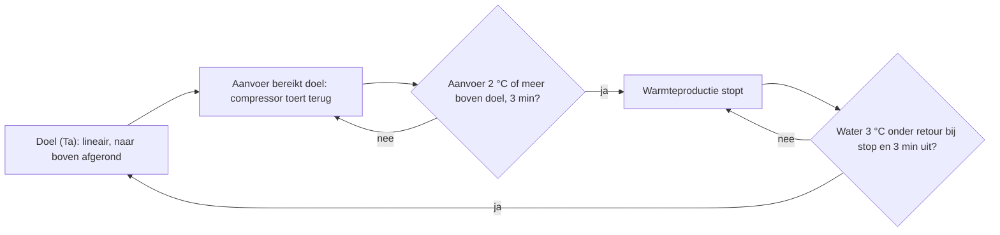

Hoe de Panasonic Aquarea de [stooklijn](../general/heating-curve.md) en de
kamerthermostaat gebruikt.

## Hoe de stooklijn wordt toegepast

- De warmtepomp rekent de doeltemperatuur (Ta) lineair uit tussen de twee punten en
  **rondt naar boven af**. Uitkomst 28,05 °C → doel 29 °C. De aanvoer ligt daarom vaak
  1 à 2 °C boven wat u verwacht.
- Bij het doel toert de compressor terug. Komt de aanvoer 2 °C of meer boven het doel,
  voor 3 minuten, dan stopt de warmteproductie.
  Voorbeeld: doel 30 °C → op 31 °C toert hij af naar minimum → na 3 min op 32 °C stopt hij.
- Hij start weer als de watertemperatuur 3 °C onder de retourtemperatuur bij het stoppen
  ligt en hij minstens 3 minuten uit is geweest.

- Met de **shift** verschuift u de stooklijn van −5 tot +5 °C, op de afstandsbediening, in
  de cloud of met HeishaMon.

### Minimaal vermogen in de praktijk

De datasheets noemen geen minimaal vermogen. Met een stooklijn zijn deze waarden realistisch:

| Model | Minimaal vermogen |
|---|---|
| `WH-MDC05H3E5` | 1400 W |
| `WH-MDC07H3E5`, `WH-MDC05J3E5`, `WH-MDC07J3E5`, `WH-MDC09J3E5` | 2500 W |

### Bronnen

- [ercolano, 2024-11-28](https://gathering.tweakers.net/forum/list_message/80862806#80862806): lineaire berekening, afronden naar boven
- [Cr3ator, 2024-11-28](https://gathering.tweakers.net/forum/list_message/80862926#80862926): afregelen en stoppen rond het doel
- [twain4me, 2023-03-13](https://gathering.tweakers.net/forum/list_message/74751460#74751460): topicstart, stop- en startregels, tabel minimaal vermogen
- [blb4, 2024-03-02](https://gathering.tweakers.net/forum/list_message/78317946#78317946): shift −5/+5

## Valse stops door de buitentemperatuur

De warmtepomp middelt de buitentemperatuur niet. Stijgt de buitentemperatuur 1 °C, dan
daalt het doel direct. De warmtepomp kan dan stoppen terwijl de kamer nog niet warm is.
Oplossingen:

- Maak de stooklijn vlakker.
- Gebruik een externe kamerthermostaat (zie hieronder).
- Compenseer met een HeishaMon-rule: verhoog de shift als het doel daalt door de
  buitentemperatuur. Zie de [HeishaMon-documentatie](https://github.com/Egyras/HeishaMon).

### Bronnen

- [wheli, 2024-03-02](https://gathering.tweakers.net/forum/list_message/78317820#78317820): stop na stijging buitentemperatuur
- [blb4, 2024-03-05](https://gathering.tweakers.net/forum/list_message/78348238#78348238): compensatie met shift via HeishaMon
- [ercolano, 2024-03-02](https://gathering.tweakers.net/forum/list_message/78318160#78318160): vlakkere stooklijn, externe thermostaat
- [ErikVers, 2024-03-02](https://gathering.tweakers.net/forum/list_message/78319782#78319782): externe thermostaat aanbevolen

## Kamerthermostaat

De afstandsbediening kan als kamerthermostaat werken, maar heeft nadelen:

- Alle temperaturen worden afgerond. De schakelbreedte is daardoor 1 °C: bij 20 °C
  ingesteld gaat hij uit op 21 °C en weer aan op 19 °C (dit is 19,0 tot 19,99 °C).
- Hij past een *compensation curve* toe op basis van de kamertemperatuur. U kunt die niet
  uitzetten.

- De sensor van de afstandsbediening zit rechts onder in het scherm. Lichaamswarmte van
  iemand die er vlak voor staat, beïnvloedt de meting. Dit herstelt na enkele minuten.
  Een wijziging van de thermostaatcorrectie met 0,5 °C kan zo toch een veel groter effect
  tonen.
- De Zone1-waarde *Actual temperature* in de cloud heeft een resolutie van 0,5 °C. De
  waarde *RC-1: Room thermostat internal sensor temperature* en het display zijn naar
  beneden afgerond op hele graden.

**Meningen verschillen.**

Het display toont hele graden. Eén gebruiker zegt dat het afrondt naar de dichtstbijzijnde
graad (21,6 wordt 22). Een ander zegt dat het naar beneden afrondt. De nauwkeurigheid van de
sensoren zelf is niet bekend.

Wilt u op de [stooklijn](../general/heating-curve.md) sturen in plaats van op de
kamertemperatuur? Kies dan op de afstandsbediening *Systeeminstellingen → Zone & sensor →
Sensor* op *Watertemperatuur*. Staat de sensor nog op ruimtethermostaat, dan verwarmt de
unit niet zolang de kamer boven het setpoint blijft. Na de wissel is de afstandsbediening
geen thermostaat meer. U kunt dan de stooklijn verschuiven (−5 tot +5), ook met de weektimer,
bijv. voor een lagere of hogere stand bij wisselende energieprijzen.

Met de watersensor staat de warmtepomp altijd aan. Dat gaat goed als stooklijn en afgifte
passen bij het warmteverlies. Anders kan het te warm worden. Een externe thermostaat is
dan een optie.

Een externe thermostaat geeft alleen een aan/uit-signaal. De warmtepomp en de cloud kennen
het setpoint en de kamertemperatuur dan niet. De cloud kan die temperatuur dus niet tonen.
Alleen als de installateur de afstandsbediening in de kamer hangt en als interne
thermostaat instelt, ziet u de kamertemperatuur in de cloud en verdwijnt de shift van ±5.
De HACS-integratie werkt via de cloud en kan daarom hetzelfde als de app. Een lokaal
alternatief is HeishaMon, zie [HeishaMon](control/heishamon.md).

Een externe thermostaat met een kleinere, instelbare schakeldrempel werkt beter.
Er zijn twee aansluitingen:

| | `CN4` (externe bediening) | `CN2` (externe thermostaat) |
|---|---|---|
| Spanning | Zwakstroom, UTP-kabel mogelijk | 230 V, dikkere kabel en geschikte thermostaat |
| Effect | Schakelt de warmtepomp uit, zoals de aan/uit-knop | Schakelt alleen de warmte-/koelvraag |
| Tapwater | Ook geen SWW meer | SWW blijft werken |
| Shift | Blijft beschikbaar | Niet beschikbaar |

Bij `CN4` moet de instelling *External control* aan staan.

**Let op: 230 V op `CN2`.**

Op `CN2` staat netspanning. Gebruik een thermostaat en kabel die geschikt zijn voor 230 V.

### Bronnen

- [twain4me, 2023-03-13](https://gathering.tweakers.net/forum/list_message/74751460#74751460): topicstart, *Kamerthermostaat*, verschillen `CN2`/`CN4`
- [ErikVers, 2024-03-02](https://gathering.tweakers.net/forum/list_message/78319782#78319782): compensation curve is niet uit te zetten
- [FransvWoerkom, 2026-10-18](https://gathering.tweakers.net/forum/list_message/86378812#86378812): sensor wisselen via *Zone & sensor*
- [PappleD, 2026-10-19](https://gathering.tweakers.net/forum/list_message/86379036#86379036): sensor stond op ruimtethermostaat, unit verwarmde niet
- [FransvWoerkom, 2026-10-19](https://gathering.tweakers.net/forum/list_message/86386104#86386104): shift ook met de weektimer
- [RichieB, 2026-10-26](https://gathering.tweakers.net/forum/list_message/86432924#86432924): shift is een tijdelijke correctie van max ±5
- [Thorsd, 2026-10-26](https://gathering.tweakers.net/forum/list_message/86433060#86433060): met externe thermostaat geen shift
- [FransvWoerkom, 2026-10-26](https://gathering.tweakers.net/forum/list_message/86437272#86437272): externe thermostaat is aan/uit; interne thermostaat in de kamer; HACS via cloud
- [Tinkerer84, 2026-10-26](https://gathering.tweakers.net/forum/list_message/86437090#86437090): watersensor: warmtepomp altijd aan
- [ErikVers, 2026-10-27](https://gathering.tweakers.net/forum/list_message/86445632#86445632): sensor rechtsonder; lichaamswarmte; display per graad
- [FransvWoerkom, 2026-10-28](https://gathering.tweakers.net/forum/list_message/86448654#86448654): resolutie 0,5 °C in de cloud; display naar beneden afgerond

## Backup heater bij het ontdooien

Daalt de retourtemperatuur (Tr) onder 27 °C, dan gebruikt de warmtepomp de backup heater
bij het ontdooien (COP 1). Boven 27 °C haalt hij de energie uit het cv-water. Twee knoppen
houden de Tr hoger: de stooklijn en de ΔT van de waterpomp. Voorbeeld: Ta 33 °C bij 3 °C
buiten en ΔT 5 geeft Tr 28 °C.

**Meningen verschillen.**

- Ook met Tr 28 °C kan de heater bijschakelen als de Tr tijdens het ontdooien onder
  27 °C zakt, bijv. bij een klein seriebuffervat.
- Bij een T-CAP met veel vloerverwarming kost Tr boven 27 °C zoveel vermogen dat het huis
  te warm wordt. Ontdooien met COP 1 is dan de betere keuze.
- Een gebruiker zag bij Tr 26 °C en 11 ontdooicycli de heater nooit aangaan.

Zie ook [storingen: ontdooien](troubleshooting.md#ontdooien-h65-h75).

### Bronnen

- [Thorsd, 2023-11-29](https://gathering.tweakers.net/forum/list_message/77336830#77336830): grens Tr 27 °C, stooklijn en ΔT
- [blb4, 2023-11-29](https://gathering.tweakers.net/forum/list_message/77337018#77337018): heater ook bij Tr-daling tijdens ontdooien
- [ConQuestador, 2023-11-29](https://gathering.tweakers.net/forum/list_message/77337116#77337116): T-CAP, Tr 27+ niet altijd haalbaar
- [nokiaan958GB, 2023-11-30](https://gathering.tweakers.net/forum/list_message/77348768#77348768): heater niet aan bij Tr 26 °C

## Sturen op minimaal vermogen (HeishaMon)

Met HeishaMon kunt u de warmtepomp langer op minimaal vermogen laten draaien. Dit geeft
langere runs, een hogere COP en minder pendelen:

1. Start de warmteproductie: zet het doel 3 °C boven de retourtemperatuur.
2. Zodra de compressor draait: zet het doel 1 °C onder de huidige watertemperatuur.
3. Herhaal dit tot de kamer op temperatuur is.

Gebruik dit alleen boven de buitentemperatuur waarbij het minimale vermogen groter is dan de
warmtevraag. Zie de [HeishaMon-documentatie](https://github.com/Egyras/HeishaMon) voor rules.

### Bronnen

- [twain4me, 2023-03-13](https://gathering.tweakers.net/forum/list_message/74751460#74751460): topicstart, *Sturen op minimaal vermogen*
- [CurlyMo, 2022-08-22](https://gathering.tweakers.net/forum/list_message/72503648#72503648): automatische stooklijncorrectie en slow start

## Stille modus

De stille modus (*Quiet Mode*, QM 1 tot 3) begrenst de compressorfrequentie en het toerental
van de ventilator. De unit maakt minder geluid, maar levert ook minder vermogen. Volgens de
topicstart daalt het rendement. Met HeishaMon zet u de modus met `SetQuietMode`, zie
[HeishaMon](control/heishamon.md).

- **Zachtere start.** Zonder stille modus schiet de compressor bij de start door naar hoog
  vermogen. Het doel wordt snel overschreden en de unit stopt. Met QM3 start hij rustiger en
  blijft hij langer op laag vermogen draaien. Dit helpt vooral bij mild weer en bij een
  klein watervolume (bijv. 30 L).
- **Vermogen.** Gemeten voorbeelden: 1,2 kW opgenomen met QM tegen 2 kW zonder; 3,2 kW
  geleverd met QM3 tegen circa 5 kW met QM0.
- **Ventilator.** Op een 5 kW H-serie draaide de ventilator 200–250 r/min op QM3 en
  300–400 r/min op QM0.
- **Tapwater (SWW).** Op een 12 kW H-serie verlengt QM de SWW-run: 7 kW in minder dan een
  uur zonder QM, 4 kW in ruim 1,5 uur met QM2 of QM3. Op de J-serie zagen gebruikers geen
  verschil.

**Meningen verschillen: stille modus en ontdooien.**

- Meerdere gebruikers schrijven dat QM meer ontdooicycli geeft, door de lagere
  ventilatorsnelheid. Een hogere luchtsnelheid bij gelijk vermogen geeft minder
  ontdooicycli.
- Een ander verwacht juist minder cycli, omdat QM ook de compressor begrenst.
- Minder cycli per uur met QM komen ook door het lagere vermogen. Per opgewekte kWh
  blijft het aantal volgens een installateur gelijk of stijgt het iets.

Zie ook [Ontdooien](../general/defrost.md) en [Pendelen](../general/cycling.md).

### Bronnen

- [twain4me, 2023-03-13](https://gathering.tweakers.net/forum/list_message/74751460#74751460): topicstart, *Stilte modus*: compressor, ventilator, rendement, klein watervolume
- [FransvWoerkom, 2022-11-13](https://gathering.tweakers.net/forum/list_message/73448620#73448620): QM3 geeft een zachte start en lange runs op 20 Hz
- [FransvWoerkom, 2023-02-07](https://gathering.tweakers.net/forum/list_message/74387518#74387518): 12H pendelt bij 10 °C zonder QM3; effect op rendement onzeker
- [elgringo, 2023-02-07](https://gathering.tweakers.net/forum/list_message/74386780#74386780): 1,2 kW met QM, 2 kW zonder
- [Dre, 2026-01-03](https://gathering.tweakers.net/forum/list_message/84314384#84314384): 3,2 kW bij QM3, 5 kW bij QM0
- [t.oswald, 2021-12-04](https://gathering.tweakers.net/forum/list_message/69699772#69699772): 5H: ventilatortoerental bij QM3 en QM0
- [FransvWoerkom, 2022-10-26](https://gathering.tweakers.net/forum/list_message/73254716#73254716): 12H: SWW-run duurt langer met QM
- [sjimmie, 2022-10-29](https://gathering.tweakers.net/forum/list_message/73289524#73289524): J-serie: QM geen verschil bij SWW
- [blb4, 2024-01-12](https://gathering.tweakers.net/forum/list_message/77782522#77782522): QM begrenst compressor en ventilator; mogelijk meer ontdooicycli
- [ErikVers, 2026-02-06](https://gathering.tweakers.net/forum/list_message/84583910#84583910): QM geeft extra ontdooicycli
- [blb4, 2026-01-03](https://gathering.tweakers.net/forum/list_message/84314420#84314420): hogere luchtsnelheid, minder ontdooicycli
- [timovd, 2026-02-09](https://gathering.tweakers.net/forum/list_message/84605448#84605448): verwacht minder ontdooicycli met QM
- [ErikVers, 2026-01-04](https://gathering.tweakers.net/forum/list_message/84326736#84326736): minder cycli komt door minder vermogen

## Pompsnelheid en max duty

De circulatiepomp heeft twee standen in het installatiemenu:

- **ΔT.** De warmtepomp kiest zelf de pompsnelheid bij de ingestelde ΔT. Een kleinere ΔT
  geeft een snellere pomp. *Max duty* is dan een bovengrens.
- **Max duty.** De pomp draait altijd op de ingestelde duty.

*Max duty* is het maximale vermogen van de pomp, niet de flow. De flow hangt af van de
weerstand van het systeem. De controller toont de waarde **hexadecimaal**; HeishaMon
(`SetMaxPumpDuty`) gebruikt decimaal. Het bereik is 64–255 (`0x40`–`0xFF`), in stappen van
circa 0,4 %. Zoek de juiste waarde met proberen: wijzig de duty, wacht circa 5 seconden en
lees de flow af.

| Waarde | Wat gebruikers melden |
|---|---|
| `0x50` (80) | J-serie: laagste werkelijke duty. Lager instellen kan, maar heeft geen effect. Max volgens de service manual: `0xC5` |
| `0x5E`–`0x7D` (94–125) | Optimum op één installatie: 94 bij minimaal vermogen, 120 bij maximaal vermogen |
| `0x64` / `0x7D` (100 / 125) | Zonder HeishaMon: circa 100 boven het vriespunt, 125 eronder |
| `0xC0` (192) | Advies bij een te lage max duty: zet hem een stuk hoger |

- Een lagere flow geeft een grotere ΔT. Het water moet dan warmer zijn voor hetzelfde
  vermogen. Dat kost compressorvermogen. Het optimum ligt waar pompvermogen plus extra
  compressorvermogen het laagst is.
- **ΔT-stand tegen overshoot.** Een gebruiker meldt dat de pomp in de ΔT-stand start rond
  10 l/min en pas later versnelt. Het verschil tussen Ta en Tr wordt dan groter (hier soms
  10 °C tijdens de start). De compressor gaat dan eerder terug in toerental. Een vaste
  hoge max duty geeft juist overshoot. Zie [Pendelen](../general/cycling.md).
- **Ontdooien negeert max duty.** De pomp gaat dan naar circa 30–32 l/min.
- **Dynamische pompsnelheid.** Met HeishaMon kunt u de max duty laten volgen op de
  buitentemperatuur of de compressorfrequentie. Zet de pomp dan op *max duty*, niet op ΔT.
  Zie het voorbeeld in [HeishaMon: rules](control/heishamon.md#rules).

**Meningen verschillen: max duty en SWW.**

- Een gebruiker zag een SWW-run op 35 Hz bij max 12 l/min. Met een hogere max duty liep
  de run op 75 Hz. Met een lage max duty kunt u volgens hem SWW op laag vermogen maken.
- Een ander ziet de flow bij een *Force DHW*-run ruim boven de ingestelde max uitkomen.

Voor flowstoringen, zie [Storingen: `H62`](troubleshooting.md#water-en-flow-h62-h20).

### Bronnen

- [twain4me, 2023-03-13](https://gathering.tweakers.net/forum/list_message/74751460#74751460): topicstart, *Optimale pompsnelheid*: ΔT-stand, tabel, 100/125, dynamische pump duty
- [Heronimo, 2021-02-16](https://gathering.tweakers.net/forum/list_message/66180766#66180766): stand max duty: vaste duty, flow hangt af van weerstand
- [Thorsd, 2023-12-03](https://gathering.tweakers.net/forum/list_message/77388144#77388144): duty is hexadecimaal, niet de flow, stappen van 1/255
- [Aikon, 2023-12-03](https://gathering.tweakers.net/forum/list_message/77387916#77387916): bereik 64–255, controller toont hex
- [vandermark, 2021-12-23](https://gathering.tweakers.net/forum/list_message/69959126#69959126): flow opzoeken door de duty te wijzigen
- [rickp70, 2022-02-28](https://gathering.tweakers.net/forum/list_message/70774770#70774770): J-serie: minimum `0x50`, max `0xC5`
- [FransvWoerkom, 2025-12-22](https://gathering.tweakers.net/forum/list_message/84240960#84240960): max duty hoger, bijv. `0xC0`
- [thehog, 2021-02-15](https://gathering.tweakers.net/forum/list_message/66159696#66159696): ontdooien negeert max duty, 32 l/min
- [sjimmie, 2021-02-09](https://gathering.tweakers.net/forum/list_message/66074886#66074886): max 15 l/min, bij ontdooien 30 l/min
- [dlrozendaal, 2024-10-16](https://gathering.tweakers.net/forum/list_message/80415276#80415276): pomp volgt compressorfrequentie; stand max duty
- [ercolano, 2026-10-28](https://gathering.tweakers.net/forum/list_message/86451310#86451310): ΔT-stand start laag en geeft grotere Ta–Tr; QM3 als tijdelijke oplossing
- [blb4, 2023-03-27](https://gathering.tweakers.net/forum/list_message/74885816#74885816): lage max duty beperkt SWW-vermogen
- [padoempats, 2023-03-27](https://gathering.tweakers.net/forum/list_message/74886608#74886608): flow bij *Force DHW* boven ingestelde max

## Tapwater-instellingen

Algemene regels over SWW staan op [Tapwater](../general/hot-water.md). Panasonic-specifiek:

- **DHW capacity** (*System setup → DHW capacity*, J-serie en nieuwer). *Standaard*: eerst
  vol vermogen tot de maximale aanvoer (57 °C bij een gebruiker met 9 kW), daarna hogere flow en
  dalend vermogen. *Variabel*: niet het volle vermogen, dus minder geluid, bijv. 's nachts. Volgens de
  handleiding verwarmt *Variabel* de tank snel op en houdt hij de temperatuur daarna efficiënt
  vast; *Standaard* verwarmt met het nominale vermogen. De optie is er alleen als de
  tankaansluiting (*Tank connection*) op *YES* staat.
  Bij `F12` adviseerde een Panasonic-monteur *standaard*, zie
  [Storingen](troubleshooting.md#koelcircuit-en-compressor-f12-f14).
- **Smart DHW** (J-serie): de tank overdag binnen een band van 5 °C houden. De H-serie kent
  alleen setpoint, ΔT en een tijdvenster.
- **Overname door het element.** Vanaf 53 °C tank verwarmt het element (tankheater of backup
  heater) verder; zie [Tankheater](hardware/backup-heater.md#tankheater-booster-heater).
- **Timer.** In de weektimer kiest u per blok verwarmen/koelen en tank, apart of samen.
  Alternatief: laat de modus altijd op *Heat+DHW* en verlaag met de timer alleen het
  SWW-doel. Lager dan 40 °C kan niet.
- **DHW defrost** (*Force DHW → DHW-defrost*, L-serie; K-serie gemeld). *Ja*: de unit
  ontdooit uit het SWW-vat. Bij koud, vochtig weer gaf dat bij een gebruiker een kringloop
  van ontdooien en vat opwarmen; met de vloer en een buffervat ging het beter. De afweging
  staat op [Tapwater en ontdooien](../general/hot-water.md#tapwater-en-ontdooien).

### Bronnen

- [Thorsd, 2023-03-12](https://gathering.tweakers.net/forum/list_message/74738364#74738364): *System setup → DHW capacity*, gedrag bij *standaard* (handleiding)
- [FransvWoerkom, 2024-06-25](https://gathering.tweakers.net/forum/list_message/79377300#79377300): H-serie timer; Smart DHW en DHW capacity bij J
- [Thorsd, 2024-10-08](https://gathering.tweakers.net/forum/list_message/80346682#80346682): DHW capacity verlaagt het opwarmvermogen
- [nMad, 2026-06-24](https://gathering.tweakers.net/forum/list_message/85553244#85553244): monteur zet DHW capacity op standaard
- [FransvWoerkom, 2024-06-18](https://gathering.tweakers.net/forum/list_message/79314712#79314712): vanaf 53 °C de heater
- [FransvWoerkom, 2024-08-06](https://gathering.tweakers.net/forum/list_message/79770652#79770652): timer: heat/cool en tank apart of samen
- [Thorsd, 2023-01-06](https://gathering.tweakers.net/forum/list_message/74044656#74044656): altijd Heat+DHW, SWW-doel via timer, min 40 °C
- [Stellar, 2025-12-23](https://gathering.tweakers.net/forum/list_message/84248806#84248806): L-serie: *Force DHW → DHW-defrost*
- [rvdgaag, 2025-12-24](https://gathering.tweakers.net/forum/list_message/84249598#84249598): kringloop ontdooien en SWW
- [mbrunek, 2024-11-04](https://gathering.tweakers.net/forum/list_message/80608076#80608076): K7 ontdooit over het SWW-vat
- [ErikVers, 2024-12-27](https://gathering.tweakers.net/forum/list_message/81141448#81141448): keuze DHW defrost ja/nee vanaf de L-serie

## Sterilisatie

De sterilisatierun (anti-legionella) stelt u in op de controller onder
*Installer → Operation → Tank → Sterilization* (Nederlands: *Bedrijfsinstellingen → Tapwater
→ Sterilisatie*). In de Service Cloud kunt u de sterilisatie niet plannen. U kiest de dag,
het tijdstip, de temperatuur en de houdtijd: hoe lang het vat op temperatuur blijft
(5 minuten tot 1 uur, *Ster. max time*).

Verloop en voorwaarden:

- De compressor verwarmt tot 53 °C. Daarna neemt het element het over tot het doel, bijv.
  65 °C. Welk element en welke menu's, zie [Backup heater](hardware/backup-heater.md).
- De *Operating Mode* moet DHW bevatten (*Heat+DHW*, *Cool+DHW*). Zonder DHW komt het
  element niet in.
- De run stopt bij succes, na 8 uur proberen of als de tankmodus stopt. Een weektimer die
  tijdens de run de tankmodus uitzet, breekt de run dus af.
- Haalt de run het doel niet? Mogelijke oorzaken: groot vat, veel tapwater tijdens de run,
  slecht aangesloten element, maximaalthermostaat te laag.

**Let op: Legionella.**

Een afgebroken run desinfecteert het vat niet. Controleer na de run dat het doel is
gehaald. Zie [Legionella](../general/legionella.md).

Bekend probleem (J-serie met externe tankheater): na een ontdooicyclus met de backup heater
ging de tankheater niet meer aan, als *doel − DHW-delta* boven de tanktemperatuur lag. Een
gebruiker met een vast SWW-venster in de middag heeft er minder last van: dan zijn er minder
ontdooicycli.

### Bronnen

- [FransvWoerkom, 2026-02-10](https://gathering.tweakers.net/forum/list_message/84614868#84614868): *Installer → Operation → Tank → Sterilization*
- [FransvWoerkom, 2024-03-18](https://gathering.tweakers.net/forum/list_message/78484702#78484702): *Bedrijfsinstellingen → Tapwater → Sterilisatie*
- [Draakje5, 2024-03-19](https://gathering.tweakers.net/forum/list_message/78485718#78485718): niet te plannen via de Service Cloud
- [FransvWoerkom, 2022-07-12](https://gathering.tweakers.net/forum/list_message/72121380#72121380): dag, tijd, temperatuur, houdtijd 5 min–1 uur
- [FransvWoerkom, 2026-10-14](https://gathering.tweakers.net/forum/list_message/86352454#86352454): *Ster. max time*; compressor stopt bij 53 °C
- [cerebrum, 2024-07-26](https://gathering.tweakers.net/forum/list_message/79672548#79672548): Operating Mode moet DHW bevatten
- [FransvWoerkom, 2023-09-17](https://gathering.tweakers.net/forum/list_message/76553654#76553654): stopt na succes, 8 uur of einde tankmodus
- [FransvWoerkom, 2025-10-28](https://gathering.tweakers.net/forum/list_message/83789662#83789662): stop na 8 uur; oorzaken, weektimer
- [Pejdref, 2026-01-20](https://gathering.tweakers.net/forum/list_message/84454584#84454584): J-serie: tankheater blijft uit na ontdooien
- [Ethirty, 2026-01-20](https://gathering.tweakers.net/forum/list_message/84459124#84459124): vast SWW-venster, minder last

## Power Off en Thermo Off

De Service Cloud toont op het statusscherm *Power Off* of *Thermo Off*:

- **Thermo Off**: er is warmtevraag, maar de compressor staat uit, bijv. omdat het water warm
  genoeg is. Thermo aan/uit komt neer op compressor aan/uit.
- **Power Off**: de warmtepomp staat uit, bijv. door *OFF* in de weektimer. Een lager
  kamersetpoint geeft *Thermo Off*.

Let op het verschil als u de warmtepomp 's nachts uitzet, zeker met een thermostaat op `CN4`
(die werkt als de aan/uit-knop). Bij een M-serie in een stand-alone opstelling kan de
vorstbeveiliging starten als de unit niet draait. Hoe u de weektimer instelt en activeert,
staat bij [Cloud: weektimers](control/cloud.md#weektimers).

### Bronnen

- [Pejdref, 2024-12-03](https://gathering.tweakers.net/forum/list_message/80911308#80911308): Thermo Off = compressor uit bij warmtevraag
- [FransvWoerkom, 2025-11-17](https://gathering.tweakers.net/forum/list_message/83958946#83958946): weektimer OFF of lager setpoint; let op bij `CN4`
- [ErikVers, 2025-11-17](https://gathering.tweakers.net/forum/list_message/83962834#83962834): M-serie: vorstbeveiliging als de unit niet draait

## Force defrost

De instelling *Force Defrost* staat bij de monoblock onder *Installer Setup → System setup*.
U komt er alleen bij als de warmtepomp uit staat.

- **Auto**: de unit ontdooit volgens een tijdschema onder een bepaalde temperatuur, ook als
  het niet nodig is.
- **Manual**: de unit ontdooit alleen als het echt nodig is. Dit is het advies.

Een gebruiker met een J-serie had op *Auto* meerdere ontdooicycli per ochtend bij RH boven
80 % en minder dan 6 °C. Na de wissel naar *Manual* had hij die niet meer. In de Service Cloud
en bij de L-serie heet de optie *Ontdooi forceren* met de keuze *-* of *Aanvraag* (*request*);
het topic geeft niet aan wat die keuze doet.
Volgens de handleiding start de unit op *Auto* een geforceerde ontdooiing na 3 uur draaien
zonder ontdooicyclus bij een buitentemperatuur onder 5 °C. Zie ook [Ontdooien](../general/defrost.md).

### Bronnen

- [cerebrum, 2026-01-04](https://gathering.tweakers.net/forum/list_message/84321840#84321840): *Installer Setup → System setup → Force Defrost*, op MANUAL, unit uit
- [ErikVers, 2024-11-19](https://gathering.tweakers.net/forum/list_message/80758190#80758190): Auto ontdooit op tijdschema
- [ErikVers, 2024-11-19](https://gathering.tweakers.net/forum/list_message/80758090#80758090): force defrost niet op auto
- [cerebrum, 2024-11-19](https://gathering.tweakers.net/forum/list_message/80757786#80757786): van Auto naar Manual, geen extra ontdooicycli meer; geforceerd ontdooien na 3 uur bij < 5 °C (handleiding)
- [MisterMailman, 2024-11-19](https://gathering.tweakers.net/forum/list_message/80758126#80758126): Service Cloud: *Ontdooi forceren*, *-* of *Aanvraag*
- [Joricobussen, 2026-01-04](https://gathering.tweakers.net/forum/list_message/84325724#84325724): L-serie: keuze *-* of *request*

## Externe thermostaat en shift

Staat de warmtepomp op *Externe thermostaat* (`CN2`), dan is de shift niet beschikbaar. Ook
via HeishaMon werkt de shift dan niet. De stooklijn zelf blijft werken. Een gebruiker bouwde
een eigen shift: hij verschuift met HeishaMon alle punten van de stooklijn tegelijk.

### Bronnen

- [sjimmie, 2021-01-26](https://gathering.tweakers.net/forum/list_message/65864178#65864178): geen shift met externe thermostaat; eigen shift via stooklijnpunten
