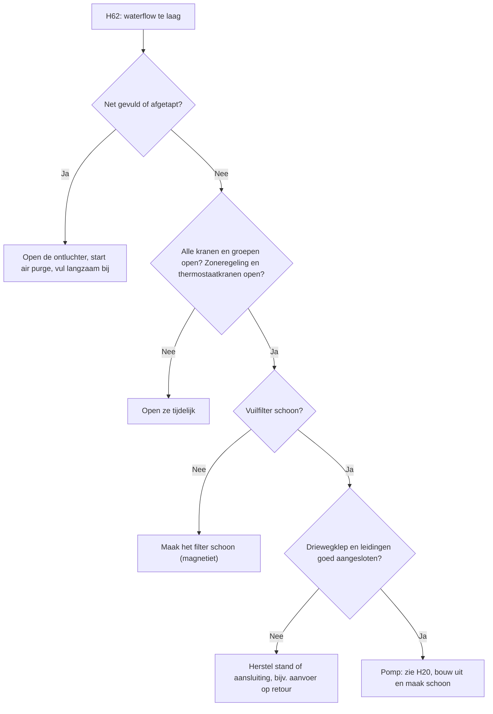

# Storingen en foutcodes

Panasonic Aquarea toont een storing als code op de afstandsbediening: `H..` of `F..`.
De service manual van uw model geeft per code een stappenplan. Deze pagina geeft de
oorzaken die in de praktijk het vaakst voorkomen.

!!! warning "Elektrische veiligheid"
    Sommige controles gebeuren op de printplaat. Daar staat netspanning op (bijv. 320 V op
    `CN-PUMP1`). Schakel de spanning uit voordat u stekkers of schroeven aanraakt.

## Overzicht

| Code | Betekenis | Eerst controleren |
|---|---|---|
| `H62` | Waterflow te laag | Lucht, dichte kranen of groepen, filter |
| `H20` | Circulatiepomp abnormaal | Vastgelopen pomp (magnetiet), lucht |
| `H65` | Circulatie tijdens ontdooien | Flow door secundaire pomp of lucht in buffervat |
| `H70` | Overbelastingsbeveiliging backup heater | Voeding backup heater, lucht in heater |
| `H75` | Ontdooien lukt niet | Backup heater uitgeschakeld, retour te koud |
| `H91` | Overbelastingsbeveiliging tankheater | Brug of droogkookbeveiliging op `CN6` |
| `H90` | Communicatie binnen–buiten | Datadraad en schroeven, netfilter |
| `H43`, `H67` | Sensor zone 1 ontbreekt | Instelling *Zone en sensor* |
| `H15` | Sensor compressor | Stekker of printplaat |
| `F12` | Hoge druk | SWW bij hoge buitentemperatuur, firmware |
| `F14` | Toerental compressor wijkt af | Stekkers compressor op inverterprint |

## Algemene eerste stappen

1. Noteer de code en wat de warmtepomp op dat moment deed (verwarmen, SWW, ontdooien).
2. Zet de storing op de afstandsbediening terug. Een melding kan ook komen door een
   instelling die u kort ervoor hebt gewijzigd. Kijk of de storing terugkomt.
3. Een fabrieksreset lost een hardwareoorzaak niet op. De storing komt dan terug.

## Water en flow: `H62`, `H20`

`H62` is de meest gemelde storing. Oorzaak is bijna altijd te weinig flow door de warmtepomp:

- **Lucht.** Vooral na de eerste start of na aftappen en opnieuw vullen. Kleine luchtbellen
  verdraagt de warmtepomp; `H62` komt pas na ongeveer een minuut lucht.
- **Dichte kringen.** Dichte groepen op de verdeler, dichte kranen of radiatoren die een zone­regeling
  dichtzet.
- **Driewegklep.** Verkeerde stand of verkeerd aangesloten. De pijl op sommige kleppen klopt niet.
- **Verkeerd aangesloten leidingen**, bijv. aanvoer op retour.
- **Vuil.** Magnetiet (zwarte drab) in het filter of in de circulatiepomp.

`H20` meldt dat de circulatiepomp niet goed draait. Een bekende oorzaak is een pomp die
vastzit door magnetiet. De pomp kunt u uitbouwen, openen en schoonmaken.

!!! warning "Hoge spanning"
    De pompstekker voert tot 373 V gelijkspanning. Laat metingen op de print over aan een
    installateur. Schakel de spanning uit voordat u een stekker los- of vastmaakt.

De service manual meet bij `H20` het toerental van de pomp (storing bij meer dan 6000 of minder
dan 1000 omw/min, 5 seconden lang). Het stappenplan controleert in deze volgorde:

1. Draait de pomp? Zo niet, controleer de stekker van de pomp.
2. Aandrijfspanning 280–373 Vdc (pin 1 en 4), stuurspanning 15 Vdc (pin 5 en 4) en
   stuursignaal 0–6 V (pin 6 en 4). Ontbreekt een van deze, dan is de printplaat defect.
3. Zijn alle spanningen goed en draait de pomp toch niet, dan is de pomp defect.

De handleiding noemt de stekker `CN-PUMP2`. Op een J-model zat hij op `CN-PUMP1`.

Oplossen:

1. Open de automatische ontluchter in de warmtepomp (het zwarte dopje los).
2. Start het ontluchtingsprogramma (*air purge*) in het servicemenu.
3. Vul tijdens het ontluchten water bij. De druk zakt als de lucht ontsnapt.
4. Vul langzaam. Maak het vuilfilter schoon. Controleer of alle kranen en groepen open staan.
5. Zet zoneregeling en thermostaatkranen tijdelijk open, zodat zij de flow niet blokkeren.

Beslisboom voor `H62`:

Druppelt de ontluchter na het ontluchten? Dan zit er vaak nog lucht in het systeem. Ontlucht
af en toe opnieuw en let op de druk. Druppelt hij na een paar dagen nog, dan kunt u hem
sluiten. Test dan wel af en toe op lucht op het hoogste punt en bij het magneetfilter.

!!! warning "Vorstbeveiliging"
    Bij `H62` werkt de vorstbeveiliging met de circulatiepomp niet meer. Los de storing in de
    winter snel op.

### Bronnen

- [FransvWoerkom, 2022-08-08](https://gathering.tweakers.net/forum/list_message/72367360#72367360): `H62` na een minuut lucht; bijvullen tijdens air purge
- [Tinkerer84, 2024-10-09](https://gathering.tweakers.net/forum/list_message/80347696#80347696): oorzaken `H62`: ontluchting, dichte verdelers
- [gazmask, 2024-10-09](https://gathering.tweakers.net/forum/list_message/80355250#80355250): aanvoer en retour verwisseld
- [ErikVers, 2022-03-02](https://gathering.tweakers.net/forum/list_message/70791408#70791408): lucht in nieuwe spiraal bij eerste start
- [koevlaas2, 2022-03-02](https://gathering.tweakers.net/forum/list_message/70801158#70801158): pijl op driewegklep klopt niet
- [bazzzzzz, 2024-05-12](https://gathering.tweakers.net/forum/list_message/78965128#78965128): `H20` door vastgelopen pomp; spanning op `CN-PUMP1` (handleiding, foto)
- [FransvWoerkom, 2024-05-12](https://gathering.tweakers.net/forum/list_message/78967846#78967846): magnetiet in pompmotor; filter, air purge
- [Thorsd, 2024-05-13](https://gathering.tweakers.net/forum/list_message/78969582#78969582): automatische ontluchter open zetten
- [FransvWoerkom, 2023-09-02](https://gathering.tweakers.net/forum/list_message/76405700#76405700): druppelende ontluchter, nog lucht in de leidingen
- [ErikVers, 2023-10-29](https://gathering.tweakers.net/forum/list_message/76998854#76998854): na een paar dagen sluiten; elders op lucht testen
- [FransvWoerkom, 2026-05-02](https://gathering.tweakers.net/forum/list_message/85181984#85181984): magnetiet; pomp uitbouwen en schoonmaken
- [mdi2022, 2023-10-18](https://gathering.tweakers.net/forum/list_message/76877988#76877988): fabrieksreset helpt maar enkele dagen
- [Tromp.et, 2025-11-17](https://gathering.tweakers.net/forum/list_message/83955324#83955324): vorstbeveiliging pomp werkt niet bij `H62`

## Ontdooien: `H65`, `H75`

`H65` (*deice circulation error*) volgt volgens de documentatie bij een flow van meer dan
5 l/min tijdens ontdooimodus 2. In die modus zet de warmtepomp de circulatiepomp uit.
Oorzaken:

- Een buffervat met T-stukken: de secundaire pomp blijft water door de warmtepomp duwen.
  Laat de warmtepomp de secundaire pomp aansturen; dan stopt die tijdens het ontdooien.
- Lucht in het buffervat. Lucht is samendrukbaar, dus het water blijft stromen als de pomp stopt.
- Een vuil filter of een vuile pomp.

`H75` volgt als het ontdooien niet lukt. Dit gebeurt vooral als de backup heater uit staat
en het retourwater te koud is (gemeld bij een retour van 18 °C; bij 20 °C ging het goed).

!!! note "Meningen verschillen"
    Volgens een gebruiker gebruikt een T-CAP de backup heater nooit voor het ontdooien.
    Een ander schrijft dat de backup heater tijdens het ontdooien wel bijspringt als de
    warmtewisselaar dreigt te bevriezen.

### Bronnen

- [Thorsd, 2023-11-26](https://gathering.tweakers.net/forum/list_message/77302382#77302382): `H65` bij > 5 l/min in deice-2; secundaire pomp
- [FransvWoerkom, 2024-01-21](https://gathering.tweakers.net/forum/list_message/77882334#77882334): lucht in buffervat
- [Heronimo, 2023-12-04](https://gathering.tweakers.net/forum/list_message/77401958#77401958): filters en pomphuis schoonmaken
- [KaDoos, 2023-01-17](https://gathering.tweakers.net/forum/list_message/74163122#74163122): `H75` bij Tr 18 °C zonder backup heater
- [flippy, 2023-01-17](https://gathering.tweakers.net/forum/list_message/74162210#74162210): T-CAP ontdooit zonder backup heater
- [FransvWoerkom, 2023-01-17](https://gathering.tweakers.net/forum/list_message/74165312#74165312): pomp uit in mode 2; backup heater bij bevriezingsgevaar

## Heaters: `H70`, `H91`

`H70` betekent: de overbelastingsbeveiliging (OLP) van de backup heater is onderbroken.
Dit gebeurt als u de voeding van de backup heater uitschakelt terwijl de heater in de
instellingen aan staat. Lucht in de heater geeft dezelfde code. Laat bij de eerste start
het ontluchtingsprogramma minstens 15 minuten draaien. Het scherm toont
*Back-up heater OLP error* met de keuzes *Close* en *Reset*.

Backup heater uitzetten zonder storing: doe dit in het menu, niet met de groep in de meterkast.

- Gebruikersmenu → *Functie instellen* → vrijgave backup heater, of
- het *Custom Menu*: hamburgerknop + pijl omlaag + pijl links, 5 tot 10 seconden vasthouden.
  De bronnen noemen 5 en 10 seconden.

!!! warning "Geen beveiliging meer"
    Een uitgeschakelde backup heater beschermt niet meer tegen bevriezing en helpt niet
    meer bij het ontdooien (zie `H75`). Alleen de circulatiepomp beschermt dan het water.

`H91` gaat over de beveiliging van de heater in het SWW-vat. Op de hoofdprint zit een
aansluiting voor een droogkookbeveiliging (`CN6-1` en `CN6-2`). Zonder aparte beveiliging
moet daar een draadbrug op.

### Bronnen

- [FransvWoerkom, 2026-01-05](https://gathering.tweakers.net/forum/list_message/84331184#84331184): `H70` = OLP onderbroken; uitzetten via menu
- [Cubico, 2026-01-04](https://gathering.tweakers.net/forum/list_message/84327864#84327864): toetscombinatie Custom Menu, 10 s; geen beveiliging meer
- [twain4me, 2023-03-13](https://gathering.tweakers.net/forum/list_message/74751460#74751460): topicstart, *Koelen*: Custom Menu, 5 s
- [Maestro, 2022-03-31](https://gathering.tweakers.net/forum/list_message/71108442#71108442): `H70` na uitschakelen groep backup heater
- [Phyc, 2022-12-02](https://gathering.tweakers.net/forum/list_message/73664976#73664976): minstens 15 min air purge tegen `H70` (screenshot)
- [Thorsd, 2023-02-02](https://gathering.tweakers.net/forum/list_message/74338944#74338944): `H91` en OLP van de tankheater
- [FransvWoerkom, 2023-06-19](https://gathering.tweakers.net/forum/list_message/75696494#75696494): droogkookbeveiliging op `CN6-1,2` of draadbrug

## Communicatie: `H90`

Binnen- en buitenunit communiceren over de voedingskabel. Bij een split zit de datadraad op
klem 5 van beide units. Bij een monoblock loopt de communicatie tussen de waterprint en de
koelprint over de interne 230V-bedrading.

- Controleer of de schroeven op de klemmen vast zitten (spanning eraf).
- Zet geen extra netfilter in de voedingskabel van de buitenunit.
- Een werkschakelaar tussen binnen- en buitenunit kan `H90` geven. Plaats een werkschakelaar
  liever voor de binnenunit.
- Een losse schroef in de werkschakelaar, samen met vocht, gaf `H90`. Controleer de klemmen
  in de werkschakelaar (spanning eraf).

### Bronnen

- [FransvWoerkom, 2023-11-20](https://gathering.tweakers.net/forum/list_message/77237378#77237378): datadraad op klem 5; schroeven aandraaien
- [FransvWoerkom, 2023-11-24](https://gathering.tweakers.net/forum/list_message/77292370#77292370): `H90` bij monoblock: waterprint–koelprint
- [FransvWoerkom, 2026-01-29](https://gathering.tweakers.net/forum/list_message/84526994#84526994): geen netfilter in voedingskabel
- [FransvWoerkom, 2023-11-21](https://gathering.tweakers.net/forum/list_message/77251594#77251594): werkschakelaar tussen units
- [koevlaas2, 2022-09-16](https://gathering.tweakers.net/forum/list_message/72806834#72806834): werkschakelaar geeft problemen
- [FransvWoerkom, 2023-11-24](https://gathering.tweakers.net/forum/list_message/77292642#77292642): losse schroef en vocht in werkschakelaar, `H90`
- [FransvWoerkom, 2024-12-12](https://gathering.tweakers.net/forum/list_message/81007714#81007714): draad los in werkschakelaar, met vocht

## Sensoren: `H43`, `H67`, `H15`, `F36`, `F37`, `F48`

`H43` en `H67` betekenen: de warmtepomp verwacht een sensor voor zone 1 die er niet is.
Dit is meestal een instelling, geen defect.

- `H43` met een aan/uit-thermostaat: zet zone 1 op *watertemperatuur*, niet op *ruimte*.
- `H67`: het buffervat staat aan in de instellingen, maar er zit geen watertemperatuursensor
  op de aanvoer van zone 1. Sluit de sensor aan of zet het buffervat uit in de instellingen.
- De Nederlandse handleiding zegt *Zone 1 systeem*, maar bedoelt *1-zonesysteem*.

`H15` is de compressorsensor (65 kΩ bij 20 °C). Klopt de weerstand, dan zit de fout in de
stekker of de printplaat. `F36` is de buitenluchtsensor. `F37` en `F48` gaan over sensors die
volgens sommige schema's ook op `CN-TH1` zitten.

### Bronnen

- [Gary199, 2022-09-19](https://gathering.tweakers.net/forum/list_message/72828272#72828272): `H43`/`H67`: sensor via zone 1 verwacht
- [hnq, 2022-09-18](https://gathering.tweakers.net/forum/list_message/72825850#72825850): zone 1 op watertemperatuur
- [Thorsd, 2024-12-03](https://gathering.tweakers.net/forum/list_message/80919534#80919534): `H67` door buffer zonder aanvoersensor
- [FransvWoerkom, 2023-02-17](https://gathering.tweakers.net/forum/list_message/74493038#74493038): vertaalfout *Zone 1 systeem*
- [PASware, 2023-10-13](https://gathering.tweakers.net/forum/list_message/76823800#76823800): `H15` en weerstandswaarde
- [ErikVers, 2023-10-14](https://gathering.tweakers.net/forum/list_message/76837482#76837482): `H15`: stekker of printplaat
- [FransvWoerkom, 2023-11-23](https://gathering.tweakers.net/forum/list_message/77277490#77277490): `F36`, `F37`, `F48` en `CN-TH1`

## Koelcircuit en compressor: `F12`, `F14`

`F12` (hoge druk) komt vooral voor bij SWW-bereiding op hete dagen en tijdens sterilisatie.
In één geval verdween de storing na een firmware-update door Panasonic en na het omzetten
van de DHW-capaciteit van *variabel* naar *standaard*.

`F14` betekent dat het toerental van de compressor niet past bij het signaal van de print.
Controleer de stekkers van de compressor op de inverterprint. Anders is de inverterprint
of de compressor defect.

### Bronnen

- [BarryH, 2026-06-18](https://gathering.tweakers.net/forum/list_message/85516188#85516188): `F12` bij SWW op hete dagen
- [nMad, 2026-06-24](https://gathering.tweakers.net/forum/list_message/85553244#85553244): firmware-update en DHW-capaciteit standaard
- [The-Source, 2024-07-09](https://gathering.tweakers.net/forum/list_message/79524252#79524252): `F12` tijdens sterilisatie
- [Carboy54, 2022-08-07](https://gathering.tweakers.net/forum/list_message/72360770#72360770): `F14`: oorzaken uit de handleiding
- [flippy, 2022-08-07](https://gathering.tweakers.net/forum/list_message/72364832#72364832): `F14`: stekkers inverterprint
